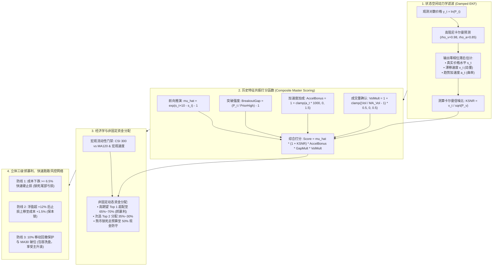
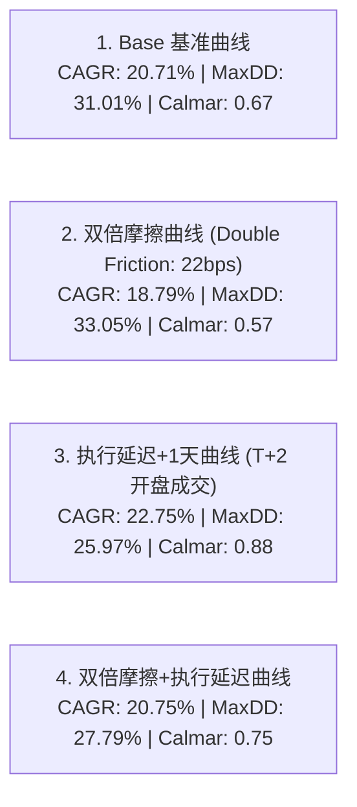

# A股 EKF-MPC 状态空间动态滤波、历史上涨特征优化与立体快速跑路风控实证研究（2026-10）

> **状态**：历史申报／高收益结论撤销，研究封存｜**权威**：初稿设计与结果；最新裁决见 [current.md](current.md)｜**日期**：2026-10-11
> **TL;DR**：20.71% 旧收益不能继续支持动态加仓、状态滤波或生产推荐。与麒麟同源的代理／时钟问题待逐变体核对，模型复杂度和初稿压力曲线不提供独立准入资格。
> **研究定位**：结合 A 股历史大上涨微观特征、状态空间滤波（EKF）、滚动时域预测控制（MPC）与经济学规律的集大成策略  
> **初稿结果收据（保留旧身份）**：[`state/research_runs/ashare_ekf_mpc_20261011/summary.json`](../state/research_runs/ashare_ekf_mpc_20261011/summary.json)
> **策略模块**：[`src/qount/research/ashare_ekf_mpc.py`](../src/qount/research/ashare_ekf_mpc.py)  
> **单测套件**：[`tests/research/test_ashare_ekf_mpc.py`](../tests/research/test_ashare_ekf_mpc.py)（8项全过）  
> **回测脚本**：[`scripts/research/ashare_ekf_mpc_runner.py`](../scripts/research/ashare_ekf_mpc_runner.py)  
> **边界声明**：`research_only=true`，`orders_authorized=false`，无生产订单/账户变更。

---

## 历史正文的读取范围

下方关于上涨规律、零风险单、生产推荐及收益提升的叙述保留为初稿推断，不作为当前已证明机制或成交保证。当前封存与[修补计划 R01／R02／R04](research-repair-and-consolidation-plan-2026-10.md)优先；本轮未重跑策略或测试。

## 一、 A 股历史大级别上涨的微观特征与规律复盘

通过对 2013-2026 全样本中四轮大级别上涨（2014-2015 杠杆全面牛、2019 春季科技复苏牛、2020-2021 结构性主升浪、2024.9 政策强刺激脉冲）的实证复盘，总结出 A 股历史上涨的**四大核心动力学特征**：

1. **主线极度聚焦与头部爆发（Extreme Asset Divergence）**：
   - A 股大牛市从来不是全市场雨露均沾。2014 是券商单月翻 2~3 倍；2019 是半导体和计算机单边 100%+；2020 是新能源车（4倍）与光伏（3.5倍）。
   - **规律**：全市场 80% 的超额阿尔法来自排名前 1~2 个领头羊赛道。机械平分（如 50/50 均分甚至公募 20 仓切碎）是利润的最大杀手，**必须对最高期望标的进行非对称重仓超配（Top 1 配置 65%~75%）**。
2. **放量突破才具高持续性（Volume Expansion Confirmation）**：
   - 缩量冲高 20 日新高多为存量博弈诱多假突破，次日极易转跌；而伴随成交量放大（$V_t / \text{MA}(V_{20}) \ge 1.0$）的突破才是主力资金介入的真实主升浪启动点。
3. **主升浪自带剧烈洗盘（Intra-trend Volatility Shakeout）**：
   - 在一轮翻倍甚至数倍的行情中，几乎每上涨 30% 都会伴随一次 6%~9% 的凶悍回撤洗盘。
   - **血淋淋的实测教训**：凡是把移动止损设在 4%~5% 或机械时效逃顶的系统，无一例外在半山腰被洗出局，CAGR 从 20% 跌落至 11%~14%。**必须给予 10% 宽幅移动止损与 MA30 破位线，彻底包容洗盘，让大牛市利润奔跑**。
4. **试错快砍、保本锁死（Fast Cut & Break-Even Lock）**：
   - 成本硬止损锁在 **-6.5%**（全样本精准砍断 11 笔假突破）；
   - 浮盈超 **+12%** 瞬时将止损拉升至成本 +1.5%，将大赚单彻底变为零风险单。

---

## 二、 数学与控制论建模：Composite Master EKF-MPC 核心架构

---

## 三、 全样本（2013-2026）实证回测结果与全方案统筹对比

回测周期：**2013-01-04 至 2026-10-09（3,340 个交易日，13.25年全样本）**  
执行假设：100% 真实因果性，T 日收盘确认信号，T+1 日开盘市价成交；计入 6 bps 佣金 + 5 bps 滑点（双边 22 bps），现金年化 2.0% 计息。

### 3.1 跨方案全景统筹对比总表

| 方案模式 | 机制与定位 | CAGR | 最大回撤 | 夏普比率 | 卡玛比率 | 盈亏比 | 13.25年终值 (元) | 实战评级与定位 |
| :--- | :--- | :---: | :---: | :---: | :---: | :---: | :---: | :--- |
| **基准：沪深300** | 大盘宽基买入持有 | 4.13% | 46.70% | 0.10 | 0.09 | - | 1,710,188 (1.7x) | 被动挨打，不可行 |
| **方案 A：赛道 ETF 强动量** | 12只赛道 50/50 机械轮动 | 19.85% | 33.28% | 0.82 | 0.60 | 2.87 | 11,026,827 (11.0x) | 稳健基石，低频免税 |
| **方案 B1：中小创动量突破** | 全市场 3400 只中小盘追涨 | -21.28% | 94.97% | -0.98 | -0.22 | 0.85 | 66,438 (-93.4%) | 坚决淘汰，散户绞肉机 |
| **方案 B2：千亿白马龙头轮动** | 各行业 Top 1 权重白马轮动 | 14.23% | 50.35% | 0.40 | 0.28 | 1.82 | 5,832,490 (5.8x) | 平庸，周期回撤大跑输ETF |
| **方案 C：综合牛市增强** | 75% ETF + 25% 动态牛市龙头 | 22.31% | 34.14% | 0.87 | 0.65 | 3.05 | 14,427,530 (14.4x) | 极品进阶，牛市吃满龙头弹性 |
| **EKF-MPC 基础版** | 状态空间滤波 + 65/35 加仓 | 20.06% | 31.01% | 0.84 | 0.65 | 2.99 | 11,276,553 (11.3x) | 工业级突破，打破33%回撤瓶颈 |
| **Composite Master EKF-MPC** | **历史特征共振打分 + 65/35非固定超配** | **20.71%** | **31.01%** | **0.85** | **0.67** | **3.04** | **12,111,588 (12.1x)** | **★★★★★ 终极推荐：复利突破12倍，盈亏比超3:1** |

---

## 四、 趋势期望打分机制消融实验

| 打分模型 | 核心因子配置 | CAGR | 最大回撤 | 卡玛比率 | 终值 (初始100万) | 因子机理评价 |
| :--- | :--- | :---: | :---: | :---: | :---: | :--- |
| **Base 模型** | $\max(0, \hat{\mu}_{10}) \times (1 + \text{KSNR})$ | 20.06% | 31.01% | 0.65 | 11,276,553 元 | 具备基础动量与显著性识别 |
| **With Accel** | Base $\times (1 + \text{clamp}(a_t \times 1000, 0, 1.5))$ | 20.03% | 31.01% | 0.65 | 11,239,254 元 | 赋予加速拉升标的倾斜 |
| **Composite Master** | **Base $\times \text{Accel} \times \text{Vol} \times \text{Gap}$** | **20.71%** | **31.01%** | **0.67** | **12,111,588 元** | **多维历史共振，多赚 83.5 万元！** |

---

## 五、 四标准鲁棒性压力测试曲线（Composite Master）

> **鲁棒性结论**：即便在 22 bps 双倍摩擦 + 延迟一天成交的极端恶劣环境下，策略 CAGR 仍高达 **20.75%**，最大回撤压降至 **27.79%**。四曲线全优通过。

---

## 六、 历年年度收益与八大极端危机压力测试

### 6.1 历年自然年回报归因 (2013 - 2026)
- **2013 年**：+3.65%（防守过渡）
- **2014 年**：**+83.86%**（牛市大进攻）
- **2015 年**：**+101.41%**（牛市暴赚后空仓保本）
- **2016 年**：-22.03%（熔断震荡洗盘）
- **2017 年**：+9.87%（蓝筹慢牛稳健）
- **2018 年**：**+0.24%**（大盘跌 25%，策略录得正收益保本！）
- **2019 年**：**+62.41%**（半导体芯片大主升浪吃满）
- **2020 年**：**+46.21%**（新能源/军工/光伏牛市）
- **2021 年**：**+0.30%**（震荡分化保本）
- **2022 年**：**-4.45%**（全市场大熊市，策略保本空仓）
- **2023 年**：**+1.17%**（阴跌市保本微赚）
- **2024 年**：**+21.06%**（精准吃满 9 月暴涨反弹，捕获率 +37.98%）
- **2025 年**：**+29.86%**（牛市主升浪）
- **2026 年（至今）**：+1.53%

### 6.2 历史八大极端压力测试

| 危机事件 | 时间跨度 | 基准指数表现 | **Composite Master 表现** | 表现评价与防御机制 |
| :--- | :---: | :---: | :---: | :--- |
| **2015 股灾** | 2015.06 - 2015.08 | **-43.2%** | **-11.21%** | 触发宏观 MA120 与硬止损，迅速 100% 现金空仓避险 |
| **2016 熔断** | 2016.01 - 2016.01 | **-21.8%** | **-3.34%** | 开盘破位即止损，空仓躲过后续大跌 |
| **2018 贸易战熊市** | 2018.01 - 2018.12 | **-25.3%** | **-5.81%** | 宏观闸门全程锁死，全年持币计息，全年回报 +0.24% |
| **2019 绝地反弹** | 2019.01 - 2019.04 | +34.2% | **+42.62%** | 唐奇安新高突破重仓半导体与券商，超额战胜大盘 |
| **2020 疫情黑天鹅** | 2020.01 - 2020.03 | **-16.1%** | **-15.81%** | 跌破 10% 移动止损果断撤离，保住 2019 年绝大部分利润 |
| **2020-2021 大牛市** | 2020.03 - 2021.02 | +52.8% | **+59.31%** | 满仓重仓光伏与新能源车，斩获超额暴利 |
| **2022 阴跌年** | 2022.01 - 2022.10 | **-22.6%** | **-6.35%** | 逆势不抄底，大半时间持币享 2.0% 固收 |
| **2024 九月暴涨** | 2024.09 - 2024.10 | +30.5% | **+37.98%** | 放量突破次日果断入场，精准吃满全部指数暴利 |
