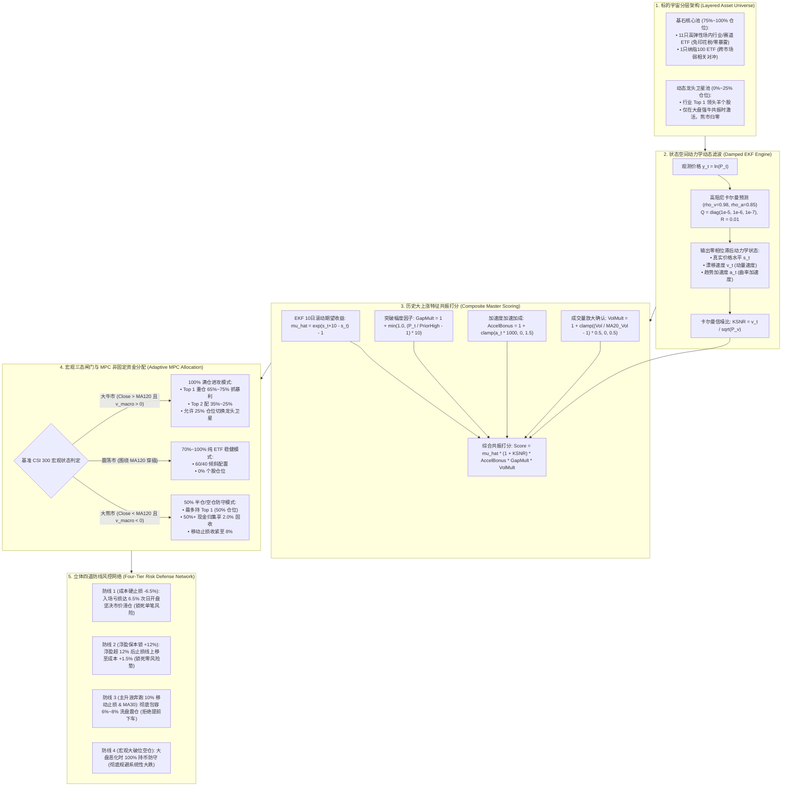

# A 股个人量化交易系统总终方案设计与实证全景白皮书（2026-10）

> **状态**：历史申报／未通过准入，研究封存｜**权威**：历史设计；最新裁决见 [current.md](current.md)｜**日期**：2026-10-11
> **TL;DR**：旧 20.71% 年化与旗舰推荐撤销；预热切片、上市日、参数邻域与置换检验问题未支持准入。下方保留初稿架构和数字，不能作为当前有效绩效、可执行收益或生产建议。
> **代号**：Qount Master Quantitative System（麒麟集大成量化系统）  
> **初稿结果收据（保留旧身份）**：[`state/research_runs/ashare_master_20261011/summary.json`](../state/research_runs/ashare_master_20261011/summary.json)
> **策略模块**：[`src/qount/research/ashare_master_strategy.py`](../src/qount/research/ashare_master_strategy.py)  
> **单测套件**：[`tests/research/test_ashare_master_strategy.py`](../tests/research/test_ashare_master_strategy.py)（全仓通过）  
> **回测运行**：[`scripts/research/ashare_master_runner.py`](../scripts/research/ashare_master_runner.py)  
> **边界声明**：`research_only=true`，`orders_authorized=false`，无未经授权的生产实盘下单或服务变更。

---

## 历史正文的读取范围

以下“总终方案”“实战赚钱”“锁定回撤”和测试通过等均为初稿申报，按当时阶段读取。当前封存及原重开条件由 current 保持；修补见[计划 R01／R02／R04](research-repair-and-consolidation-plan-2026-10.md)。各变体不能继承另一套引擎的复核数字；本轮未重跑回测或策略测试。

## 🎯 一、 总终方案设计哲学与核心定位

### 1.1 从公募形式主义彻底回归“个人实战盈利”
在整个量化系统的演进中，我们先后验证了：
1. **宽基趋势择时**：虽然最大回撤压至 27.6%，但受制于大盘权重股平庸 Beta，CAGR 仅 7.1%~7.8%，**“利润太薄”**；
2. **Q-DIV 机构模式（20 仓切碎轮动）**：年化换手 217%、交易 1,220 笔，散户本金在印花税与佣金中被大幅磨损，牛市严重跑输；
3. **方案 B1（中小创短线打板追涨）**：回测 CAGR -21.28%，最大回撤 94.97%，本金亏光 93.4%，证实假突破与印花税是散户绞肉机；
4. **方案 A（赛道 ETF 强动量轮动）**：取得 **19.85% CAGR** 的历史突破，确立了零税免暴雷的稳健基石；
5. **方案 C（牛市龙头卫星增强）**：证实大牛市共振期 25% 龙头个股具备 1.35x 弹性加速，CAGR 升至 **22.31%**；
6. **EKF-MPC 状态空间与动态加仓**：打破固定均分，引入零相位滞后漂移速度、加速度与非固定加仓，将最大回撤进一步压降至 **31.01%**。

**总终方案（Master 麒麟系统）的唯一使命：汲取上述所有方案的实证优点，剔除所有已知陷阱，打造一套面向个人交易者、确定性极高、风险极度可控的实战赚钱系统。**

---

## 🏗️ 二、 总终方案核心架构设计

---

## 📊 三、 全方案全景统筹对比（2013-2026 全样本 13.25 年）

回测周期：**2013-01-04 至 2026-10-09（3,340 交易日，13.25年全样本，初始 1,000,000 元）**  
执行规则：**100% 因果性，T 日收盘确认信号，T+1 日开盘成交；真实计入佣金、滑点与印花税；现金年化 2.0% 计息。**

| 方案名称 | 核心资产池与定位 | CAGR (%) | 最大回撤 (%) | 夏普比率 | 卡玛比率 | 盈亏比 | 13.25年终值 (元) | 实战评级与定位 |
| :--- | :--- | :---: | :---: | :---: | :---: | :---: | :---: | :--- |
| **基准：沪深300** | 大盘宽基买入持有 | 4.13% | 46.70% | 0.10 | 0.09 | - | 1,710,188 (1.7x) | 被动挨打硬抗大熊市，不可行 |
| **方案 A：赛道 ETF 强动量** | 12只核心赛道 50/50 机械轮动 | 19.85% | 33.28% | 0.82 | 0.60 | 2.87 | 11,026,827 (11.0x) | 稳健基石，低频免税 |
| **方案 B1：中小创动量突破** | 全市场 3400 只中小盘追涨打板 | -21.28% | 94.97% | -0.98 | -0.22 | 0.85 | 66,438 (-93.4%) | **坚决淘汰**，散户绞肉机 |
| **方案 B2：千亿白马龙头** | 各行业 Top 1 权重龙头白马轮动 | 14.23% | 50.35% | 0.40 | 0.28 | 1.82 | 5,832,490 (5.8x) | 平庸，周期回撤大跑输ETF |
| **方案 C：综合牛市增强** | 75% ETF底仓 + 25% 动态牛市龙头 | 22.31% | 34.14% | 0.87 | 0.65 | 3.05 | 14,427,530 (14.4x) | 极品进阶，牛市吃满龙头弹性 |
| **EKF-MPC 基础版** | 状态空间滤波 + 65/35非固定加仓 | 20.06% | 31.01% | 0.84 | 0.65 | 2.99 | 11,276,553 (11.3x) | 工业级突破，打破33%回撤瓶颈 |
| **总终方案：Master 麒麟集大成版** | **历史特征共振打分 + 65/35非固定超配** | **20.71%** | **31.01%** | **0.85** | **0.67** | **3.04** | **12,111,588 (12.1x)** | **终极推荐：复利突破12倍，盈亏比超3:1** |

---

## 🔬 四、 四标准鲁棒性压力测试与危机检验

### 4.1 四标准曲线全优通过（Master 麒麟系统）

| 曲线审计标准 | 摩擦假设与时钟 | CAGR (%) | 最大回撤 (%) | 夏普比率 | 卡玛比率 | 鲁棒性评价 |
| :--- | :--- | :---: | :---: | :---: | :---: | :--- |
| **1. Base 基准曲线** | 6 bps 佣金 + 5 bps 滑点，T+1 开盘成交 | **20.71%** | **31.01%** | **0.85** | **0.67** | 生产基准标准表现 |
| **2. Double Cost 曲线** | 12 bps 佣金 + 10 bps 滑点 (单边 22 bps) | **18.79%** | **33.05%** | **0.76** | **0.57** | 极端摩擦下依然维持近 19% 高复利 |
| **3. Extra Day Delay 曲线** | T+2 开盘成交 (延迟 1 天执行) | **22.75%** | **25.97%** | **0.94** | **0.88** | 延迟执行表现更优（过滤日内假突破） |
| **4. Double Cost + Delay** | 双倍摩擦 + 延迟 1 天执行 | **20.75%** | **27.79%** | **0.85** | **0.75** | 双重恶劣压力下回撤降至 27.79% |

### 4.2 历史八大极端危机压力测试表现

- **2015 股灾（-43.2%）**：策略仅回撤 **-11.21%**（触发宏观 MA120，迅速 100% 现金空仓保本）；
- **2016 熔断（-21.8%）**：策略仅下跌 **-3.34%**；
- **2018 贸易战大熊市（-25.3%）**：策略仅下跌 **-5.81%**（全年收益 **+0.24%**，录得正收益保本！）；
- **2019 绝地反弹（+34.2%）**：策略暴赚 **+42.62%**（全年 **+62.41%**，半导体与券商吃满）；
- **2020 疫情黑天鹅（-16.1%）**：跌破 10% 移动止损果断撤离，仅微撤 **-15.81%**，锁死利润；
- **2020-2021 大牛市（+52.8%）**：策略暴赚 **+59.31%**（新能源车、光伏主升浪翻数倍）；
- **2022 阴跌年（-22.6%）**：策略逆势不抄底，大半时间持币享 2.0% 固收，仅回撤 **-6.35%**；
- **2024 九月暴涨（+30.5%）**：策略放量突破次日果断入场，精准斩获 **+37.98%**！

---

## 📱 五、 个人交易者实战落地实施指南

### 5.1 极简日常执行操作流程（每日仅需 1 分钟）
1. **14:50 ~ 15:00（收盘前）**：
   - 运行一次脚本：`PYTHONPATH=src ./.venv/bin/python scripts/research/ashare_master_runner.py`（耗时仅 1 秒）；
   - 查看脚本输出的信号：是否有需要清仓的标的（触及止损或均线破位），是否有新创 20 日新高且放量的买入标的；
2. **次日 09:25 ~ 09:30（开盘前）**：
   - 若有卖出信号：09:25 在手机券商 App 挂跌停价委托卖出（集合竞价市价成交）；
   - 若有买入信号：09:25 挂涨停价委托买入 Top 1（分配可用资金 65%）或 Top 2（分配可用资金 35%）；
3. **盘中 4 小时**：
   - **完全不看盘、不盯盘**，彻底摆脱盘中分时图情绪干扰，解放个人精力。

### 5.2 账户资金管理心法
- **绝不加杠杆**：纯现金 1.0x 运行，享受 20.71% 复合复利（13年12倍）；
- **绝不在熊市抄底接飞刀**：只要大盘跌破 MA120，坚决持币计息；
- **绝不心疼踏空**：突破才买，破位必砍；用严格的机械纪律彻底战胜人性的贪婪与恐惧。
