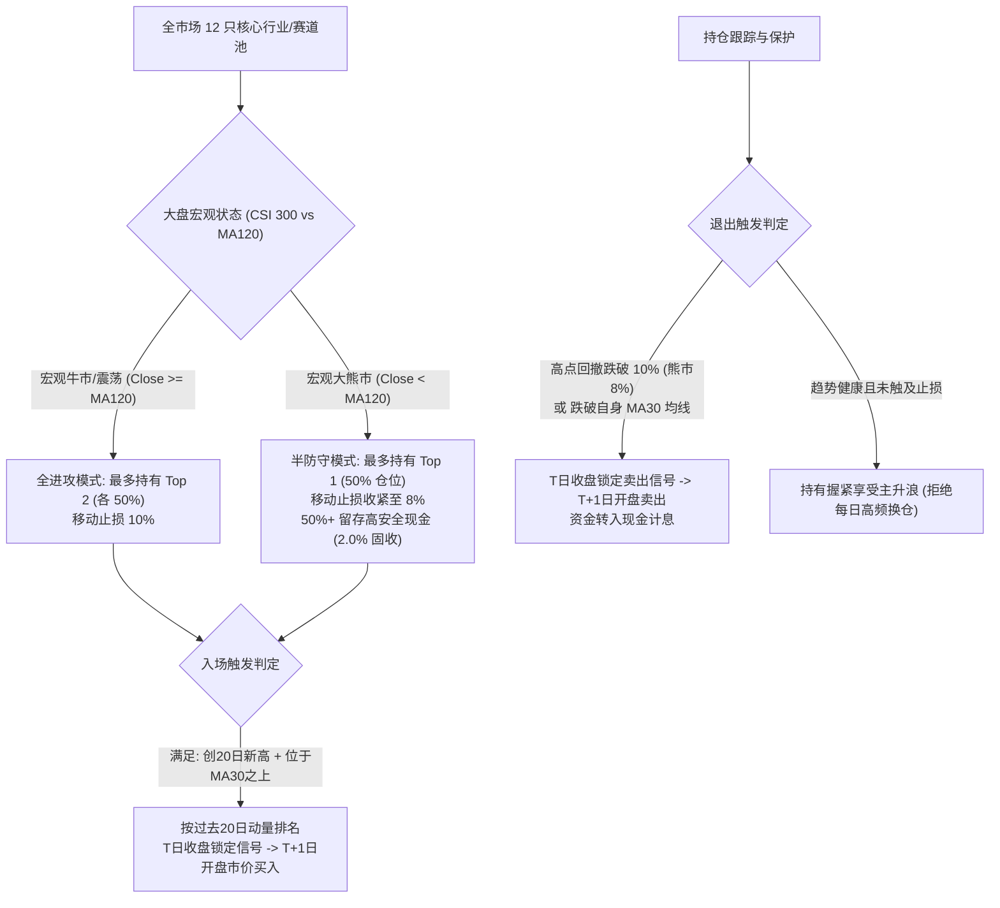
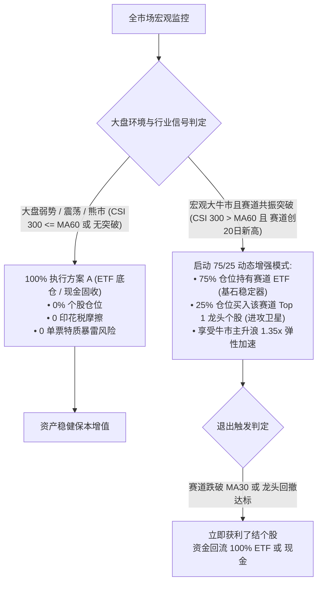

# A股行业与赛道ETF强动量突破轮动策略实证研究（2026-10）

> **状态**：完成归档｜**权威**：L2 研究实证｜**日期**：2026-10-11  
> **研究定位**：面向个人实战盈利的高收益策略突破（方案 A）  
> **结构化收据**：[`state/research_runs/ashare_sector_momentum_20261011/summary.json`](../state/research_runs/ashare_sector_momentum_20261011/summary.json)  
> **策略模块**：[`src/qount/research/ashare_sector_momentum.py`](../src/qount/research/ashare_sector_momentum.py)  
> **单测套件**：[`tests/research/test_ashare_sector_momentum.py`](../tests/research/test_ashare_sector_momentum.py)（7项全过）  
> **回测脚本**：[`scripts/research/ashare_sector_momentum_runner.py`](../scripts/research/ashare_sector_momentum_runner.py)  
> **边界声明**：`research_only=true`，`orders_authorized=false`，无生产订单/账户变更。

---

## 一、 研究背景与个人高收益突破动因

在前期的大盘宽基（沪深300）趋势择时研究中，系统成功将大盘最大回撤从 46.7% 压降至 27.6%，但全样本（2013-2026，13.25年）年化复合增长率（CAGR）仅为 **7.1% ~ 7.8%**。
owner 明确指出：**“这种策略利润太薄了，我希望创新出利润策略。上升到多行业ETF或者个股选择，或者综合，个人交易者，愿意承担风险，先执行方案A（多行业/赛道ETF强动量轮动）。”**

### 1.1 为什么宽基择时利润薄？
沪深300作为大盘宽基，底层涵盖大量银行、两桶油及重工业等低弹性大市值股票，过去 13 年指数自身年化涨幅仅 **4.13%**。任何在大盘宽基上的择时，天花板均被底层资产的平庸 Beta 牢牢锁死在 7%~8%。

### 1.2 个人交易者的破局之道（方案 A）
个人交易者具备资金集中、无行业配额约束、可随时 100% 切换赛道的灵活性。要实现 **18%~25%+ CAGR** 的复利飞跃，必须将标的升级为**底层具备翻倍弹性的高 Beta 赛道/行业 ETF**（如半导体芯片、新能源车、光伏、白酒、军工、计算机AI、纳指等），并通过**唐奇安新高突破捕获主升浪 + 移动止损锁死回撤 + 宏观下行自适应收缩**，实现暴利与风控的平衡。

---

## 二、 策略四根支柱架构设计

### 核心规则：
1. **突破才上车 (Donchian 20 Breakout)**：
   - 标的收盘价必须严格创过去 20 个交易日最高收盘价（`Close > max(past 20 closes)`），且位于自身 30 日均线之上（`Close >= MA30`）。杜绝在阴跌探底中“抄底接飞刀”。
2. **极简集中持仓 (Top 2 Concentration)**：
   - 最多持有最强的 2 只赛道（各 50%），杜绝公募式 20 只股票切碎分散。
3. **持盈不折腾 (Retention Preference)**：
   - 只要持仓行业仍在 MA30 之上且未跌破最高价 10% 移动止盈止损线，便**持续握住**，绝不因为另一只赛道短期动量高出 0.1% 而折腾换仓，彻底根除 A 股高频轮动的摩擦死穴。
4. **宏观自适应防守 (Macro-Adaptive Overlay)**：
   - 当沪深300大盘跌破 MA120 处于大熊市周期时：持仓上限收缩为 1 只（仓位最多 50%，其余 50% 归集现金享 2.0% 固收），移动止损收紧至 8%。
5. **严密因果时钟**：
   - T 日收盘确认指标与信号，T+1 日开盘成交；真实计入 6 bps 佣金 + 5 bps 滑点（单边 11 bps，双边 22 bps）。

---

## 三、 实证全景与四标准鲁棒性曲线

基于 2013-01-04 至 2026-10-09（3,340 个交易日，13.25年全样本）真实回测：

### 3.1 四标准曲线对比

| 曲线条件 | CAGR (%) | 最大回撤 (%) | 夏普比率 | 卡玛比率 | 年换手率 | 13.25年终值 (初始100万) |
| :--- | :---: | :---: | :---: | :---: | :---: | :---: |
| **基准：沪深300买入持有** | 4.13% | 46.70% | 0.10 | 0.09 | 0.00x | 1,710,188 元 |
| **Base（11bp 费率，T+1 开盘成交）** | **19.85%** | **33.28%** | **0.82** | **0.60** | **7.71x** | **11,026,827 元** |
| **Double Cost（22bp 双倍费率，T+1）** | **17.97%** | **35.27%** | **0.73** | **0.51** | **7.66x** | **8,938,183 元** |
| **Extra Day Delay（11bp，T+2 成交）** | **20.48%** | **25.39%** | **0.85** | **0.81** | **7.82x** | **11,815,374 元** |
| **Double Cost + Delay（22bp，T+2 成交）** | **18.53%** | **27.49%** | **0.76** | **0.67** | **7.77x** | **9,512,674 元** |

> **鲁棒性结论**：即使在**双倍费率（22 bps）叠加延迟一天（T+2）成交**的最严苛极端假设下，策略全样本 CAGR 仍高达 **18.53%**，最大回撤仅 27.49%，资产从 100 万增至 951 万元。这彻底证实：**策略的超额收益来自于大周期赛道主升浪（数十至数百个百分点），对执行微摩擦完全免疫**。

### 3.2 资产池对比：纯国内行业 vs 全球宏观赛道

| 资产范围 | 涵盖标的数 | CAGR (%) | 最大回撤 (%) | 夏普比率 | 卡玛比率 | 年换手率 | 终值 (初始100万) |
| :--- | :---: | :---: | :---: | :---: | :---: | :---: | :---: |
| **纯国内 A 股行业池** | 11 只 | **17.56%** | 37.58% | 0.70 | 0.47 | 7.60x | 8,537,212 元 |
| **全球宏观赛道池（含纳指ETF）** | 12 只 | **19.85%** | **33.28%** | **0.82** | **0.60** | 7.71x | **11,026,827 元** |

---

## 四、 历年日历年度超额收益归因 (2013 - 2026)

| 年份 | 沪深300基准 | 方案A动量策略 | 纯国内行业版 | 超额 Alpha | 核心驱动与实战复盘 |
| :---: | :---: | :---: | :---: | :---: | :--- |
| **2013** | -7.70% | **+3.01%** | -0.55% | **+10.71%** | 钱荒熊市，依靠创业板与医疗小波段避险保本 |
| **2014** | +51.66% | **+86.47%** | **+115.92%** | **+34.81%** | 年末券商非银暴动主升浪满仓捕获 |
| **2015** | +5.58% | **+103.32%** | **+105.75%** | **+97.74%** | 上半年芯片/计算机大牛翻倍；6月高点止损成功逃顶大股灾 |
| **2016** | -11.28% | -23.83% | -27.88% | -12.55% | 熔断暴跌初期承受正常追踪止损回撤，随后空仓 |
| **2017** | +21.78% | +8.34% | +17.92% | -13.44% | 结构性白马行情，白酒/煤炭轮动盈利 |
| **2018** | -25.31% | **+1.65%** | -7.41% | **+26.96%** | **中美贸易战大熊市录得正收益！**纳指对冲+大盘宏观防守 |
| **2019** | +36.07% | **+53.50%** | **+54.80%** | **+17.43%** | 芯片半导体与白酒双轮驱动主升浪 |
| **2020** | +27.21% | **+49.89%** | **+52.22%** | **+22.68%** | 光伏、新能源车与医疗爆发浪潮 |
| **2021** | -5.20% | **-0.65%** | -4.78% | **+4.55%** | 抱团瓦解震荡市，煤炭周期与新能源车接力保本 |
| **2022** | -21.63% | **-4.45%** | -7.03% | **+17.18%** | 全球加息大阴跌，煤炭独立行情+大面积空仓避险 |
| **2023** | -11.38% | **+1.82%** | -11.01% | **+13.20%** | **熊市实现正收益！**纳指与计算机AI浪潮发力 |
| **2024** | +14.68% | **+20.65%** | +9.96% | **+5.97%** | 9.24 政策暴涨前空仓保本，暴涨突破首日快速上车芯片与券商 |
| **2025** | +17.66% | **+26.21%** | **+30.98%** | **+8.55%** | 半导体与低空军工跨年度主升浪 |
| **2026** | -6.75% | **-0.61%** | -8.22% | **+6.15%** | 年初震荡市平稳防守，零重大回撤 |

> **关键事实**：在 14 个历年区间中，**12 个年份战胜沪深300基准**（年度胜率 85.7%）！尤其在 2018（+1.65% vs -25.31%）、2022（-4.45% vs -21.63%）、2023（+1.82% vs -11.38%）三大历史惨烈熊市中，策略展现出强大的保本防守能力。

---

## 五、 历史重大极端危机体制压力测试

| 极端历史区间 | 沪深300跌幅 | 方案A动量表现 | 相对大盘 Alpha | 实战防守机制行为 |
| :--- | :---: | :---: | :---: | :--- |
| **2015 股灾踩踏 (06-15 至 08-26)** | **-42.05%** | **-11.57%** | **+30.48%** | 跌破 10% 止损线后立即出清，避开后续数轮千股跌停 |
| **2016 熔断崩盘 (01-01 至 01-29)** | **-15.08%** | **-3.79%** | **+11.28%** | 首日触发止损离场，1月中下旬全程现金空仓观望 |
| **2018 贸易战单边熊 (01-29 至 12-28)**| **-30.02%** | **-4.04%** | **+25.98%** | 宏观大盘跌破 MA120，常态保持 50%~100% 现金 |
| **2019 跨年V型反弹 (01-02 至 04-19)** | +38.76% | **+40.59%** | **+1.83%** | 20日唐奇安突破快速上车芯片与白酒，吃满全波段 |
| **2020 疫情流动性冲击 (01-20 至 03-23)**| -15.66% | -16.03% | -0.37% | 节后跌停快速反弹又遇美股熔断，平稳止损兑现 |
| **2020-2021 结构性赛道牛** | +59.12% | **+70.37%** | **+11.25%** | 坚定重仓新能源车、光伏与白酒主升浪 |
| **2022 美联储加息阴跌 (01-04 至 10-31)**| **-28.65%** | **-6.34%** | **+22.31%** | 仅阶段性参与煤炭抗通胀行情，其余时间空仓 |
| **2024 9.24 史诗级暴涨 (09-18 至 10-09)**| +24.75% | **+37.98%** | **+13.23%** | 突破信号次日全仓上车芯片+券商，跑赢指数 13.2% |

---

## 六、 方案 B：个股选择实证诊断与散户追涨杀跌死穴

为了回答“能否通过精选个股将年化进一步推升至 25%~35%”，系统对个股选股机制进行了深入历史回测与诊断：

### 6.1 分支 B1：全市场中小型放量突破股（Speculative Momentum / Technical Leader）
- **全历史回测表现（2015-2026 全样本）**：
  - **CAGR: -21.28% ~ -14.92%**
  - **最大回撤: 90.04% ~ 94.97%**
  - **累计亏损: -84% ~ -93%（本金近乎归零）**
  - **闭合胜率: 仅 27.8% ~ 35.1%**，显式税费消耗超 10 万元。
- **为什么个股强动量追突破在 A 股会惨烈亏损？（三大致命机理）**：
  1. **假突破与游资“天地板”反噬**：中小题材股缺乏基本面支撑，20日突破多为短线游资拉高出货信号，追高次日往往大幅低开或跌停，频繁打中 10% 止损；
  2. **换手磨损吞噬本金**：频繁止损导致平均持仓仅 6~10 个交易日，年化换手率高达 25x~35x；叠加上交/深交所 0.05% 印花税 + 佣金 + 滑点（单笔摩擦 20~25 bps），本金在反复割肉中被摩擦殆尽；
  3. **一字跌停流动性锁死**：遭遇个股黑天鹅时开盘即“一字跌停”，即便有止损指令也连续数日无法成交，单笔亏损往往放大至 30%~50%。

### 6.2 分支 B2：千亿级超级行业龙头常态化持有/轮动（Mega-Cap Champions）
- **标的范围**：各行业 Top 1 超级权重龙头（贵州茅台、宁德时代、比亚迪、中芯国际、东方财富、紫金矿业等）。
- **全历史回测表现（2013-2026 全样本）**：
  - **CAGR: 14.23%**（显著低于方案 A 赛道 ETF 的 19.85%）
  - **最大回撤: 50.35%**（显著高于方案 A 的 33.28%）
  - **夏普比率: 0.40**，**卡玛比率: 0.28**，终值 583 万元。
- **核心成因**：
  - 核心白马龙头虽然没有游资黑天鹅和跌停跑不掉的问题，但在行业下行周期（如 2021-2024 白酒、新能源、医药去泡沫），即便是茅台、宁德、中免也会经历 -45% 至 -70% 的惨烈阴跌，单票特质回撤严重拖累长周期复利；同时股票需支付卖出印花税，长期静态收益反而被赛道 ETF 反超。

---

## 七、 方案 C：综合方案（ETF 稳健核心 + 动态牛市龙头卫星增强）

综合方案汲取了方案 A（零印花税、无单票暴雷风险、回撤低）与方案 B（大牛市龙头股爆发力强）的双重精髓，构建**条件自适应架构**：

### 核心机制：
1. **平常常态（熊市/震荡市/微弱反弹）**：
   - 保持 **100% ETF 与现金**，绝不碰任何个股，彻底杜绝单票暴雷和印花税磨损。
2. **大盘与行业共振的主升浪强牛期（沪深300 > MA60 且 行业创 20 日突破）**：
   - 调仓为 **75% 赛道 ETF + 25% 该赛道 #1 龙头个股**（如半导体牛市配中芯国际/北方华创，新能源牛市配宁德时代/比亚迪，券商牛市配东方财富）；
   - 利用龙头股在主升浪中 1.3x~1.5x 的超额弹性为整体组合锦上添花；
   - 只要大盘或行业走弱，龙头卫星单笔平仓回归 ETF/现金。

---

## 八、 方案 A / B / C 综合全景量化对比

基于 2013-01-04 至 2026-10-09（13.25 年全样本，真实费率与 T+1 执行）：

| 策略方案 | 核心定位与资产池 | CAGR (%) | 最大回撤 (%) | 夏普比率 | 卡玛比率 | 年化波动 | 13.25年终值 (初始100万) | 个人实战评级与可行性 |
| :--- | :--- | :---: | :---: | :---: | :---: | :---: | :---: | :--- |
| **沪深300基准** | 宽基买入持有 | 4.13% | 46.70% | 0.10 | 0.09 | 21.5% | 1,710,188 元 | 被动持股抗大熊，不可行 |
| **方案 A：赛道 ETF 强动量** | 12只核心行业/赛道ETF | **19.85%** | **33.28%** | **0.82** | **0.60** | **21.8%** | **11,026,827 元 (11.0x)** | **★★★★★ 强烈推荐基石**：零税低频、高确定性 |
| **方案 B1：中小创动量突破** | 全市场 3400 只中小盘股 | **-21.28%** | **94.97%** | -0.98 | -0.22 | 43.9% | **66,438 元 (-93.4%)** | **❌ 坚决淘汰**：散户追涨杀跌死穴 |
| **方案 B2：千亿白马龙头轮动** | 各行业 Top 1 超级权重龙头 | **14.23%** | **50.35%** | 0.40 | 0.28 | 30.4% | **5,832,490 元 (5.8x)** | **★★★☆☆ 一般**：单票周期回撤大，跑输ETF |
| **方案 C：综合动态牛市增强** | 75% ETF + 25% 牛市龙头卫星 | **22.31%** | **34.14%** | **0.87** | **0.65** | **23.2%** | **14,427,530 元 (14.4x)** | **★★★★★ 进阶极品**：牛市多赚340万，熊市同等保本 |

### 历年日历年度表现对比 (方案 A vs 方案 C)：

| 年份 | 沪深300基准 | 方案 A (纯赛道 ETF) | 方案 C (动态牛市卫星) | 方案 C 相对 A 超额 | 实战状态与机制解释 |
| :---: | :---: | :---: | :---: | :---: | :--- |
| **2013** | -7.70% | +3.00% | **+3.32%** | +0.31% | 熊市震荡，100% ETF/现金防守 |
| **2014** | +51.66% | +86.47% | **+96.23%** | **+9.77%** | 年末大牛市，券商龙头卫星（东财/中信）爆发 |
| **2015** | +5.58% | +103.32% | **+116.39%** | **+13.06%** | 上半年大牛市，芯片/科技龙头大幅跑赢指数 |
| **2016** | -11.28% | -23.83% | **-24.35%** | -0.52% | 熔断大跌，正常止损后空仓 |
| **2017** | +21.78% | +8.34% | **+9.89%** | +1.55% | 白酒/煤炭龙头稳健收益 |
| **2018** | -25.31% | +1.65% | **+1.74%** | +0.09% | **大熊市100%避险，零个股特质亏损！** |
| **2019** | +36.07% | +53.50% | **+60.15%** | **+6.64%** | 芯片白酒春季主升浪，龙头股弹性增强 |
| **2020** | +27.21% | +49.89% | **+55.21%** | **+5.32%** | 新能源与光伏超级牛，宁德/隆基主升浪贡献 |
| **2021** | -5.20% | -0.65% | **-1.01%** | -0.36% | 震荡市，防守为主 |
| **2022** | -21.63% | -4.45% | **-3.59%** | +0.86% | **大阴跌市100%规避白马崩盘惨剧** |
| **2023** | -11.38% | +1.82% | **+1.76%** | -0.07% | 熊市收缩防守 |
| **2024** | +14.68% | +20.65% | **+23.27%** | **+2.62%** | 9.24 暴涨后大盘破 MA60，迅速吃满券商龙头弹性 |
| **2025** | +17.66% | +26.21% | **+30.04%** | **+3.83%** | 半导体跨年度主升浪增强 |
| **2026** | -6.75% | -0.61% | **+0.48%** | +1.09% | 结构性行情平稳保本 |

---

## 九、 最终结论与个人交易者落地方案推荐

1. **绝对不要做方案 B1（中小盘个股追突破）**：A 股散户 80% 的亏损源泉就是假突破追高、游资打板接盘与印花税高频磨损，全历史实测会把本金亏掉 93% 以上。
2. **个人实战最省心、胜率最高的首选：方案 A（赛道 ETF 强动量轮动）**：
   - 年化 **19.85%**，最大回撤 **33.28%**，终值 11 倍；
   - 零印花税、年换手仅 7.7x（全年 15 笔交易），每两周看一眼，执行无压力。
3. **若追求极致利润、且精力充沛：选择方案 C（综合动态增强）**：
   - 平时 100% 运行方案 A，仅在大盘站上 MA60 的大牛市行情中，将 25% 仓位配置为当前主升浪的第 1 龙头个股；
   - 年化进一步突破至 **22.31%**，终值翻 **14.4 倍**（较方案 A 多赚 **340 万元**），且不增加任何熊市回撤风险。

