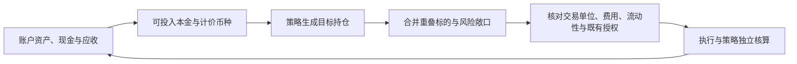

# 资产管理策略选择与设计依据

> **状态**：研究评估与设计建议｜**日期**：2026-10-26｜**当前事实与权限**：[current.md](current.md)
> **结论**：优先围绕纳指ETF风险预算、G20行业轮动建立候选设计，CTA-R作为跨资产分散化候选；A股低波待真实性与执行复核，15U宏观保留固定小额实验。没有足够材料将任何一条认证为长期实盘盈利策略。本页不替代当前事实、不新增交易授权、不启动服务或实验。

## 1. 哪些最值得保留

按可复现收益、回撤、简单对照、成本压力、资金规模和执行成熟度评价；不同币种、窗口、回撤频率的指标不作全项目收益榜。

|策略家族|目前较强的证据|适合未来承担的角色|主要缺口|研究判断|
|---|---|---|---|---|
|纳指ETF风险预算|513100人民币实际ETF、2014-01-02至2026-10-09：波控净CAGR17.99%/日MDD18.79%，双成本17.61%/18.93%；同窗买持20.00%/28.56%|长期成长敞口的风险管理候选|未独立OOS；QDII溢价/开盘容量未认证，不能泛化到所有ETF|优先候选，优势主要在风险效率，不是更高绝对收益|
|G20月度行业轮动|美元总回报单位、2018-04-02至2026-07-30：原20%为15.54%/17.93%；固定15%为12.41%/13.57%|有BIL防守配置的行业轮动候选|杠杆ETF路径/行业集中、整数股、税务与真实执行|优先候选；保留20%控制，较低预算作为简单实现候选|
|G20动态波控|同窗20bp/下一开盘13.69%/13.58%；相近平均风险资金下低于固定18%的回撤|G20家族内部的动态定仓版本|40bp且晚一天11.07%/14.42%，风险效率低于固定15%的10.81%/12.85%|低费自动执行值得验证，高费/手动优先固定预算|
|CTA-R跨资产趋势|美股冻结规则复现，2005-12-19至2026-09-28：10bp模型CAGR7.42%/MDD17.08%，20bp为6.94%/17.77%|跨权益、黄金、国债的分散化候选|原收盘权重收益代理，不是整数股下一开盘现金账本；未超过60/40 Sharpe|值得保留，但暂不赋予核心资金资格|
|A股低波上升趋势|人民币100万元、2015至2026-09-30价格代理：10.22%/33.86%；双成本5.90%/35.58%，晚一天5.12%/34.99%|以后人民币股票账户的区域候选|行业非PIT、现金公司行动/历史可成交未认证，近期弱势，回撤并不低|可继续研究，不列入优先资金方案|
|现行15U宏观|当前25%压力预算，2026-04-07至10-22前，15.27USDT基础累计32.56%/小时MDD12.18%；双成本−3.02%|小额执行与新机会机制实验|现行策略归属实盘成交尚无证据，成本/容量与资本规模高度敏感|保留小额，暂不扩大资产管理资金|

表内CAGR均扣除各实验声明的交易成本；A股包含声明的印花/过户等交易税费，个人所得税/分红税未统一认证。CTA-R沿原模型年化口径，不混称自然日历年化；只有15U一行是短窗累计收益。模型完整条件必须连同下文来源读取。

## 2. 两个优先家族，分别解决什么问题

**纳指ETF风险预算解决的是成长资产拿多少。** 不借款、只做多，20日波动估计、周度检查、下个交易日开盘，`w=min(100%,15%/sigma20)`，剩余现金。主情景为10万元人民币、100份整手、单边6bp佣金/5bp滑点、最低佣金5元、现金0利息。它相对同窗买持牺牲约2个百分点CAGR，换来约9.77个百分点MDD下降。MA120同引擎11.42%/28.15%，暂不支持将均线择时选作主要增长版本。

同公式在159915创业板只有3.81%/53.52%，弱于买持及暴露匹配静态，说明规则本身不是跨市场通用优势。该实现首先适用于经过验证的513100研究问题；USD QQQ是另一个标的/币种模型，不能直接继承17.99%。同2018–2026美元总回报单位对照中QQQ波控为14.67%/22.19%，只是独立建模的对照结果。

**G20解决的是风险资金投向哪个行业。** 七个1倍代理用调整价格作63日排名，月度选对应杠杆ETF，余下BIL。固定20%、15%、10%和动态版是同一个行业选择家族的定仓替代项，不是四个独立alpha。固定15%是简单风险取舍，并非已认证最佳参数；动态公式`min(20%,15%/实际杠杆ETF的sigma20)`在历史上有超出平均减仓的降险贡献，但需要更多交易，严格执行情景不全面胜出。

最新已发布的20%现金分红模拟，2026-01-02至10-23累计21.39%/MDD15.95%，204点为10月25日历史重建；分红税前、整数股、20bp、现金0利息。它与上表长窗总回报单位研究不同，不能拼成八年实盘曲线；6月以来仍−2.50%。年内旧价格利润约69%来自ERX、26%来自SOXL，不能把策略当稳定收息。

**载体比较已执行（10月25日）**：保持行业选择和时钟，按过去20日包含BIL协方差的全组合方差匹配一倍代理权重。2018–2026月度20%原/一倍CAGR/MDD为15.54%/17.93%与16.94%/17.82%；40bp且晚一天为13.35%/17.10%与13.75%/17.61%。一倍版风险资金约55.50%，年换手7.40x，高于原20.45%/2.91x；不是在同样20%资金下去杠杆。优势集中SOXL→SMH，二者基准并不相同；事后保留SOXL、只替换其他行业，基础降至15.05%/18.29%、严格11.81%/18.43%，三个预算下收益均弱于原控制。2026短窗一倍收益也较低，配对块收益差区间均含零。不支持全面替换；下一问题收窄到同基准半导体载体。60账本/60归因和24原控制已核对，见[载体研究](../state/research_runs/g20_carrier_comparison_20261025_final/report.md)。

**半导体同基准对照亦已完成**：补SOXX公开缓存，原排名不变、仅替换半导体，其他行业继续原杠杆ETF。月度20%原SOXL/SMH/SOXX长窗CAGR/MDD为15.54%/17.93%、17.00%/17.77%、15.54%/18.04%；严格为13.35%/17.10%、14.47%/17.36%、12.97%/17.26%。SOXX更接近原基准，改用一倍载体的普遍收益优势消失；SMH增量涉及不同指数和权重。2021换指数日期不同，过渡期单列，三个基础控制在6–8月无SOXL持仓。SMH在2018–2021前段和2026短窗落后，收益差块区间含零，不直接替换线上。额外36账本/36归因、12旧控制通过；只在半导体使用风险匹配SMH保留为研究候选，下一问题是整股/分红现金/费用下的可执行性。见[SOXL/SMH/SOXX对照](../state/research_runs/g20_semiconductor_carriers_20261025/report.md)。

**2026现金可执行性检验已完成（10月26日）**：1000/10000美元、三个预算、两个载体、八种执行情景共96账本。整股、单边5bp佣金＋15bp滑点、税前分红按实际付款日转现金。10000美元原/SMH的累计收益与MDD：月度20%为21.39%/15.95%与20.05%/16.61%；月度15%为16.20%/12.01%与15.64%/12.25%；周度动态为22.34%/6.86%与21.83%/5.75%。月度20%平均风险资金20.01%→34.68%、费用63.15→98.96美元；动态SMH降低部分回撤，但不是收益与成本全面改善。1000美元月度15%SMH收益较高（22.54%对19.45%），同时平均风险资金几乎翻倍（17.94%对9.15%）、MDD增至5.73%对3.42%；可分割控制的SMH反而较弱（15.82%对16.52%）。严格40bp/延迟/1美元最低佣金下，1000美元动态SMH仅9.84%，原14.62%，不能挑基本情景宣布优势。最低佣金与滑点分别计算，费用改变整股持仓路径，不从固定曲线直接减手续费。6个旧现金控制和已发布204点逐点复现，72项相关测试通过。2026为已消费历史，不认证2018–2026整股现金执行，样本内也没有SMH除息。裁决：原G20继续作控制，SMH降为待补全长窗现金证据的候选，不替换线上、不继续同窗挑参数。见[现金执行检验与全部压力结果](../state/research_runs/g20_cash_carriers_20261026_final/report.md)。

G20账户不融资，载体仍含每日杠杆。长期回报不能按指数收益简单乘倍数，[SEC/FINRA说明](https://www.sec.gov/files/investor/pubs/leveragedetfs-alert.htm)解释了每日重置与复利路径风险。BIL是短期美国国债ETF，存在交易和市场风险，不是银行存款或USDT利息；收入按基金分配和到账建模，不冻结一个年收益率。[基金发行人资料](https://www.ssga.com/us/en/intermediary/etfs/state-street-spdr-bloomberg-1-3-month-t-bill-etf-bil)。

## 3. 为什么保留CTA-R，却不把其他线一并叫优秀

CTA-R使用63/126/252日趋势符号、63日逆波动率、单标的35%上限及21交易日调仓，冻结规则在美国ETF有跨市场复现。美股模型10bp Sharpe0.7474，低于同窗60/40 SPY/IEF的0.7787；其价值线索在回撤17.08%小于60/40的32.63%，而非已经证明更好的长期收益。原样本2022年仍−10.52%，也不是危机必赚。当前A股持续账本是原2bp基础/10bp压力的收盘权重代理，与美股10/20bp复现不同，不能互相替代。先问可执行成本下是否保留分散化价值，暂不设计复杂分配器。

A股低波的“低波”是筛选机制名，不是低损失保证。33.86%回撤、双成本/延迟后增长明显下降、历史缺价与非PIT资格，使它不适合与ETF现金账本按同一可信度排名。2025−8.12%、2026截至9月底−3.01%的失败窗口也须保留。9月底虚拟十股不是当前买入清单。

15U宏观的新规模重跑非常明确：100/1000/10000USDT基础累计2.15%/−2.78%/−3.27%，双成本均约−3.11%；盈利IWM/XLE数量受历史容量限制，亏损CL随本金放大。可复用其确定性时钟、费用/容量门、原生止损与未知订单处理，但执行工程有效不等于信号有可扩展净优势。宏观压力预算25%也不是G20的25%资金权重或损失上限。

|不进入当前优先资金方案的线|原因与可保留价值|
|---|---|
|G20/QQQ初始各半组合|同2018–2026窗口15.11%/16.21%，超额相关约0.61；2022组合−7.46%而G20+5.58%，不是独立收益源，未验证最优比例|
|GC5、D15|G20/C60的资金分配包装，不是新alpha；不能因GC5短窗较平稳就授予独立优势。G20分红修正未传递至原组合，旧曲线会计还不一致|
|C60与旧选币高收益|幸存者名单优势在PIT复核后撤回；当前持续模拟只作原组件/对照，旧失败变体不恢复|
|通用状态v1.3及后续版本|标准Calmar口径已更正；样本依赖、商品收益集中、反复迭代，短前向不足以认证；后续高杠杆数字不参与排名|
|ETF MA120、买入持有、静态配置|继续作为简单且可执行的竞争基线；买持可因低成本/高风险承受力被选择，不因不是主动策略被排除。MA120当前证据不优先|
|Q-DIV-Core、赛道/麒麟、小额突破、旧全球宏观、P2/P3失败实现|原失败/撤销/冻结结论保持。可保留失败机制知识，不能因本次设计梳理恢复资金或训练|
|Q-DIV-IVOL名单、公告/短周期情报、Alpha Agents|名单/资料不等于净收益策略，不能按预测alpha或现金流参与组合|

## 4. 面向以后资产管理的最小设计

建议把系统分工围绕资金和风险组织，而不是按网页研究线数量分配资金：

|职责|优先承载方式|设计要点|
|---|---|---|
|可用资金与防守资产|按账户持有现金、已验证用途的BIL|现金、BIL市值、分红应收、保证金可用额分别计量；应收不提前使用|
|成长资产风险管理|纳指ETF风险预算及同标的买持/静态对照|先确定资产/币种/账户，再按规则管理仓位；不将人民币QDII结果改名成美元收益|
|行业选择|G20固定或动态版本择一评价|定仓是家族内部选择；先验证真实费用、股数、执行时钟，再谈分配比例|
|跨资产分散化|CTA-R候选|现货权益、黄金、债券风险拆开；先检验可执行的同窗增量，再决定是否加入|
|区域与新机会研究|A股低波、固定小额宏观实验|研究资金独立且有明确金额；不按总资产扩大实验风险，不让研究订单进入核心账户|

建议的数据/执行方向为：

这只是设计建议，不新增通用框架或自动调仓器。实现先复用现有行情、目标、执行与现金账本；具体问题需要时再补能力。

**组合预算需要穿透，而不是简单相加策略名称。** 若G20获总资产40%的资本、其内部风险资金20%，相应杠杆ETF占总资产约8%、BIL约32%，不能再额外把32%当可重复分配现金。若另有纳指ETF，其与SOXL/TQQQ及CTA-R里的QQQ/SPY存在共同权益暴露，必须按实际标的、行业、杠杆和币种合并评价；名义账户数量不是独立风险数量。跨券商/市场无法执行的净额不当成可跨账户互抵的现金。

**资金规模决定可用实现。** 100美元当前整数股G20无法形成风险ETF组合；1000美元固定预算容易维护但偏离较大；10000美元能较好形成动态仓位。人民币ETF另受100份整手和最低佣金约束，A股十股策略的100万元研究不能线性缩到1000美元。碎股、账户资格、真实费用和实际可成交性按选定账户核实。详细规模对照见[预算与规模实验](../state/research_runs/g20_fixed_budget_20261025_final/report.md)。

**未来资金分配先比较两个简单版本。** 先以一个可执行的成长ETF或G20账户作为单账户基线，再比较加入另一个家族是否改善同币种/同窗口/真实成本后的增长和损失；CTA-R只有新增分散化价值才占用资本。先保持固定资本分配，不因“多策略”直接引入RL、动态总预算或近期赢家加权。没有得到新证据前不宣布比例最优，也不自动触发观察期或新调度。

## 5. 五类策略的研究优化优先级

本节按下一项实验的信息价值、已有可信基线、净增长改进空间、资金适配和研究成本排序；不同于立即投入实盘资金的顺序。G20固定/动态合计一个家族，五类为G20、纳指ETF风险预算、CTA-R、现行宏观、A股低波。本节只明确研究问题，不自动启动新实验或恢复冻结线。

|优先级|策略家族|为什么现在值得研究|下一项最小有效问题|何种结果才值得采用|
|---|---|---|---|---|
|1|G20|分红、预算/规模、全行业及半导体载体比较已完成；2026现金检验未见SMH稳定替换优势|补全完整2018–2026现金/付款/费用口径，原规则对照是否仍保留单位模型的收益取舍？|固定原规则、完整窗口，先确认分红数据可得；保留失败年份，不挑2024或重复2026扫参，不把基准差异包装为alpha|
|2|纳指ETF风险预算|长历史与成本压力相对稳健，是未来成长资产管理的重要候选；规则简单，可低成本区分风险缩放与交易摩擦|513100按真实ETF价格、决策时可用净值/汇率与溢价资料，保留原固定规则，计入开盘偏离后是否仍优于相近风险的固定配置？|相同可用信息与成本下保留风险效率改善，且不是仅因降低平均仓位；无法取得当时净值/公布时间时限制结论，不能用事后净值填回|
|3|CTA-R|长样本、冻结跨市场复现使其具备分散化研究价值；当前主要不确定性集中于执行会计|冻结信号与调仓节奏，以实际持仓份额和下一可用开盘构造现金账户，对照同口径60/40；原收盘代理改善能否保留？|可执行模型仍有较好的损失控制，并在同窗组合比较中提供新增风险价值；不要求单独收益第一，不为通过而换宇宙或时钟|
|4|现行15U宏观|已有逐笔费用/资金费、容量和规模诊断，边际实验较便宜；但当前信号未证明可扩展净优势|保留原真实容量与入场门，按事前规则限制单机会风险，能否改善100/1000USDT净收益，而不是只放大受容量约束较少的CL？|完整重算机会、数量和资金费，基础/双成本及赢家缺失情景有稳定取舍；不能事后删CL、放宽容量或将盘口显示量当保证成交|
|5|A股低波|有正向代理结果，但PIT/公司行动/可成交缺口大，继续优化信号很可能放大模型误差|先在有限、可核对的样本上比较调整单位代理与真实股数/分红/交易限制会计，判断原低波机制是否仍值得保留|在可解释的数据误差和真实成本范围内仍有收益价值；未完成必要真实性复核前不扩大股票池或加入复杂财务模型|

**G20近期现金问题已得到负面证据，优先保留原控制。** 下一次G20研究应填补完整长窗现金/付款和费用证据；若完整历史分红资料无法低成本取得，则转向纳指ETF或CTA-R已有明确问题，不以重复同窗预算/载体搜索替代进展。目标继续使用当时已知波动/风险信息定仓，实际平均敞口与回撤分别报告；不能事后匹配全窗波动后宣称可交易公平对照。下一问题不自动授予新模拟、实际买入或配置替换权限。

纳指排第二是因为其基础优势已较清楚，下一步更需要确认资产与可成交价格，而不是搜索MA/波动窗口。CTA-R排第三是因为它可能带来不同资产来源，但当前代理与执行账本之间的差距尚未回答。宏观排在A股之前是边际试验成本与现有工具更有利，不意味着获得更多投资资金；其实际定位仍为固定小额实验。该排序不为五条线硬性分配研发比例，也不因写入文档产生持续观察或训练任务。

## 6. 证据入口与本次核对范围

- 纳指：[人民币ETF风险预算](../state/research_runs/etf_risk_budget_20261025_final/report.md)，含创业板失败、匹配暴露、金额和成本压力。
- G20：[收益来源与美元同窗比较](../state/research_runs/g20_risk_synthesis_20261025/report.md)、[现金修复](../state/research_runs/g20_cash_repair_20261025/report.md)、[固定/动态及规模比较](../state/research_runs/g20_fixed_budget_20261025_final/report.md)、[SMH候选现金执行检验](../state/research_runs/g20_cash_carriers_20261026_final/report.md)。
- CTA-R：[跨市场结果](cta-r-us-replication-and-c60-vol-matched-2026-09.md)、[原账本口径](cta-r-forward-ledger-2026-09.md)，本次核对本地`cta_r_us_replication_v1/9dc7b5a80cd6ec80/results.json`及既有manifest文件哈希。
- A股：[原研究及失败窗口](ashare-strategy-study-2026-10.md)，本次复读`ashare_lowrisk_20261010/summary.json`的基础、双成本、延迟与控制，不重跑大数据。
- 宏观：[自然闭合样本](../state/research_runs/macro_trend_continuation_20261022/report.md)、[最新规模对照](../state/research_runs/g20_fixed_budget_20261025_final/report.md)。

本次是已有证据的选择与设计梳理，没有新增选参实验、训练、组合绩效、交易所查询或线上发布。提交前从暂存代码独立导出目录：44项模拟相关、50项API、8项前端与83项研究测试通过；其中25项旧API夹具固定在其原10月16日参考时钟，其余使用实际时钟。相同公开缓存下重跑预算/规模研究，48组单位模型、12个现金账户及8组宏观结果与已保存结果逐项相同，不依赖工作区未提交的实盘改动。此次同配置复算只验证提交完整性，不增加独立收益证据。

Git保留实现、测试和文档摘要，原始行情及完整结果仍按现有规则保留于忽略的`state/`；克隆仓库后需另取原输入才能复现。当前模拟开关、实盘策略与权限只看current；本页的研究优先级不是owner已批准的资金分配。

上述为原梳理提交的验证范围。随后owner要求推进G20并继续，新增全行业/半导体载体研究共96条账本及归因，36次原控制复现，52项相关测试通过；独立导出的暂存代码再次复算，全部96条逐日NAV与保存结果一致。新增市场输入仅为SOXX公开缓存，未启动交易、服务或训练。相关新结论已写入第2、5节，不把新增已消费历史曲线当独立收益证据。

10月26日新增的是另96条现金账户，和前述单位模型分开计数。独立导出的暂存代码通过72项相关测试，复算结果与保存文件完整相等，包含19,584个日权益点；不依赖工作区未提交的宏观或账户改动。完整结果本地保留，Git记录第2、5节中的关键结论及实现。
