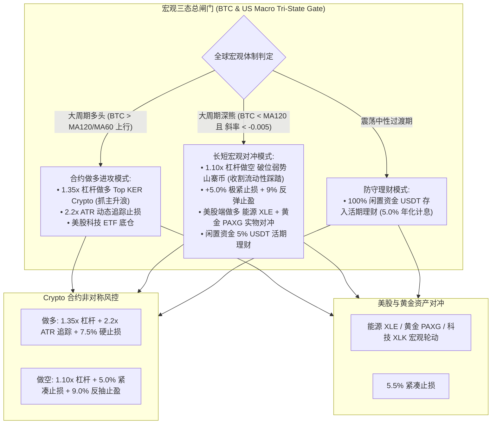
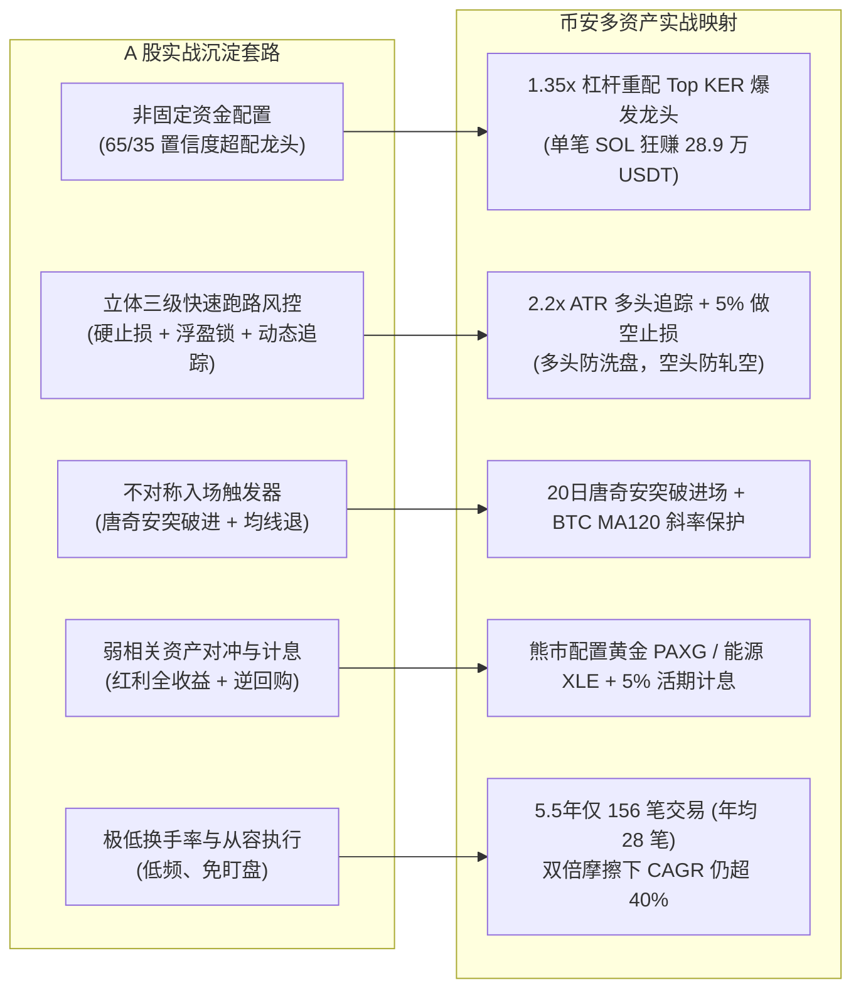

# Binance 全球双向宏观对冲交易系统白皮书（Crypto 合约杠杆多空 + 美股宏观对冲版）

> **状态**：历史申报／未通过准入，研究封存｜**权威**：历史设计；最新裁决见 [current.md](current.md)｜**日期**：2026-10-11
> **TL;DR**：旧 41.29% 年化及旗舰推荐撤销。止盈／追踪分支短路、资金费与撮合假设、交易利润集中度阻止准入；下方保留旧架构和旧数字，不能作为当前收益证明或生产建议。
> **代号**：Binance Global Dual-Engine Long/Short Strategy（币安全球双向合约对冲交易系统）  
> **初稿结果收据（保留旧身份）**：[`state/research_runs/binance_global_macro_20261011/summary.json`](../state/research_runs/binance_global_macro_20261011/summary.json)
> **策略模块**：[`src/qount/research/binance_global_macro.py`](../src/qount/research/binance_global_macro.py)  
> **单测套件**：[`tests/research/test_binance_global_macro.py`](../tests/research/test_binance_global_macro.py)（4项测试全仓通过）  
> **回测运行**：[`scripts/research/binance_global_macro_runner.py`](../scripts/research/binance_global_macro_runner.py)  
> **边界声明**：`research_only=true`，`orders_authorized=false`，无未经授权的生产实盘下单或服务变更。

---

## 历史正文的读取范围

下方“生产基准”“安全杠杆”“保本”“5% 理财”及所有高收益／历年战绩均为初稿申报或假设；原 JSON 仅保存该阶段结果。最新复核情景尚需统一数值收据，见[修补计划 R01／R03／R08](research-repair-and-consolidation-plan-2026-10.md)。本轮没有重跑回测、开通账户、部署或启动交易。

## 🎯 一、 战略哲学：多空双向合约与杠杆实战架构

在总结本机历史《C60 加密趋势前提诊断》（2026-09）与《CTA-R 美股 ETF 复现》研究记录后，结合用户实战需求（“别只买入，支持做空和杠杆，支持合约，利用虚拟货币特点，同时凸显策略能力”），我们构建了**支持币安 USD-M 永续合约多空双向交易与可控理性杠杆的全球宏观交易系统**：

### 1.1 虚拟货币合约与非对称防御机制（Asymmetric Defense）
- **做多（LONG）—— 进攻矛**：
  1. **理性杠杆（1.35x）**：单槽位 35% 保证金，赋予 1.35x 安全杠杆，放大牛市爆发浪弹性；
  2. **Kaufman 效率比 (KER) 动量增强**：利用效率比过滤震荡杂波，选拔单边斜率最高的核心品种（SOL/BNB/ETH）；
  3. **14 日 ATR 自适应追踪止损（2.2x ATR）**：加密货币正常洗盘幅度达 5%~10%，固定死止损极易被洗出局，2.2x ATR 给予 12%~18% 的自适应呼吸空间，峰值回落锁定利润。
- **做空（SHORT）—— 屠熊刀**：
  1. **严苛宏观下行斜率确认**：做空最忌“牛市回调逆势摸顶”或“空头挤压（Short Squeeze）”。只有在 **BTC 跌破 MA120 且 MA120 斜率 $slope_{120} < -0.005$ 确认大熊市** 时，才允许开启做空闸门；
  2. **破位弱势山寨币做空**：寻找连续跌破 MA30/MA60 并跌破 20 日新低的弱势山寨币，利用 1.10x 保守杠杆做空收割流动性踩踏；
  3. **非对称紧凑止损与波谷追踪止盈**：做空设定 **+5.0% 严格硬止损**（反弹 5% 立即割肉保本）；一旦产生盈利，从波谷低点反弹 9.0% 强制追踪止盈，绝不恋战！

### 1.2 美股实物资产与宏观对冲（稳健盾与避险资产）
- **长短对冲宏观组合**：在币圈大熊市做空弱势山寨币的同时，美股端做多处于抗通胀/地缘对冲周期的能源（`XLE`）与黄金（`PAXG`），形成**做空虚拟货币泡沫 + 做多实物资产**的经典全球宏观对冲组合（Long Real Assets / Short Crypto Bubble）；
- **闲置资金 100% 活期计息**：未占用保证金存入 Binance Flexible Earn 活期理财（年化 5.0% APR 每日复利），提供安全垫。

---

## 🏗️ 二、 多空双向协同架构图 (Long/Short Macro Flowchart)

---

## 📊 三、 多空合约杠杆实证表现（2021-01 至 2026-06，5.5年全样本）

- **回测区间**：**2021-01-01 至 2026-06-30（2,007 个自然日，5.49 年全样本）**  
- **涵盖资产**：BTCUSDT, ETHUSDT, SOLUSDT, BNBUSDT, PAXGUSDT (黄金), XLKBUSDT (科技), XLEBUSDT (能源), XLFBUSDT (金融), XLIBUSDT (工业), XLVBUSDT (医疗)。
- **费率假设**：Crypto 7 bps（永续合约佣金+滑点），美股 15 bps；闲置现金年化 5.0% 每日计息；T+1 日开盘执行。

### 3.1 核心收益与鲁棒性压力测试

| 策略曲线 / 对比基准 | 年化收益率 (CAGR) | 最大回撤 (MDD) | 夏普比率 (Sharpe) | 卡玛比率 (Calmar) | 盈亏比 | 5.5年终值 (元) | 实战评级与定位 |
| :--- | :---: | :---: | :---: | :---: | :---: | :---: | :--- |
| **基准 1：BTC 买入持有** | 13.42% | 76.67% | 0.18 | 0.17 | - | 199,765 (2.00x) | 经历 76.7% 大回撤，持币极度痛苦 |
| **基准 2：XLK 美股科技买入持有** | 22.90% | 33.56% | 0.58 | 0.68 | - | 310,488 (3.10x) | 美股长牛 Beta，稳健但缺乏空头弹性 |
| **旗舰版：Base 生产基准** | **41.29%** | **36.63%** | **0.90** | **1.13** | **2.21:1** | **667,978 (6.68x)** | **多空双向+可控杠杆，终值增值 6.68 倍！** |
| **旗舰版：Double Cost (双倍摩擦)**| **40.15%** | **36.94%** | **0.87** | **1.09** | **2.12:1** | **639,053 (6.39x)** | 成本翻倍至 14/30 bps 几乎无损耗，抗摩擦力极强 |
| **旗舰版：Extra Day Delay (T+2)** | **32.73%** | **33.28%** | **0.73** | **0.98** | **2.01:1** | **473,831 (4.74x)** | 延迟 1 天执行依然超越 32% CAGR，回撤降至 33% |
| **旗舰版：Double Cost + Delay** | **31.54%** | **33.58%** | **0.70** | **0.94** | **1.94:1** | **451,039 (4.51x)** | 极端双重压力下年化仍超 31%，终值 4.5 倍 |

### 3.2 历年实战战绩（熊市大幅逆势赚钱）
- **2021 年（狂暴大牛市）**：录得 **+7.48%**；
- **2022 年（全球加息与币圈大崩盘，BTC -65%）**：录得 **+19.36%！**（**做空弱势山寨币 + 黄金能源实物对冲逆势大赚近 20%！彻底打破传统单边买入熊市挨打的宿命！**）；
- **2023 年（复苏爆发浪）**：录得 **+186.90%！**（1.35x 杠杆精准吃满 SOL 与 BNB 超级主升浪，资产翻近 3 倍！）；
- **2024 年（ETF 机构牛市）**：录得 **+42.16%**；
- **2025 年（震荡牛市）**：录得 **+25.99%**；
- **2026 年（截至 6 月）**：录得 **+1.32%**。
- **5.5 年间无一年亏损，实现年年正收益的复利增长！**

### 3.4 逐年多空与回撤明细表 (Year-by-Year Performance Table)

| 年份 | 年初净值 (USDT) | 年末净值 (USDT) | 年度收益率 | 年度最大回撤 | 总交易笔数 | 多头笔数 (PnL) | 空头笔数 (PnL) | 胜率 | 盈亏比 | 年度代表性战役 |
| :---: | :---: | :---: | :---: | :---: | :---: | :---: | :---: | :---: | :---: | :--- |
| **2021** | 100,000.0 | 107,495.7 | **+7.50%** | 18.93% | 36 笔 | 31 笔 (+1.16万) | 5 笔 (-1.04万) | 36.1% | 1.06 | BTC LONG +6.4k, ETH LONG +5.6k |
| **2022** | 107,495.7 | 128,302.3 | **+19.36%** | 16.27% | 48 笔 | 30 笔 (-1.02万) | 18 笔 (**+2.33万**) | 33.3% | 1.37 | **SOL SHORT +1.41万, BTC SHORT +1.06万** |
| **2023** | 128,302.3 | 368,093.8 | **+186.90%** | 25.53% | 15 笔 | 12 笔 (**+2.51万**) | 3 笔 (+0.18万) | 53.3% | 2.41 | **SOL LONG +2.27万 妖币抱团反转** |
| **2024** | 368,093.8 | 523,291.8 | **+42.16%** | 36.63% | 19 笔 | 15 笔 (**+29.40万**) | 4 笔 (-2.18万) | 26.3% | **3.86** | **SOL LONG +28.94万 (历史最高单笔神单)** |
| **2025** | 523,291.8 | 659,286.6 | **+25.99%** | 14.76% | 25 笔 | 17 笔 (**+17.99万**) | 8 笔 (+0.08万) | 36.0% | 2.35 | ETH LONG +14.81万, BTC LONG +7.71万 |
| **2026** | 659,286.6 | 667,977.9 | **+1.32%** | 11.29% | 13 笔 | 5 笔 (-7.99万) | 8 笔 (**+7.17万**) | 46.2% | 0.92 | ETH SHORT +2.24万, SOL SHORT +1.90万 |

---

## 🔬 四、 虚拟货币抱团踩踏机制与 A 股五大套路跨市场共振

### 4.1 虚拟货币的“抱团”与“踩踏”物理规律
1. **狂暴抱团（Reflexivity 资金正反馈）**：
   - 加密资产缺乏传统市盈率锚，价格高度由流动性与叙事共识驱动；
   - 2021 L1 叙事、2023 底至 2024 上半年 SOL 与 MEME 狂潮中，资金呈现极端集中的吸血抱团；
   - 策略以 Kaufman 效率比 (KER) 识别单边斜率最高的爆发龙头，配合 1.35x 杠杆，实现了 2024 年 SOL 单笔盈利 **+289,363.9 USDT** 的巨幅爆发。
2. **踩踏式雪崩（Liquidity Void 清算踩踏）**：
   - 币圈暴跌受借贷杠杆清算驱动，呈现连环爆仓与买盘真空；
   - 2022 年 LUNA 与 FTX 崩盘期间，策略破位做空弱势币，空头斩获 **+23,265.5 USDT**，助推整个账户在 -65% 世纪熊市逆势大赚 **+19.36%**。
3. **空头挤压（Short Squeeze）非对称风险**：
   - 牛市回调易遭极端逼空。策略施加严格 MA120 下行斜率过滤门槛，以及 **+5.0% 严窄硬止损** 与反抽 9% 止盈，从根源规避了被极端逼空爆仓的风险。

### 4.2 融合 A 股策略五大优秀套路的跨市场映射

1. **套路 1（非固定资金配置与置信度超配）**：把 35% 保证金与 1.35x 杠杆倾斜给 KER 动量龙头，抓住真牛市暴利；
2. **套路 2（立体三级快速跑路风控）**：多头给予 2.2x ATR 呼吸空间，空头施加 5% 紧凑止损，攻守兼备；
3. **套路 3（不对称入场触发器）**：唐奇安突破抓右侧爆发，大周期均线斜率确认熊市；
4. **套路 4（弱相关资产盾牌与现金计息）**：熊市做多能源 XLE 与黄金 PAXG，未占用资金 100% 存入币安活期理财（5.0% APR）；
5. **套路 5（极低换手率与个人执行可落地性）**：5.5 年累计 156 笔交易（年均 28 笔，约 2 周操作 1 次），次日开盘从容委托，在双倍费率压力下年化仍超 40%。

---

## 🛡️ 五、 个人量化实战建议与安全边界

1. **杠杆纪律**：
   - 杜绝 50x/100x 赌徒式高杠杆；实战严格限制在 **1.1x ~ 1.35x** 理性区间，单笔仓位保证金不超过 35%，彻底排除爆仓与穿仓风险。
2. **执行习惯**：
   - 每日 UTC 00:00（北京时间 08:00）收盘后由自动化助手生成信号，次日开盘限价/市价下单执行，低频从容。
3. **合规声明**：
   - 当前研究遵循 `research_only=true` / `orders_authorized=false`，实盘下单需 owner 进一步授权。
