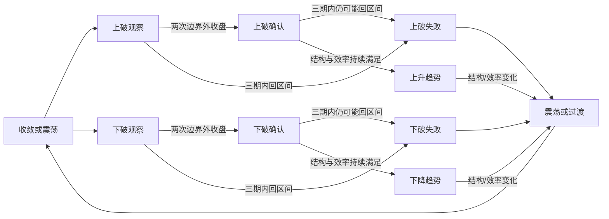

# Binance 合约市场结构、状态机与策略路由

> 2026-10-30｜离线研究与设计｜`research_only=true / orders_authorized=false`
>
> 已完成代表样本的状态、突破失败和方向机会分析，以及局部触发/市场环境过滤对照。尚未形成可替换实盘的多空策略。当前运行事实仍以 [current.md](current.md) 为准。

后续已构建日线学习数据集，并完成行为分类、树/小型神经网络对照及RL用途分析，见[数据集与模型研究](binance-market-learning-dataset-2026-10.md)；原状态与阶段证据继续保留。

## 标的类别与阶段特征：已执行的改进对照

owner要求改进模型，并检验不同标的是否有不同阶段特征。本轮结论：**应保留标的经济类别与个体归一化，但不能由此推导出每个类别必须独立训练。类别之间的波动/结构差异存在，类别预测参数的额外收益仍弱。**

分类先按经济属性固定，不根据本次收益或正确率选组：BTC/ETH、其他五个缓存币种、宽基权益（SPY/QQQ/IWM）、行业权益（SMH/XLE）、黄金、铜、原油。XLE是能源企业权益，不是原油；SMH与XLE虽然同属行业权益，其驱动和集中风险仍不同。BTC/ETH与其他缓存币种只是粗分组，不假定后者全部高beta。黄金/铜/油每类只有一个信号代理，类别效应与单标的特效不能分离。

在2021-07-20至2025年末共同日历范围，按各自真实交易时钟观察：

| 类别 | 中位年化波动率 | 上升/下降结构观测占比 | 固定定义突破失败率/成熟事件数 |
| --- | ---: | ---: | ---: |
| BTC/ETH | 55.58% | 19.65% / 14.08% | 37.41% / 139 |
| 其他五币 | 71.90% | 16.33% / 14.64% | 36.70% / 327 |
| 宽基权益 | 18.14% | 24.49% / 9.44% | 36.41% / 195 |
| 行业权益 | 26.56% | 22.21% / 8.31% | 38.71% / 124 |
| 黄金代理 | 13.75% | 24.75% / 8.40% | 50.65% / 77 |
| 铜代理 | 22.86% | 15.55% / 9.29% | 49.25% / 67 |
| 原油代理 | 31.14% | 17.61% / 6.88% | 37.29% / 59 |

上表用未被突破事件覆盖的底层`structure`字段，因此与前轮最终路由占比不同；低ER区间分类也不代表真实经济状态只有震荡。突破定义和样本选择均固定，上下突破合并；黄金/铜事件只有几十个，不把点估计当类别普适规律。币种按日历日、ETF按交易日，观测期并非相同自然日长度。

实现与实验：

- 保留共同状态语义与原分类器，新增19项因果细节：EMA距离/ATR、5/20期动量/已知波动、方向效率、相对波动、波动变化、均线斜率、区间位置、状态/方向持续时间、突破年龄/边界距离、单期冲击，以及相对BTC或SPY的状态/动量。
- 对照包含资产历史频率、原状态频率、类别收缩频率、仅状态的逻辑模型、共同连续特征、类别交互特征，以及三种在线收缩版本。两种连续模型均带相同资产ID，类别版本仅增加部分特征的类别交互，避免把资产漂移截距当成类别增量。
- 仅用季初之前已成熟标签拟合，缩放器只用训练数据；正则C=.1固定，无类权重调整或网格搜索。5/20期使用同一批每5期起点、共同截掉末端20期，故与前轮总样本略有区别。20期结果存在重叠，不按独立样本解释。
- 在线收缩只用已经成熟的历史预测误差。共同权重在共同细节模型与原状态模型之间选择；类别权重再向共同权重收缩。同期多资产的总校准权重为1，固定罚项10；没有用当前结果或未来数据设置自己的权重。类别校准与类别专家斜率分别对照，不将新增模型复杂度混称类别效应。

主要5期结果（下表三分类准确率与概率Brier分开解释）：

| 模型 | 币种准确率/平衡准确率 | 币种Brier | ETF代理准确率/平衡准确率 | ETF代理Brier |
| --- | ---: | ---: | ---: | ---: |
| 原状态频率对照 | 45.87% / 33.26% | 0.6421 | 42.03% / 36.88% | 0.6541 |
| 共同连续细节 | 46.49% / 37.52% | 0.6460 | 40.77% / 37.10% | 0.6603 |
| 加入类别交互斜率、未做在线收缩 | 45.77% / 37.02% | 0.6496 | 40.91% / 37.31% | 0.6664 |
| 共同细节、在线收缩 | 45.71% / 33.26% | 0.6398 | 42.03% / 36.90% | 0.6536 |
| 相同共同细节、类别收缩权重 | 45.61% / 33.36% | 0.6392 | 42.10% / 36.99% | 0.6534 |

新增细节改善了币种的多类区分，未经收缩的概率却更差；说明消除“总猜中性”不能单独证明改进。共同在线收缩相对原状态对照的Brier差，币种为−0.00226、季度簇95%区间[-0.00359,-0.00105]，ETF为−0.00056、区间[-0.00098,-0.00013]。这是当前历史上的小幅概率改进，不是高正确率或收益认证。

类别权重在相同共同模型之上的额外Brier增量：币种−0.00059、区间[-0.00121,+0.00002]，仍跨零；ETF−0.00011、区间[-0.00020,-0.00001]，非常小，且未校正多重比较。增加类别专家交互斜率后，币种反而变差，ETF增益区间跨零。不能把类别可描述差异，直接当作类别参数可预测未来的证据。

另对区间保持/突破维持做独立类别校准：四组类别增量区间全部跨零，未获得稳定改善；20期方向结果也未支持普遍放开类别参数。全部年份、单标的、失败模型和概率覆盖率保存在[完整结果](../state/research_runs/market_state_profiles_20261030_reviewed/report.md)。

目前保留的建模方向是：**共同状态语义 → 按标的自身波动/区间/时钟归一化 → 共同预测关系 → 有足够历史证据时才允许类别或个体偏离 → 概率可靠性与拒绝判断。** 类别首先服务于数据与执行语义、误差分层，以及小幅概率校准，不据此给各类别单独扫参数。当前Brier改善没有解决方向区分弱的问题；不把专家权重换成仓位，不启动空仓/部分持仓/加仓/减仓操作。

后续类别特征只能作为待检验假设：币种的资金费/OI/基差和流动性，行业权益相对宽基的强弱与集中暴露，黄金的美元/实际利率环境，铜/油的供需与期货期限结构。现有实验没有证明这些新增信息有预测增量。USO/CPER等期货型代理还含展期/跟踪机制，不能将代理阶段直接解释为Binance合约阶段。[XLE发行人](https://www.ssga.com/us/en/institutional/etfs/state-street-energy-select-sector-spdr-etf-xle)、[SMH发行人](https://www.vaneck.com/us/en/investments/semiconductor-etf-smh)、[USO发行人披露](https://www.uscfinvestments.com/disclosures)、[铜指数方法](https://summerhavenindex.com/sci_methodology/)。

代码见[类别与预测模块](../src/qount/research/market_state_profiles.py)、[实验入口](../scripts/research/compare_market_state_profiles.py)。当前市场状态相关22项测试通过，覆盖类别语义、未来不变特征、相同起点、训练缩放时点、标签成熟和自适应权重因果性；实盘未改。

## 先验证模型，再决定空仓、部分持仓、加仓和减仓

owner随后明确：先验证市场建模真实可靠及判断质量，再选择有净优势的阶段操作；其余可以空仓或部分持仓，允许加仓和减仓。本轮先落实模型验证，不用原方向标签收益倒推“状态识别正确”，不开始仓位优化。

**本轮验证结论：描述性状态的因果实现通过了检查，但尚不能称为高正确率预测模型，也不足以驱动仓位。** 原来9项单测只能证明所覆盖代码场景的行为，不能当作市场判断准确率。本轮新增6项标签/概率验证测试，共15项通过。

数据与因果检查：45次真实历史前缀重建一致，30次价格整体缩放下状态/事件路由一致，七币种及八代理各自的共同日期一致。另将BTC 2022-01-03、BTC/ETH 2025-01-03三条缓存日线与Binance官方公开档案逐字段核对，全部相符。这只是三条行情的来源抽查，不证明全部行情、资金费或ETF复权历史都得到独立认证。

十种描述性状态没有自然的外部十分类真值，因此另设未来可观察目标：

- 未来5期方向：未来收盘对当前收盘的对数位移，超过±0.5×当前已知20期波动率×√5才算上/下，否则算终点位移小。终点位移小不等于途中始终震荡。
- 未来5期区间保持：要求每一期收盘都留在信号时已经固定的先前20期高低边界内。
- 未来3期突破维持：从首次观察、首次确认各自的决策时刻，预测此后完整3期是否均在原突破边界外。不能把初始3期失败率与确认后较短的剩余观察窗比较，以此制造“确认提高准确率”。

方向/区间按每5期固定取样，避免同资产未来窗口重叠；突破观察/确认仍有事件内重叠。每次概率只利用严格早于决策时刻已经成熟的结果，固定状态频率向资产历史频率收缩50个伪观测。币种从2023起评分、ETF从2019起评分，之前历史用于初始化；已消费历史仍不称独立OOS。

| 市场与任务 | 样本 | 概率模型准确率 | 同时点历史频率基线 | 模型平衡准确率 |
| --- | ---: | ---: | ---: | ---: |
| 币种未来5期三分类方向 | 1946 | 45.99% | 46.09% | 33.26% |
| ETF代理未来5期三分类方向 | 2808 | 41.99% | 39.96% | 36.83% |
| 币种未来5期区间保持 | 1180 | 72.54% | 72.54% | 50.00% |
| ETF代理未来5期区间保持 | 1586 | 59.52% | 58.70% | 52.77% |
| 币种未来3期突破维持 | 703 | 66.57% | 64.44% | 50.00% |
| ETF代理未来3期突破维持 | 1560 | 61.47% | 61.47% | 50.00% |

平衡准确率是各真实类别召回率的平均：二分类50%、三分类约33.3%可由总猜多数类得到。因此72.54%不是强区分力证据。区间、突破维持任务的概率平方误差有小幅全窗改善，但年度结果不稳定，不能替代区分力或净收益。币种方向Brier差（模型−基线）的季度簇95%区间为[-0.0071,+0.0017]，跨零；ETF为[-0.0072,-0.0003]，总体小幅改善但方向区分力仍弱。阈值50%/60%/70%下，当前概率估计没有筛出符合其原路由方向的可触发高概率方向样本，不以稀疏子类的偶然高命中率宣称成功。

完整[验证报告](../state/research_runs/binance_market_state_validation_20261030/report.md)保留逐年、混淆矩阵、平衡准确率、概率校准和覆盖率；[验证代码](../src/qount/research/market_state_validation.py)与[入口](../scripts/research/validate_binance_market_states.py)只评价结果预测，不计算交易收益或仓位。

动作设计保留以下语义，等待预测与净收益证据，不预设资金比例：

| 动作 | 目标含义 | 依赖的证据与约束 |
| --- | --- | --- |
| 空仓 | 该机制目标风险敞口为0 | 没有可靠净优势、输入不可靠或风险不可接受时允许不参与；研究判断不直接控制既有实盘退出。 |
| 部分持仓 | 目标风险敞口大于0、低于允许上限 | 在已证实有净优势的前提下，按估计误差、波动、止损及相关暴露限制风险；不等同少量保证金配高杠杆。 |
| 加仓 | 目标风险敞口高于当前仓位 | 新的已验证信息支持增量风险与净优势，成本可覆盖，总账户和相关暴露不过预算；不因浮亏自动摊平，不重置原风险预算。 |
| 减仓 | 目标风险敞口低于当前仓位，可保留部分 | 证据变弱、波动/流动性压力上升、净空间下降或相关暴露超额时降低风险，不必等到完全反向；降至0即空仓。 |
| 维持 | 当前仓位等于目标或变动不足以覆盖摩擦 | 没有足够新证据时避免无意义来回调整；容忍带与具体比例以后按实际成本检验。 |

仓位、杠杆、保证金与压力风险分别表达。状态函数的`risk_scale`只是首轮启发式研究标签，未校准、未验证，不是预测概率或账户资金比例。预测命中率高也可能因盈亏不对称、费用和尾部损失而亏损；验证顺序是实现/数据可信 → 可检验的未来判断增量 → 扣成本后的净优势 → 仓位与操作。当前继续停留在模型验证，后续优先定位为什么方向状态对未来的区分力弱，而不是调仓位放大现有弱信号。

概率验证参考：[scikit-learn概率校准说明](https://scikit-learn.org/stable/modules/calibration)、[Hyndman滚动起点预测验证](https://otext.robjhyndman.com/hyndsight/tscv/)。这些支持评分方法，不证明本模型或阈值有效。

## 研究结论

建议用**十种结构/事件路由，叠加冲击与数据不足两个保护状态**。十不是自然规律，而是当前可以定义、观察、检验的交易分类。状态描述价格行为，不推断无法直接观测的“主力吸筹”“庄家出货”或未来必然反转。

不能把识别行情与证明策略有效混为一谈。首轮数据中，震荡/收敛观测很多，突破后回到原边界的事件也不少，但机械震荡回归、假突破反向、增加市场共振条件均没有获得跨窗稳定的净优势。状态机有助于把机制分开检验，不自动创造收益。

## 范围与多层判断

目标是 Binance 合约覆盖的虚拟货币、ETF 对应权益市场及既有商品合约。首轮不是全部在售合约扫描：

- 币种：BTC、ETH、SOL、BNB、XRP、LTC、LINK，日线和实际资金费；状态有效样本为2021-07-20至2026-10-26，200期预热后的13,475个资产日观测。
- ETF/商品代理：SPY、QQQ、SMH、IWM、XLE、GLD、CPER、USO；2017-01-03至2025-12-31，18,096个资产交易日观测。GLD/CPER/USO分别只是黄金/铜/油的结构信号代理。
- 固定当前存续名单有选择偏差；结论不外推至新币、已退市币和所有流动性层级。

判断按四层组织：

| 层 | 回答的问题 | 当前实现与边界 |
| --- | --- | --- |
| 市场环境 | 当前是广泛趋势、分化还是冲击？ | 币种用BTC及七币方向广度；权益用SPY及五个权益代理方向广度。它们是代表样本广度，不是全市场广度。黄金、铜、油不继承股指方向否决。 |
| 资产结构 | 该资产自身处于趋势、区间还是过渡？ | 日线EMA50方向/斜率、20期动量、ER20、相对波动率；EMA200与63期动量单独保留为慢周期结构标签。 |
| 事件与触发 | 突破在观察、已确认还是已失败？是否出现回踩/区间拒绝？ | 固定边界递推突破事件；趋势与区间使用不同触发，不把“价格低”直接等同做多。 |
| 合约执行 | 是否有足够净空间且实际可成交？ | 资金费、特殊分红、盘口、标记价格、交易时段、档位和离散数量必须在原生合约回放落实；本轮方向标签未完成这一层。 |

多周期宜先用“日线环境/结构 → 4小时或1小时触发 → 分钟执行”。本次只实现并分析日线状态；没有将小时确认或盘口可靠性冒充已验证结果。ETF底层现金市场收盘与Binance合约时段分别处理，不能拿尚未完成的ETF收盘作盘中信号。

## 十种状态与对应策略假设

下表的策略、退出和失效条件是待验证设计；本次5/20期机会标签没有模拟这些止损、移动止损或分批操作。

| 状态 | 可观察定义 | 策略与入场 | 退出/失效 |
| --- | --- | --- | --- |
| 1. 低波收敛 | ER20<0.28，20期波动率低于过去至多252期波动率中位数的0.75倍 | 等待扩张；记录上下边界，不因收敛提前猜方向。随后进入上破或下破观察。 | 收敛结束后重新分类；单边突破时停止沿用区间反向交易。 |
| 2. 常态震荡 | ER20<0.28，相对波动率介于0.75与1.5倍 | 候选为区间边缘回归：位置在过去20期区间底部20%且收阳才研究多头，顶部20%且收阴才研究空头；中部不入场。还需有足够扣费后空间。 | 中线/对侧边界分开检验；止损在区间外并有波动缓冲。出现确认突破或市场强烈逆向时失效。 |
| 3. 宽幅震荡 | ER20<0.28，相对波动率>1.5倍 | 首先防御。仅把边界拒绝、小风险、较短期限回归作为候选；禁止机械网格加仓或浮亏摊平。 | 原边界失守、跳空、冲击或深度不足时退出/拒绝；首轮结果不支持直接启用。 |
| 4. 向上突破观察/确认 | 收盘>先前20期最高价+0.25×先前ATR14；启动时边界固定 | 第一次收盘进入观察；连续两次在原边界外收盘后才有突破多头候选。后续可以检验回踩站稳的小时触发。 | 回到原边界内转为上破失败；确认后仍可能失败，不能用确认次数代替止损。 |
| 5. 向下破位观察/确认 | 收盘<先前20期最低价−0.25×先前ATR14；与上破对称 | 确认后研究破位空头或反抽失败空头；区分下跌启动与已经急跌后的追空。 | 回到原边界内转为下破失败；负资金费、挤空风险与标记价距离必须进入成本/风险判断。 |
| 6. 上升趋势 | 价格>EMA50、EMA50五期斜率向上、20期动量为正，连续两期方向一致且ER20≥0.28 | 主要研究顺势多头：趋势突破、回踩EMA20后重新转强；回踩是内部子状态，不自动转为空头。 | 结构破坏、原始止损、期限或移动止损分别验证；单一日线标签变化不默认立刻反手。 |
| 7. 下降趋势 | 上述方向条件镜像 | 主要研究顺势空头：反抽EMA20失败、继续破位；反弹是内部子状态，不自动转为多头。 | 原始止损、反抽结构被突破、期限/资金费额度或跟踪止损；不得把止损线当作保证成交价。 |
| 8. 上破失败 | 上破启动后3期内，有一根收盘重新回到启动时固定上边界内 | 首先撤销突破多头资格；反向做空是独立候选，须检查大环境。强牛市里通常先退出/等待，不自动逆势做空。 | 失败后的局部高点外止损；中线或原支撑作为目标候选；重新站稳上边界则反向逻辑失效。 |
| 9. 下破失败 | 下破启动后3期内，收盘回到固定下边界内 | 首先撤销破位空头资格；反向多头是独立候选。强熊市里不把每次假跌破都当成底部。 | 局部低点外止损，中线/上沿为目标候选；再次跌破并站不回时失效。 |
| 10. 分歧/过渡 | 方向、斜率、动量不一致，或方向尚未达到连续确认；也包括高ER但缺乏一致方向 | 暂停新方向仓，等待确认。上涨衰竭、下跌衰竭、潜在反转只是解释标签，不能凭“涨多/跌多”交易。 | 满足趋势、区间或突破事件条件后离开；不强求经过完整标准周期。 |

“低波/高波”本身不决定多空。上升趋势也可能高波，下跌也可能低波；这些属性保留为风险标签，不再扩成几十套各自调参的策略。慢周期上升中的短周期破位，与慢周期下降中的破位，也应分别归因，不能都算同一种空头优势。

**保护覆盖优先于策略路由：**

- `SHOCK`：当前绝对日对数收益超过先前20期标准差3倍，当前期及下一期不产生新路由。这里只是价格冲击识别；不能据此声称已经识别流动性危机。盘口失真、跳价、基差异常等需独立原生数据验证。
- `UNKNOWN`：预热不足、关键输入缺失或不可确认。状态分析不填造类别。生产遇到数据异常时，已有交易所保护如何保持是另一个执行问题，不能由本离线标签直接接管。

## 状态转移、确认与去抖

图示是常见路径，不强迫行情依次经过所有节点。跳空可能直接破坏结构，冲击/数据保护可以覆盖任何节点。

- 底层结构和突破事件同时保存；最终路由按保护覆盖 → 突破/失败事件 → 结构状态选择，避免一根K线同时发出趋势追价与区间反向单。
- 方向至少连续两期确认；同方向新突破启动至少间隔5期，避免连续新高每天重新计作独立事件。此数值是固定去重假设，并非已优化参数。
- 启动边界不随之后新高/新低移动。首次突破后连续监测3期，即使第二期已确认，第三期回到区间也记作确认后失败。
- 实验中先前20期最高/低点不包括信号当期；冲击分母和突破ATR缓冲来自先前数据，波动基准来自先前滚动窗口。

例：先前区间上沿100，先前ATR为2。第一天收101，越过100.5，记上破观察；第二天收101.2，在固定边界100外，记确认；第三天收99.8，才记上破失败。不能把第一天的信号事后改写为“已知假突破”。研究里的币种信号额外等待完整一天再取开盘，ETF信号取下一交易日开盘；未来持有终点只用于结果评分。

## 第一轮数据结果

完整结果：[市场状态研究](../state/research_runs/binance_market_states_20261030_final/report.md)，[机器可读结果](../state/research_runs/binance_market_states_20261030_final/results.json)。代码见 [market_stages.py](../src/qount/research/market_stages.py) 和 [研究入口](../scripts/research/study_binance_market_states.py)。

按最终路由观测占比，收敛/常态震荡/宽幅震荡合计：币种59.85%，ETF代理55.73%；上升/下降趋势合计22.75%/20.62%。突破事件会覆盖部分趋势观测，因此这些比例不能解释为“市场真正只有约两成时间有趋势”。冲击与冷却占4.79%/3.31%。

| 市场 | 上破成熟事件/失败 | 上破失败率 | 下破成熟事件/失败 | 下破失败率 |
| --- | ---: | ---: | ---: | ---: |
| 七币种 | 328 / 121 | 36.89% | 222 / 89 | 40.09% |
| 八ETF/商品代理 | 738 / 287 | 38.89% | 372 / 160 | 43.01% |

这些是特定20期边界、0.25ATR缓冲、3期失败期限和5期间隔下的结果，不是任意突破的普适失败概率。币种270次上破、175次下破曾获得两次收盘确认，其中63/42次仍在失败窗内返回区间；ETF对应598/293次确认，其中147/81次后来失败。确认减少部分早期噪声，但不能消灭风险。

方向机会使用事前固定5期或20期持有、同标的不重叠筛选。币种计实际资金费，单边摩擦10/30bp；ETF信号代理假定单边30/60bp，没有合约资金费或特殊分红，所以ETF“净标签”仅指扣假定摩擦后的方向标签。均未模拟止损、仓位、保证金、离散数量或成交限制，不报告CAGR或账户回撤。

几个直接影响设计的结果：

- 币种5期确认上破做多，214个机会，平均净标签+2.10%、中位数+0.52%；季度簇95%区间−0.04%至+4.13%，仍跨零。2025/2026均值分别+0.86%/+0.18%，不能用全期均值保证后续可用。
- 币种5期破位做空124个机会，平均−0.98%；下降趋势触发做空120个机会，平均+1.03%，区间跨零。后者2025为−0.74%、2026为+9.13%，存在明显阶段依赖，做空应独立建模。
- 币种宽幅震荡回归仅12个5期机会，平均−3.23%；ETF常态震荡回归353个机会，假定摩擦后平均−0.84%。不能因为“震荡常见”就默认回归/网格有净价值。
- 机械上破失败后反向做空：币种43个5期机会平均−0.03%，ETF93个平均−1.42%。下破失败反向做多也未获得跨窗稳定证据。它们目前更适合作为原方向资格失效信息，反向交易继续单独研究。
- 同一个局部机会集合上，新增环境过滤保留的币种582个机会平均+0.58%，被拒绝的227个反而+0.73%；2025保留110个平均−1.74%，拒绝44个+1.63%。ETF保留1513个平均−0.70%、拒绝217个−0.50%。这不支持直接采用“越多市场共振门越好”的假设。两组不是随机分配，不能作因果推断。
- 20期结果全部保留；例如ETF确认上破做多176个机会平均+0.74%，区间仍跨零。5期与20期机会集合不同，不用两者均值之差宣称延长每笔持有必然改善。

季度簇区间将同期多资产放在同一季度簇中，但不消除当前名单选择、历史消费、多机制比较和事件间依赖。样本内、不同年份/阶段分别列示，不称独立样本外认证。

## 合约层差异与研究裁决

币种与ETF对应合约共享状态机的语义，参数及执行必须按波动、时段、价差、资金费和容量校准。权益的强势背景不能直接否决黄金/原油趋势，BTC也不能代表每个币的独立结构。原油/黄金的ETF代理不等于原生合约的价格路径或市场深度。

Binance公开接口提供合约状态/上市信息/交易过滤器、资金费结算时点与对应标记价，并区分常规资金费与股票分红产生的特殊资金费；TradFi底层交易时段也有独立查询。将来转为合约实验必须使用适用时点的信息，不能把ETF现金市场历史补成合约上市前可交易历史。[Binance市场数据接口](https://developers.binance.com/en/docs/catalog/core-trading-derivatives-trading-usd-s-m-futures/api/rest-api/market-data)

本轮裁决：保留状态机作为可复用的市场研究与机制分离工具；**不把固定BTC/SPY共振过滤、机械破位做空、宽震荡回归或假突破反向直接接入实盘**。下一项有信息价值的实验是选一个明确的方向机制，在币种/ETF原生合约中分别加入真实资金费、可用小时触发、止损与容量，比较相同机会的原始规则、状态过滤和简单基线。没有证据支持先凑齐十套交易策略，再按状态全面启用。

研究已执行，两份针对性测试文件共9项通过，覆盖历史前缀不变、固定突破边界、确认后失败、冲击覆盖、广度冲突、商品独立环境、真实开盘时间及空头资金费符号。本轮不修改现行实盘规则或服务。
