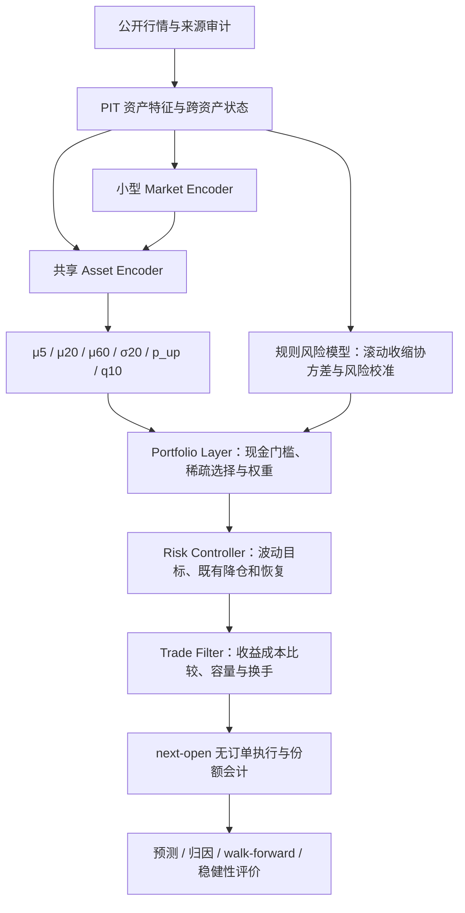

# ETF P3：预测、风险与组合分层研究及实施计划（v0.2）

> **状态**：active research / Stage1 v2 complete / postmortem complete / R3 pilot complete without qualified increment｜**权威**：P3 重构设计与推进计划；运行事实和 owner 决定以 [current.md](current.md) 为准｜**最后更新**：2026-10-04
> **TL;DR**：v2未证明神经/增强增量Alpha；复审schema-v2的R3已完成51/51-fit pilot，真实候选未通过全部增量门，正常停止且outer withheld。MLP的平均残差RankIC为正但配对空对照区间覆盖零，结果核验通过，discovery边界保留。

`research_only=true / orders_authorized=false / implementation_status=stage1_v2_complete / D_gate=pass_under_research_snapshot_v1 / alpha_result_status=no_increment_proven / next_round_status=pilot_no_increment`。
初版只交付设计；owner 随后要求“执行m0m1”，实际冻结登记、代码、验证、固定基准模拟与 D 门结论见 [§14](#14-m0m1-执行记录2026-10-02)。
owner 再要求补齐并分类数据，公开来源补采、数据字典、版本索引与剩余资格缺口见 [§15](#15-公开数据补采存储与资格分类2026-10-02)。
owner 随后明确降低研究数据标准并要求训练前审批；新数据资格与具体训练提案见 [§16](#16-研究数据标准调整与-alpha-训练审批方案2026-10-02)。§14/§15 保留当时的严格审计证据。
研究结果对生产的影响为 **无**；前瞻侧车、扩展风险预算或部署仍按当前事实文件的授权边界处理。

阅读入口：[R3 pilot结果](#24-r3残差pilot执行与结果2026-10-04)、[开训前复审与创新取舍](#23-r3开训前复审修正与创新取舍2026-10-03)、[当前启动方法](../deploy/wsl/alpha-residual/README.md)、[完整v2结果](#195-完整结果与回读核验2026-10-03)、[归因与下一轮方案](#21-负对照归因选模稳定性与下一轮训练方案2026-10-03)、[历史训练审批方案](#16-研究数据标准调整与-alpha-训练审批方案2026-10-02)、[P2 冻结与收尾](#2-范围冻结与-p2-收尾)、[指标与验收门](#8-指标资格门槛与模型保留规则)、[M0/M1 执行证据](#14-m0m1-执行记录2026-10-02)。

## 1. 研究问题、证据基础与命名

**研究问题**：在现有 9 只 US ETF、long-only、gross≤1 的边界内，是否能从时点可用的跨资产历史状态预测未来收益与风险，并跨年份、市场状态和 seed 稳定转化为成本后收益？

三个判断分开验收：模型有没有增量预测能力；组合增益来自资产选择、风险管理还是交易成本；增益能否跨年、跨 regime、跨 seed 保留。
最小验证先采用真实历史、共享小 MLP、20 日收益预测、固定组合规则和逐年 walk-forward。多期头、时序编码、风险优化和微调随后逐项消融。
如果三个冻结正式试验仍无法确认预测增量，复盘并关闭当前 Alpha 假设，不靠延长 episode、扩大网络或放宽约束救援。

### 1.1 已知证据与解释范围

本文件只引用 [P2 已核对的架构和实测](p2-project-summary-20261002.md)，不产生第二份结果表。关键背景为：

- 2015-01-02 至 2026-10-01 的弱保留集探索评估中，2× 成本下四个模型 CAGR 为 6.38%–6.70%，固定评分器为 5.86%，SPY/IEF 60/40 为 8.75%。WSL 两个模型为 6.52%/6.70%；这些结果尚不能证明稳定 Alpha。
- 四个模型全窗口满足探索性 G1–G4，剔除各模型最好完整年后均失败于 G5 的 Sharpe 条件。它表明优势依赖窗口组成，尚未证明依赖的原因就是 regime 运气。
- 两个计算端的结构、学习率和预算不同，不能把收益差异归因于 GPU；Stage A 的 32 次运行是 16 个结构×2 seeds，并非同一配置的 32-seed 稳健性验证。
- 当前事实已经记录 3090 于 2026-10-02 停训和回收。Stage B 仅有五个 ep60 持久化 checkpoint，没有 100-episode 最终模型；WSL 只有此前只读快照，不能推断其后已经完成。

**工作判断**：P2 提供了动态控制可能有价值的探索证据，稳定、可归因的神经网络 Alpha 仍待证明。P3 的首要瓶颈假设是信息与职责结构，GPU 和训练时长仅在后续实测时评估。

### 1.2 与原设计的关系

[v4.1 设计](etf-imitation-policy-design-2026-09.md)中的 P0–P4 是原交易员的实施阶段，其中“P3”指冻结后的一次真实历史验收。
本文件中的 **P3 重构** 是新一代预测架构；两者不共享“通过”状态。后续 artifact 使用 `line_id=etf_alpha_p3`、`protocol_id=p3-alpha-v0.1`，原协议记为 `p2-v4.1-historical-acceptance`，避免名称混用。

| 原方案 | P3 重构中的处理 | 需要验证的差异 |
| --- | --- | --- |
| M / Trend / Value / Risk 四因子与动态 α | 保留 P2 对照；新线取消无 PIT 来源的 Value，输入 raw features 与 M/Trend/Risk | 训练和推理的可用信息一致；不给中性 Value 权重解释成 Alpha |
| Trend 对 M 做 trailing 回归残差化 | 复用该控制方法，另报告特征相关、有效广度和预测消融 | 现有方案已处理部分共线性；“latent dimension 1.5–2.5”只是待测假设 |
| 6 维市场状态，已有平均相关及股债相关 | 增加多窗口相关、协方差和第一主成分集中度 | 现有模型已有跨资产摘要；新增矩阵是否有增量要实测 |
| GRU 输出 α / g / τ / b / κ | 模型输出收益、波动、方向概率与下尾分位；仓位和交易规则分层 | 预测、风险和交易贡献能单独审计 |
| 结构生成世界主导训练、自助族验收 | 真实历史优先；bootstrap 与 synthetic 承担增强和压力职责 | 不能把合成训练样本量当真实独立信息量 |
| 可微组合模拟中的直接 BPTT | 先监督预测，信号过门后才讨论组合微调 | P2 实际不是 PPO；P3 首轮不引入 RL |
| next-open、BIL、份额会计、成本、容量和换手约束 | 继承并补齐来源审计、跨层契约测试 | 保留可复现执行；2× 成本成立仍是必要条件 |
| 原 G1–G5、弱保留集一次测试 | 原结果原样保存；新线增加预测、归因、walk-forward 与新鲜前向证据 | 新协议不能回写原 G5 失败，也不能洗净已看过窗口 |

## 2. 范围、冻结与 P2 收尾

### 2.1 首版固定边界

US / USD 独立账户；风险资产为 SPY、QQQ、IWM、EFA、EEM、IEF、TLT、GLD、DBC，现金收益代理为 BIL。
保持 long-only、gross≤1、单只≤35%、既有同类组≤50%、US 主动换手 U=4、总换手诊断上限 1.5U，以及流动性/整股/next-open 规则。
第一版沿用 P2 的 D1=10%、D2=15% 及恢复规则；新的风控研究不得改变冻结对照。
研究名义本金首版沿用 USD 1,000,000，只代表当前成本与容量假设，不代表小账户可执行性。

CN 账户留在原协议中，待独立 PIT 数据与制度审计。首版不增加杠杆、3× ETF、做空或扩展资产池。
所有参数都写入实验合同；M1 已冻结的配置见 §14，模型和后续转换层的候选配置仍待实施与验收。

### 2.2 冻结对象与冻结清单

已建立 `baseline_id=p2-frozen-20261002`，`completion_status=partial`；“final baseline”只表示对照不再修改，不表示 Stage B 已完成或策略通过。
已有回收包与历史测试产物保持原样。M0 按以下清单执行登记，实际来源与 readback 见 §14：

1. 将已实测的四个 checkpoint 及固定评分器/60/40 结果登记为主对照；保存各自模型 config、seed、episode index、账户和来源。
2. 将 Stage A 已保存模型、五个 Stage B ep60、日志中的后续 episode 作为独立证据层登记。日志进度不替代已保存权重，ep60 表示 episode index 60 的保存状态。
3. 绑定模型 SHA256、数据 manifest/hash、特征与会计版本、1×/2×/3× 成本配置、回测产物 hash、代码来源和环境锁。
4. 绑定 Git commit **和实际运行源码逐文件 hash**。工作区及云端入口存在差异，不能只写当前 HEAD 就宣称源码可复现；缺 optimizer/RNG 的 checkpoint 明确 `exact_resume_available=false`。
5. 新建仅含非敏感元数据的 `baseline-manifest.json`，回读模型 tensor 与文件 hash；原模型、数据、代码和回测结果不覆盖、不重命名、不删除。

已有证据根分别为 `historical_20261002_v1` 和 `cloud_recovery_20261002_1713`，完整路径与回收验证见 [P2 证据入口](p2-project-summary-20261002.md#代码产物与复现)及[停训回收记录](p2-project-summary-20261002.md#云端停训与回收)。
新登记写入独立 P3 工件根，不改变上述原证据。

### 2.3 Stage A 与中途 Stage B 的有限诊断

“让 Stage B 到 100/100 后冻结”的建议已被后来停训事实覆盖。默认采用现有产物，不安排恢复训练。
如未来开展训练时长诊断，最多对已有五个 seeds 做一次配对探索评估：

- 先核实结构、学习率、seed、训练数据规则和 checkpoint 来源是否匹配。优先比较相同运行的已保存 ep30/ep40 与 ep60；Stage A/B 若学习率或续训机制不同，只能报告混杂差异。
- 冻结整个比较集后使用相同历史、会计与成本；报告配对变化、median/IQR/worst seed 和 G5，不从五个模型选 champion。
- 标记 `holdout_role=discovery`、`training_duration_diagnostic=true`。这些生成世界训练模型没有逐 fold 历史训练过程，其结果不冒称历史 walk-forward OOS。
- 无实质改善则停止讨论“多训就够了”；有改善也只说明现有控制器在该窗口的变化，不解除 Alpha 验收门。

此诊断不是 P3 启动的依赖项，也不要求增加到十个 seeds。M0 本次跳过时长诊断，没有重训或对 checkpoint 做新历史推理；M1 仅运行预先冻结的规则基准。

## 3. 目标架构与逐层合同



首版风险模型采用可解释估计器，单独的神经 Risk Encoder 是后续候选。Alpha Encoder 不读取持仓、账户回撤或换手余额；这些状态只给组合、风控和交易层，便于识别预测来源。

| 层 | 输入与输出合同 | 最窄验证 |
| --- | --- | --- |
| Data | 原始 OHLC/分配/成交量、总回报序列、日历、来源、可用时点、缺失掩码 | 日期完整性、原价/复权对账、拆股与分配、hash 回读 |
| Feature | 截至 t 收盘的历史 → X_asset[t]、X_market[t]、availability | 追加未来数据不改变既有 X；缺失不伪造为有效中性信号 |
| Label / Split | t 决策、t+1 入场、未来持有期 → 标签区间、purged folds | 最长标签不越过训练/验证边界；bootstrap 不使用外层测试 |
| Alpha | 特征序列 → 六个预测量与模型版本 | 收益/RankIC、方向及概率校准、分位覆盖、无预测能力控制组 |
| Risk | trailing 收益 → Σ、波动/尾风险诊断 | 对称 PSD、资产排列一致、风险尺度和滚动校准 |
| Portfolio | 预测、现金门槛、Σ → 目标权重与拒绝原因 | 非负、单只/组/gross 上限、允许零持仓和现金 |
| Controller / Trade | 目标、当前仓位、DD、容量、成本、预算 → 可执行模拟调整 | 风险降仓优先、单位一致、主动/强制换手分账 |
| Execution | t 决策 → t+1 open 模拟成交、现金、成本、NAV | 下一期开盘时序；份额和现金守恒；训练近似与 exact 的差异 |
| Evaluation | 冻结预测及逐日审计 → scorecard 和资格状态 | OOS 拼接连续、年度删除口径、trial/seed/fold 完整 |

最终输出是模拟调仓意图与研究 artifact，不连接订单、broker 或生产 StrategyIntent。各层保存输入版本、输出版本及 hash。

## 4. Data、Feature 与 Label 的设计

### 4.1 数据优先级与缺口

复用现有公开 US 面板作为已消费历史的研究起点，保留 Yahoo 替代来源、静态 spread/规费估计、BIL 现金代理等限制。
正式来源、PIT 复权/分配和历史成本审计单独补齐；来源切换生成新 dataset/version，不覆盖 P2 面板或结果。
如新增提供方需要认证，在允许的 Mac 环境取公开数据后仅传非敏感数据；WSL 与外置盘不接收凭据。
缺失来源、拆股未支持或日期不完整时先关闭对应评估，不用插值/事后补价制造可成交记录。

Value 从新线训练、特征、输出和评分先验中一致移除。P2 保留四因子定义，E1 用独立三因子版本（先验 6:4:3）重新构建控制组，不能直接改冻结 checkpoint 的维度。
重启估值研究必须有独立 PIT 数据合同和新增试验编号；不用价格反转悄悄替代 Value。

### 4.2 资产特征：首批约 38 个数值项

| 类别 | 首批特征 | 数值项数 |
| --- | --- | ---: |
| Return | 1/5/10/20/60/120/252 日总回报 | 7 |
| Momentum | 20/60/120 日 vol-adjusted momentum | 3 |
| Trend | MA20/60/120/200 distance；对应 20 日标准化 slope | 8 |
| Breakout | 60/252 日价格区间 percentile | 2 |
| Volatility | RV10/20/60；downside vol20/60 | 5 |
| Drawdown | trailing 252 日当前 DD；rolling max DD60/252 | 3 |
| Distribution / Tail | skew60、kurtosis60、historical VaR95/CVaR95（120 日） | 4 |
| Liquidity | volume z-score20、log dollar ADV20、Amihud proxy20 | 3 |
| Existing controls | M、Trend⊥M、Risk 的时点分数 | 3 |

总计 38；字段可用性掩码另存。单字段的公式、窗口、单位、最小历史、截断和缺失行为写入 `feature-schema.json`。
首版不补造流通份额 turnover、观测 spread 或未提供的宏观数据；静态 spread 属成本假设，不作为有时间信息的 Alpha 特征。
尾部样本量和高度相关的价格特征必须报告；更多 raw 指标不会自动增加独立信息。
输入标准化采用冻结的 trailing PIT 规则，输出尺度由训练区间拟合；不得在全历史上拟合均值、分位截断、PCA 或缺失填补器。

### 4.3 跨资产状态与风险估计

- 20/60/120 日同步收益相关矩阵；平均两两相关、SPY–TLT、SPY–GLD、QQQ–IWM，以及截面收益离散度和趋势宽度。
- 首版将低维摘要输入 Market Encoder，不一开始塞入全部矩阵元素；完整矩阵留给风险层和审计。
- 第一主成分比例优先从**相关矩阵**计算，避免直接协方差的高波动资产主导量纲；协方差上的比例另报并注明定义。PCA/收缩参数只用 trailing 或训练窗口确定。
- 组合风险首版采用 trailing 60 日样本协方差向对角收缩，候选收缩强度 0.2，日协方差乘 252 转年化；有效性和波动校准先过门，再考虑 EWMA 或独立 Risk Encoder。

资产顺序同时作用于特征、预测和 Σ 的行列；重排测试必须给出对应重排后的相同权重，不能靠代码位置记住资产。

### 4.4 标签与成交时点对齐

以 t 日收盘为决策时点，以 t+1 开盘买入为标签入场，持有 h 个 open-to-open 收益区间，到 t+h+1 开盘退出：

```text
y_i,t,h = TR_open_i,t+h+1 / TR_open_i,t+1 - 1,  h ∈ {5,20,60}
label_start = open[t+1]
label_end   = open[t+h+1]
```

`TR_open` 是包含拆股和期间分配的总回报开盘口径，必须与份额会计对账。若以原始 open×复权因子构造，需要审计因子的适用日期；未来分配可用于标签结算，不能进入 X_t。
不采用 close[t]→close[t+h] 直接替代可成交标签；特征预热可用 2015 年前已有历史，但本轮 train targets 的起点按 fold 合同固定。

收益头预测 h 日**累计简单总收益**；σ20 预测同一未来 20 日区间每日总回报的年化波动，q10 为 y20 的 10% 分位，p_up 为 P(y20>0)。
评估另计算匹配区间的 BIL 超额收益与过去估计 beta 的残差；“μ”预测总收益本身不等于已识别 Alpha。
现金未来实现值只能用于标签和事后评价；分配时的现金预测使用 t 日可得的 trailing BIL 20 日收益外推到 h，禁止使用真实未来现金收益。

### 4.5 Real first、bootstrap 与 synthetic 的职责

Prediction Stage 1 首轮 **100% 使用真实训练段**。用户提出的 60% real / 25% block bootstrap / 15% synthetic 保留为后续增强与压力批次的候选比例，通过 E2/后续独立对照评估，不直接替代首轮监督数据。

Bootstrap 同步抽全资产，块长范围 40–120 日，默认 60 日；来源只限各 fold 的 train。特征要保留原块的过去上下文，监督标签必须在同一原始连续区间内完整实现，禁止跨拼接处制造“未来收益”。
60 日标签加 next-open 边界需要至少 61 个未来 bar；短块无法提供对应监督样本时保留 mask。组合压力回放可以拼接路径，但接缝、价格重建、分配和 volume/ADV 处理必须声明，不能把接缝结果当真实预测证据。
默认 60 日块只增强较短 horizon；60 日头使用真实连续样本或预登记的更长块，每个 head 的有效样本数单独报告。

Synthetic 用于股债同跌、波动骤增、跳空、利率/通胀冲击、长期熊市、横盘和流动性恶化。日线引擎只能表达日级跳空压力，不能宣称验证了盘中 flash-crash 执行。
生成器参数只从训练段拟合；synthetic 不提供真实 Alpha 标签，也不靠奖励合成世界的资产漂移来筛 Alpha 模型。
若后续采用混合批次，分别记录采样比例、参与梯度更新比例和仅压力验收比例；压力批次对 Alpha 头停止梯度。不得把“15% 压力验证”写成“15% Alpha 训练”。

## 5. Alpha 训练：先预测，后组合微调

### 5.1 最小模型与最终候选

先实现无时序 Ridge 和共享小 MLP 的 20 日预测控制组，然后扩展多期/多任务，再加入 Market Encoder。
历史只有约 3,000 个决策日，9 只相关 ETF 的 asset-date 行不能当成 27,000 个独立样本；首版容量按真实有效样本量控制。

| 项目 | 起始配置 | 后续有限候选 |
| --- | --- | --- |
| Market Encoder | E5 才加入；sequence=60、GRU hidden=32、layers=1、embedding=16 | sequence=120 / hidden=64，各须新配置编号；TCN 作为独立结构对照 |
| Asset Encoder | 共享 MLP：资产特征⊕market embedding → 64 → 32 → 32，GELU | 首版不使用 ETF 独立网络或 Transformer |
| Prediction Heads | E3：μ20；E4：μ5/μ20/μ60/σ20/p_up/q10 | μ20 是预登记主 horizon，其余不用于事后挑最优 horizon |
| Regularization | §16 提案：AdamW lr=3e-4、weight decay=1e-4、Dropout=0.1、clip grad norm=1 | 替代初版 Adam 起点；位置和不衰减参数见 §16，首轮不扫学习率 |
| Training budget | 最多 100 epochs，validation patience=10；一次训练不按“episode 数越多越好”推进 | 先用小 fixture 检查流程；真实诊断消耗单独登记 |

现有 schema 为 38 项资产特征、17 项市场特征。E3/E4 输入 38 维，E5 拼接 16 维市场 embedding 后为 54 维；具体层结构及参数量见 §16。
单层 GRU 的层间 dropout 不生效，0.1 显式放在市场输入/embedding 上。
训练支持重叠序列，但有效样本与置信区间按日期和标签重叠处理；所有模型实际参数量、峰值显存和 fold 耗时都在试跑后记录，不沿用 P2 ETA。

### 5.2 Multi-task loss 与诊断

```text
L_pred = 1.0 × mean_h Huber(μ_h, y_h)
       + 0.2 × BCE(p_up, 1[y20>0])
       + 0.5 × Pinball_0.10(q10, y20)
       + 0.2 × Huber(log σ20, log realized_σ20)
```

收益 Huber 和 quantile 项使用训练区间拟合的目标尺度，三个收益 horizon 先取均值，避免它们数量和单位压过其余任务。
σ20 用 softplus 加正下限；概率用 sigmoid；q10 反归一化回 20 日累计收益单位。任务权重在读 test 前冻结。

每个 fold 同时报告：20 日主预测的 cross-sectional IC/RankIC、逐资产 time-series IC、方向准确率与多数方向基线、Brier score/概率校准、q10 违约率和 σ20 校准。
所有 IC 按日期和资产有效掩码算，明确有效日期数、有效资产数和相关资产的有效广度。95% 区间用同步日期块而非独立 asset-date 重采样。
同时报告现金超额和 lagged-beta 残差的预测表现，与历史均值、动量和 Ridge 比较，防止只学到股票/债券长期收益差就宣称 Alpha。

### 5.3 Stage 2 的进入条件与目标

只有通过 §8 的预测门并保存冻结的预测报告，才启动组合 end-to-end fine-tune；不以盈利的一条净值线替代该门。
先冻结 Alpha，验证组合/风控/交易层，再考虑解冻有限预测层；保留 Stage 1 checkpoint 作为控制组。

```text
U = mean_t log(1+r_net,t)
    - λ_dd × mean_t DD_t²
    - λ_cvar × ES_loss_5%(r_net)
    - λ_turn × mean_t turnover_t
    - λ_conc × mean_t sum_i w_i,t²
J = 0.7 × mean_episode(U) + 0.3 × mean_worst30%_episode(U)
L_finetune = -J + λ_pred × L_pred
```

`ES_loss_5% = max(0, -mean(worst5% r_net))`；episode 以相同尺度/长度或每日期望归一，收益、DD area 和尾部口径写清。
λ_pred 保留预测约束，其余 λ 只在 train/validation 上按预先规则确定。Worst-30% 目标作为 E9 的独立消融，不能在全历史上调系数。
MDD 留作验收；训练使用 downside deviation、CVaR 和 DD area 的平滑近似，不直接对不平滑的单点 MDD 寻优。
若稀疏 Top-K 或交易过滤采用固定 mask/可微近似，必须记录梯度范围；最终一律用真实硬选择和 exact 会计测试，近似收益不能当正式结果。

## 6. 组合、风险、交易与收益归因

### 6.1 现金门槛与稀疏组合

组合主 horizon 固定 20 日。定义 `a_i = μ20_i - cash_forecast20 - hurdle20`；现金预测与 μ 使用相同持有期，风险溢价起点为年化 0.5%，换算到 20 个交易日后使用。
`a_i≤0` 或数据/流动性不合格时不给新买入权重；没有合格资产时全现金。这个现金经济门槛是所有新 P3 组合的共同规则，与 P2 的原现金逻辑分别报告。

E3–E6 为归因采用固定的组合桥接规则：合格资产预测分位、τ=0.3、trailing 63 日逆波动权重，固定 gross=1、每 21 日主动再平衡，b=0、κ=1；仍受既有硬降仓、容量和换手约束。
桥接规则不是 P2 baseline，E3 跨架构与 E0 的差异不能全部归因于 raw features；E3 必须同时比较同规则下的三因子输入 MLP。

E7 只替换分配器为稀疏版本：`score_i = a_i / σ_i^γ`，γ=1，默认 Top-K=3；K=2/4 仅作预登记敏感性，不事后取收益最好值。
先对合格资产归一，再执行单只与组上限，超出部分留现金；不通过强制再分配偷偷改变 P2 上限语义。
Top-2 在 35% 单只上限下最多投入 70%，同类组上限还可能更低。稀疏性是可测假设，不能承诺提高 CAGR。
未通过 σ20 校准前使用 trailing 波动；改用预测波动是独立变体，收益与风险贡献分别报告。

### 6.2 独立风险控制

E8-R 加入规则 volatility target，初始年化目标 12%。对完成上限投影的组合 w，计算：

```text
σ_port = sqrt(wᵀ Σ_annual w)
g_vol  = clip(0.12 / max(σ_port, epsilon), 0, 1)
w_vol  = g_vol × w
```

Σ 用 t 日前可得数据；σ_port 接近零时保持原合格组合，不能扩大到杠杆。最终 gross 再受既有 D1/D2 限制，削减进现金。
DD 用真实成本后 NAV 的历史峰值计算，降仓及恢复按已有状态机执行一次，禁止新旧控制器重复乘同一降仓系数。
报告预测/实现波动比、target 偏离、降仓天数、恢复时长和错过反弹的成本，避免只凭 MDD 较低筛模型。

用户建议的 8%/12%/16% 对应 1/0.8/0.6/0.4 阶梯，以及 15% vol target 保留为后续独立风控变体；首轮不同时改目标和 DD 规则，也不修改 P2 的 10%/15% 对照。
单独 Risk Encoder 只有在滚动估计器校准明显不足且存在新增信息时再进入实验矩阵。

### 6.3 b、κ 改为可解释交易规则

E8-X 为独立交易消融，不与 volatility target 同一个 trial 一起替换。先按现金超额预测计算调仓组合的预期收益改善，再与模拟成本比较：

```text
B = sum_i Δw_i × (μ20_i - cash_forecast20)      # 占权益的20日预期改善
C = sum_i estimated_cost_i(N_i) / equity      # 占权益的完整调仓成本
主动调整仅在 B > K_cost × C 时接受，K_cost=2
```

买卖腿合并评估，Δw 保留方向；卖出有正预期收益资产的机会成本要扣除，不能使用 `abs(Δw)×Alpha` 将买卖都计为收益。
必须同时估计所有买卖腿、现金变化、整股残差和 2× 成本场景。风险强制减仓、禁买和容量限制优先于收益门槛。
调整速度由剩余主动预算、5% ADV 单日容量和可成交份额确定；未成交部分按冻结规则下一日重估，不由神经网络输出 κ。
决策时所有收益/风险/成本估计止于 t 收盘，t+1 的真实 open 只给执行器；额外一天延迟作为压力敏感性。

### 6.4 证明增益来自哪里

同数据、同成本、同风险边界下建立以下交叉控制组，E0/P2 只作为原规则参考：

| 控制组 | 资产信号 | 风控与交易 | 可回答的问题 |
| --- | --- | --- | --- |
| C00 | 历史均值/固定因子/Top-3 momentum | 固定桥接与原硬约束 | 无神经预测的收益基线 |
| C10 | 新 Alpha | 与 C00 相同 | 预测选择是否产生增量 |
| C01 | 与 C00 相同 | 新 vol target / 交易过滤分别开启 | 风险与成本规则是否已经解释增益 |
| C11 | 新 Alpha | 与 C01 相同 | 风险管理后 Alpha 是否仍有价值 |
| Negative controls | train 内标签块错位、恒定均值、打乱预测排序 | 完全相同的分配/执行 | 模型是否只靠结构或市场 beta 盈利 |

分别报告 `C10−C00`、`C11−C01`、`C01−C00` 与交互项，不把简单差值相加当完整因果分解。
再用相同风险预算的动量和 risk-only 对照，报告 SPY/60-40 描述性 beta、现金超额、净/毛收益与成本拖累。
beta 的拟合窗口和残差定义在结果前冻结，描述性回归不单独证明 Alpha。
若 IC≈0、选择增益消失而 C01 有效，结论写为“risk-control value”；若只有成本下降，写为“execution value”；只有预测和风险匹配后的增量均成立才保留 Alpha 结论。

## 7. Walk-forward、regime、seed 与比较组

### 7.1 主验收：expanding walk-forward

| Fold | Train targets | Validation | Test |
| --- | --- | --- | --- |
| WF2020 | 2015–2018 | 2019 | 2020 |
| WF2021 | 2015–2019 | 2020 | 2021 |
| WF2022 | 2015–2020 | 2021 | 2022 |
| WF2023 | 2015–2021 | 2022 | 2023 |
| WF2024 | 2015–2022 | 2023 | 2024 |
| WF2025 | 2015–2023 | 2024 | 2025 |
| WF2026 | 2015–2024 | 2025 | 2026 至已审计数据截止 |

每个 fold 的模型、标签尺度与选择参数独立拟合。允许下一 fold 将以前 test 年当作已经发生的过去数据，流程规则保持冻结。
每个 outer fold 的模型选择只能使用该 fold 之前的 train/validation；若用 2020–2025 汇总 validation 选出全局结构后再重评 2020，该早期结果只能记为 retrospective discovery，不能算选择无泄漏的 OOS。
2026 首版最多覆盖现有截止 2026-10-01，是 partial-year，不冒充全年；完整年稳定性初始使用 2020–2025 六个 test 年。

切分按 `label_end < 下一分区起点` 执行，清除训练到 validation、validation 到 test 的重叠未来标签。
最长 60 日 next-open 标签的边界间隔至少涉及 61 个交易步；以明确的 label 区间判断，不机械按日历 60 天处理。
额外 embargo 若使用，默认 5 个交易日并在 folds manifest 中固定；不得删除验证/测试的收益天数来改善统计。
验证标签在 test 起点前已实现，early stopping 和参数选择只能看 validation；测试末尾没有完整未来标签的预测只屏蔽该 horizon 的 IC，不删除对应 NAV 收益。

训练序列可读取训练开始前的纯过去特征上下文，测试序列可读取 test 开始前历史；不能读取未来或继承经过 test 优化的 hidden state。
年界处只更换已冻结模型，承接实际持仓、现金、NAV、换手预算与 DD 状态；如有新模型导致的调仓照常记成本，不能每年重置为新现金账户。
先跑一条连续的执行账本，再按各 test 区间取收益拼接；若分 fold 回放，必须证明 carried state 等价，OOS 日期不重复、不留空洞。

### 7.2 “历史 OOS”与“新鲜证据”分别标记

2015–2026 已被 P2 与其他研究暴露，P3 仍可做严格按时间拟合的 historical walk-forward OOS，但它属于 `holdout_role=discovery`。
协议中的 Pure OOS 只表示每个预测来自未训练该时点未来的 fold，不表示研究者从未看过窗口。
查看外层 test 后再改模型，会增加历史选择偏差；所有版本及失败都登记，外层 test 不作为模型选择器。

独立确认需冻结模型/协议后再积累未消费的新市场窗口，开始时点晚于已消费截止和实际冻结时间。
保存 `consumed_through`、`protocol_frozen_at`、`fresh_window_start` 和窗口消费记录，并遵守 [holdout 边界](holdout.md)的 once-only 原则。
日期晚于 2026-06-01 不自动变成新鲜 validation；历史多次试验也不自动产生 paper/live 资格。

### 7.3 Leave-one-regime-out 与年度删除

预先冻结 Covid 2020、通胀/股债同跌 2022、2023 上涨阶段，以及按过去特征定义的 risk-off、横盘和利率敏感状态。
事件区间、在线 regime 的阈值与覆盖下限写入 `regime-contract.json`，不按模型盈利日重新划分状态；未定义的 rate-cut cycle 暂不列正式验收桶。

实用主口径为 **past-only held-out episode**：在事件前可得历史上训练、purge 边界，在事件内测试；另在每个 walk-forward 的 train 中删去某类 regime，再看后续相同类型 test 的稳定性。
如“train other regimes”包含被留出事件以后的数据，只能标记非因果研究诊断，不能合入 Pure OOS。
逐 regime 报收益、超额 Sharpe、MDD、CVaR 和样本量；短状态不强行年化成可比较 CAGR。

保留原 P2 G5：剔除各模型最好完整年，模型和基准删同一年后重算 G1。新 P3 另外报告逐年删除、删除共同最好年、逐 regime 删除和最大收益贡献比例。
这都是删除已实现收益的统计诊断，不是重训；重训/LOO 的结果分开。NAV 删除后重算所得 MDD 也标记为诊断值，不冒充该策略真实经历的回撤。

### 7.4 Seeds、ensemble 与统计区间

每个实验初筛固定 5 seeds（1000–1004），报告 median、P25/P75、worst seed；资格判断最终扩为固定 10 seeds（1000–1009），保留失败/中断原因。
种子预算是待实施协议，不意味着现有 P2 有这些新 seed 模型。完全相同配置的已冻结运行可按 hash 复用，新增 seed 和配置均登记。
E10 ensemble 默认平均预先指定的 1000–1004 五个模型预测，σ/概率/分位头也分别平均并重新检查校准；不按 test 收益挑五个 champion。
资产预测先合成，再经过同一个风险/组合/执行层；报告全部十个单模型分布与 ensemble，不能用最好 seed 代替最终结论。

置信区间采用候选和基准同步日期块抽样，默认块长 60、敏感性 40/120；按 fold 保留边界、所有资产和 seeds 同步抽样，报告配对差。
块自助只是统计估计，不等于增加独立样本。DSR 使用完整试验账本及相关性假设；PBO/CSCV 若配置矩阵不足，明确 `not_identifiable`，不填虚构分数或默认通过。

### 7.5 必须升级的 baselines

| Baseline | 冻结规则起点 | 比较目的 |
| --- | --- | --- |
| BIL | 同期现金总回报代理 | 超额收益与现金门槛 |
| SPY buy & hold | 全窗口持有，报告同成本口径 | 股市 beta |
| SPY/IEF 60/40 | 60/40、21 日再平衡 | 与原 P2 主基准衔接 |
| Equal Weight | 9 只等权、21 日再平衡 | 无预测配置 |
| Risk Parity | trailing Σ 的风险贡献近似相等、21 日再平衡 | 风险配置本身 |
| Vol Target | 等权/逆波动底层＋12% 目标 | 简单动态风险管理 |
| 12M Momentum | 252 日绝对收益门槛，现金比较，21 日再平衡 | 时间序列趋势 |
| Dual Momentum | 252 日相对排序＋绝对现金门槛 | 相对和绝对强弱 |
| Top-N Momentum | 默认 Top-3；Top-2 预登记诊断 | 简单轮动是否胜过网络 |
| Fixed Factor / P2 frozen | 原固定评分器与已冻结四个模型 | P2 工程增量 |
| Ridge / MLP / GRU | 相同特征、标签、fold 和组合规则 | 网络及时间结构的增量 |

同时报告自然参考与约束匹配版本：SPY buy & hold、原 60/40 不因 35% 上限被改成其他组合；约束匹配版本另有 `baseline_variant`，不与自然结果混名。
CTA-R 只在有定义的新无订单适配器中复现冻结规则，不执行 legacy 脚本或恢复旧线。所有 comparator 使用同日历、next-open、BIL、分配、成本和税前口径。
复杂模型若没有超过同风险的 Top-3 momentum/简单风险配置，不保留其复杂度；只有 risk-only 对照也能解释的增益不计为神经 Alpha。

## 8. 指标、资格门槛与模型保留规则

### 8.1 五层 scorecard

| 优先级 | 主指标 | 必须附带的信息 |
| --- | --- | --- |
| 1 预测 | μ20 IC / RankIC、方向与概率校准 | 原收益/现金超额/残差口径、与简单预测的差、区间和有效样本 |
| 2 风险调整 | BIL excess Sharpe、Sortino、Calmar | excess Sharpe = sqrt(252)×mean(r_net−r_BIL)/std(r_net−r_BIL)，日样本标准差 |
| 3 收益 | NAV CAGR、累计净收益 | 毛收益、成本/现金贡献、partial-year 不年化冒充全年 |
| 4 风险 | MDD、daily CVaR95、worst 20-day | MDD 报正损失幅度；CVaR95 表示最差 5% 日收益，另报持有期尾风险 |
| 5 稳定性 | 年度/regime/fold/seed 分布 | 逐年删除、G5、ensemble、turnover 和强制降仓 |

旧 P2 Sharpe 有零基准和 BIL 超额两列，门槛按原定义保留；新模型 S 的主口径为上表 excess Sharpe，不拿 0.8 的旧零基准与新的 1.0 直接比较。
Sortino 使用 BIL 超额收益与零超额门槛的下行偏差，Calmar 使用同一 NAV 的 CAGR/MDD；所有分母和年化单位写入 metric contract。
P3 CAGR 年化按 252 个实际收益日、NAV 连续复利计算，不对 partial-year 年度表伪造全年收益。

### 8.2 分层验收门

| 门 | 要求与决策 |
| --- | --- |
| D 数据/时序 | 严格来源资格保留原审计；本轮按 owner 认可的 research_snapshot_v1 判定通过（§16.1）。hash、因果特征、next-open 标签及 purge/embargo 必守，已接受的来源/会计限制随结果报告 |
| A 预测 | μ20 的 seed median RankIC>0；至少 70% seeds 方向一致，至少 4/6 个完整 test 年为正；相对预登记简单预测的配对 95% 区间下界>0，并保留现金超额/残差诊断 |
| A 的不确定状态 | 点估计正但区间跨零为 `signal_unconfirmed`；未超过 Ridge 时不得声称神经结构有增量。A 未通过不得进入 Stage 2，以更多复杂度替代预测证据 |
| P 组合归因 | 2× 成本下 `C11−C01` 仍有增量，超过同风险的简单轮动/风险配置；改进不能全部来自现金、beta 或成本；预测、分配和风险作用分开 |
| R 稳定性 | 十个固定 seeds、连续历史 walk-forward、跨年与 regime 报告完整；G5/逐年删除和成本压力不破坏主结论；不能只有单个 seed 或一年有效 |
| F 新鲜确认 | 冻结后新窗口、once-only 记录和来源完整；样本不足写 insufficient，不把历史 OOS 升格为独立确认 |

A 的阈值和比较组需在读 test 前冻结。初筛五个 seeds 的 70% 要求按至少四个判断，最终十个按至少七个；跨年按共同完整年份，覆盖减少时不得自行下调比例。
A 检查增量预测，不要求所有辅助 head 都改善，但不合格的 σ/概率/分位头不得驱动真实组合规则。

### 8.3 每次改动的 minimum improvement

可选复杂模块只在 validation 的同风险、2× 成本、seed 配对比较中满足下列至少一项时保留：Δ excess Sharpe>0.05，或 Δ CAGR>0.5 **个百分点**，或 MDD 下降≥2 **个百分点**。
同时要求预测门、硬风险/换手边界不退化，改善在多数完整 folds/seeds 方向一致；配对区间跨零则标记待确认，不用一个 seed 的大幅改善宣称保留。
来源修复、去泄漏、标签/会计一致性属于可信度前置工作，不以提高收益作为是否修复的条件；它们不能作为 Alpha 成功记录。
outer test 用于冻结后的报告，不能每看一次 E_n 的 test 就选择是否继续下一模型；真实历史的反复暴露仍完整记入 trial/selection 账本。

### 8.4 Robustness Score：仅 validation 筛选

保留用户提出的权重，但先冻结尺度：

```text
R = 0.25×Z(Sharpe_excess) + 0.20×Z(Calmar)
  + 0.20×Z(WorstRegime)  + 0.15×Z(MedianYear)
  + 0.10×Z(SeedStability) - 0.10×Z(Turnover)
```

WorstRegime 取覆盖充分状态中的最低超额日均收益，MedianYear 取完整年度收益中位数，SeedStability 定义为 excess Sharpe 的负 IQR，Turnover 用主动单边年化换手。
Z 的中心、尺度与截断只由 train/validation 基准分布冻结，并写 `selection-contract.json`；尺度为零或 regime 样本不足时 R 为 unavailable。
每个 outer fold 独立冻结自己的尺度；跨年汇总 R 可作事后诊断，不用较晚年份的 R 反向选择较早 test 年的模型。
R 不进入训练 loss、不覆盖任何 D/A/P/R/F 硬门、不因测试结果重新调权重。择优仍用 validation；保留每个候选的全部分项，避免 CAGR 或一个牛市主导选择。

### 8.5 分阶段目标与长期收益目标

| 阶段 | 研究目标 | 可进入的下一步 |
| --- | --- | --- |
| P2 frozen | 原 6%–7% 收益附近的探索性对照，G5 失败原样保留 | 仅作新线对照 |
| P3-A Prediction | 先过预测门；组合目标 CAGR 9%–10%、excess Sharpe>0.9、MDD<18% | 信号确认后研究组合，不用目标数字代替 A 门 |
| P3-B Conversion | 同风险、可归因的 10%–12%、excess Sharpe>1.0、MDD<18% | 稀疏/风险/交易各自有增量才保留 |
| P3-C Robustness | 纯时间因果历史 OOS，逐年删除后仍争取 CAGR≥10%、excess Sharpe>1、MDD<20%；10%–12%为目标区间 | 完成独立新鲜研究确认后再讨论扩大机会集 |
| P4 future proposal | 先扩至 20–40 只未杠杆 ETF，再独立研究 15%–20% 收益目标 | 新 PIT universe、独立成本/风险合同与 owner 决策 |

这些是研究目标与停止讨论复杂度的依据，不是收益承诺或生产 promotion 条件。高于目标区间不自动判失败，低于目标也不能事后放宽成“达标”。
1.3×/1.5× 风险放大只留作未来问题；融资、波动拖累、回撤与成本不按收益线性放大，现行 gross≤1 不改变。
如果九只 ETF 的真实预测信号不足，结论应允许“数据/机会集不足”或“简单风险管理更有价值”，而非为了 20% 提前引入 3× ETF。

## 9. 实验矩阵、依赖与预算

E 编号是消融标签，不是全局 trial 编号。每个配置、重训、horizon/阈值敏感性和真实诊断都进 P3 family/exposure ledger，并与全局账本核对；不自行沿用旧设计的“153”计数。

| 实验 | 单项问题/改动 | 主要比较与产出 | 推进方式 |
| --- | --- | --- | --- |
| E0 | P2 冻结对照 | 既有四模型、固定因子、60/40、来源与 hash | 登记原结果，不重新训练或挑冠军 |
| E1 | 取消 Value 的分布错配 | 独立三因子控制器 vs 原四因子训练控制组 | 仅诊断；新格式 checkpoint，原 baseline 不改 |
| E2 | Real-first 是否改善训练/推理一致性 | 同一 E1 结构与预算，synthetic-only vs real-first | 可选诊断；按 fold 训练，60/25/15 职责按 §4.5 分账 |
| E3 | raw features 是否有增量预测 | 真实数据 μ20 MLP：38 特征 vs 同模型 M/T/R；Ridge 同规则对照 | **首个主实验**；固定桥接组合，完成预测报告 |
| E4 | multi-horizon/multi-task 是否改善 μ20 | E3 vs μ5/20/60、σ20、p_up、q10 共享头 | 组合仍用 μ20 和 trailing risk，不同时改风险规则 |
| E5 | market 时序信息是否有增量 | E4 vs 小 GRU Market Encoder；non-sequence MLP 对照 | 固定容量起点，不扫 Transformer |
| E6 | cross-asset covariance 是否有增量 | 多窗口相关/PCA 摘要加入模型；Σ 校准与风险估计单独比较 | 输入增量与风险层替换各有变体编号，不能混为一次贡献 |
| E7 | sparse allocation 是否提高收益质量 | 固定预测下，softmax 桥接 vs threshold/Top-3 风险权重 | 相同现金门槛/上限/执行；不加杠杆 |
| E8 | 规则风险/交易层是否有效 | E8-R 仅 vol target；E8-X 仅 benefit/cost 过滤 | 分别开关后再看组合交互；DD-alt 不混入首轮 |
| E9 | 均值微调 vs RegimeDRO | 通过预测门的 Stage 1 vs mean utility 微调；再 vs worst-30% 目标 | 微调和 DRO 是两次变化，分别记 trial |
| E10 | 固定 seed ensemble 是否稳定 | 同一最终配置单模型分布 vs 预定五模型预测平均 | 禁止 best-seed 选择，重新审计预测/风险校准 |

E1/E2 不阻塞 E3：它们解释 P2 的成因，P3 最小闭环可直接 real-only、raw features、μ20、walk-forward 起步。
E3 与 E2 的整体差异含模型职责、输入和训练变化，不能伪装成“只改 raw features”。E3 内部的同模型特征消融才回答 raw 增量。
每个后续模块先同前一已保留版本比较；未达到 minimum improvement 的可选模块剔除，后续以最近保留版本为 parent，不为了 E 编号齐全堆模块。

首批 Alpha family 正式预算为 E3/E4/E5 三个冻结假设；五 seeds 初筛只看 train/validation 完成流程与选择，外层 test 由预登记流程报告。
第三个正式试验必须复盘。只有确认增量预测或明确可检验的新信息，才进入下一批 E6–E10；无预测增量则结束当前 Alpha 路线。
每实验首轮采用一个默认配置；表中的子变体和敏感性显式占配置数。最终候选扩为十 seeds，每 fold 从零训练/按合同微调，训练失败不是自动补搜许可。
先测一个 fold 的 CPU/GPU 吞吐和显存，再估算全部任务；分布式训练、云租赁和大规模并发不属于 M0/M1。

## 10. 具体实施步骤与阶段交付

M0 登记完成；M1 工程与审计完成，现有数据已按 owner 的 research_snapshot_v1 标准通过研究 D 门；M2–M6 待实施。
10 月 3 日 owner 后续授权有界的 WSL 八小时训练，实施及运行口径见 §18。M5/M6 仍取决于信号结果，不用未测过的工时或预计收益替代验收。

| 里程碑 | 依赖 | 交付物 | 完成判据 |
| --- | --- | --- | --- |
| M0 P2 preservation | 已有回收/历史证据 | baseline manifest、源码差异与暴露清单 | 原产物 hash 可回读，partial 状态准确 |
| M1 Data / Labels / Splits | M0 | dataset/feature/label/fold contracts、基础 baselines | 无未来特征、无重叠标签泄漏、可执行总回报标签对账 |
| M2 Single-horizon prediction | M1 | Ridge/MLP μ20、E3 特征消融、固定桥接 | train/validation 诊断及负对照完整，μ20 预测可独立复现 |
| M3 Multi-task / Market | M2 的诊断可解释 | E4/E5、必要的 E6 输入消融 | 预测增量/校准有证据，可选模块达保留标准 |
| M4 Historical WF report | M2 或已保留 M3 | 2020–2026 连续 OOS、5/10-seed scorecard、regime/G5/区间 | 数据/预测门判定、污染标签及第三试验复盘完整 |
| M5 Conversion / Attribution | A 门通过 | E7/E8、C00/C10/C01/C11、exact 会计报告 | 2× 成本下新增分配/风控/交易价值独立可归因 |
| M6 Robustness / Fresh design | M5 通过 | E9/E10、最终冻结协议、未消费新窗口计划 | 新预测不退化；历史与新鲜资格分开，仍无生产权限 |

### M0：保存可比较的 P2 baseline

1. 只读核对现有 manifest、原始回收包、源码和四个已实测结果；列出缺文件/来源差异，不重启已经停止的 3090。
2. 生成新的冻结登记、数据暴露和配置差异清单，写 `completion_status=partial`；回读校验后保留原证据。
3. 决定是否开展 §2.3 的一次五-seed 时长诊断；无匹配模型则写不可归因，跳过，不为凑齐 baseline 再训。

### M1：先把标签与评估规则做成可审计合同

1. 把 US 数据、现金、税前成本与交易日历版本化；核对总回报标签与 raw open 份额会计。
2. 实现约 38 项特征、availability 和 schema；写 prefix-invariance、缺失/拆股/分配和资产重排的最窄测试。
3. 实现 5/20/60 日 label 区间与 purge/embargo；冻结 fold/regime/seed/baseline/metric contracts，禁止全历史 normalizer。
4. 先在小型人工 fixture 上验证分红现金、次日开盘、跨年持仓、换手余额和持续 DD；再只读审计真实数据，不提前看新策略收益选规则。
5. 跑同引擎的现金、自然/约束匹配基线，写完整规则与缺口；通过 D 门才进入预测。

### M2：先回答有没有 signal

1. 首先训练 μ20 Ridge 与小 MLP；初始使用三因子输入，再仅替换为 raw features，保持训练预算、loss 和组合桥接相同。
2. 按每个 fold 的 train/validation 做尺度、early stopping 与误差分析；产出逐资产/日期预测 CSV，不直接让模型输出权重。
3. 运行历史均值、动量、train 内标签块错位等负对照；核对是否仅识别长期资产类别收益或波动差异。
4. 报告 IC/RankIC、超额与残差预测增量、概率/波动尚未启用的状态；冻结 M2 模型及选择规则，避免先看 test 再调整学习率。

### M3：按消融增加信息和任务

1. E4 先只增加多期/多任务头，主 μ20 和原桥接不变；检查预测任务冲突、目标尺度与分位覆盖。
2. E5 加一个 60 日小 GRU Market Encoder；与同输入的 MLP 比较，记录参数量和有效样本，不同时扩大 hidden/layers。
3. E6 的市场摘要输入与 risk Σ 替换分别开关；没有增量的模块不进入最终候选。
4. 用各 fold 的过去 validation 完成选择，保存所有候选、拒绝原因、训练时间和环境锁。

### M4：形成可解释的历史 OOS 判断

1. 按冻结协议生成各 fold 预测，再用单条连续执行账本拼接；检查年度边界的模型切换、成本和风险状态承接。
2. 计算完整年、partial-year、regime、G5/逐年删除、1×/2×/3× 成本、延迟成交和 seed 分布；采用配对块区间而非只给点估计。
3. 汇总 D/A 门、模型复杂度增量、DSR/PBO 的可识别性和所有真实窗口暴露；E3/E4/E5 第三个正式 trial 结束时强制写复盘。
4. A 门未通过则停止 fine-tune；点估计正但区间不足只能等待新的独立数据或形成新的可检验假设，不能沿用原 test 无限重试。

### M5：再回答 Alpha 怎么变成收益

1. 冻结 Alpha，E7 替换组合分配；先报告稀疏性在 35%/50% 上限下造成的实际 gross/现金，不放宽上限。
2. E8-R 只研究规则 vol target，E8-X 只研究交易 benefit/cost；既有紧急减仓与恢复保持，增加参数作为新变体登记。
3. 完成交叉控制组与风险匹配比较；净增益如果来自 risk-only 或少交易，就如实分类，不能写成 Alpha 成功。
4. 仅在 exact 模拟、2× 成本和跨年/seed 增量均可解释时形成组合候选。

### M6：稳健训练、ensemble 与新鲜确认设计

1. 先比较 Stage 1 与均值效用微调，再单独增加 worst-30% DRO；尾风险、预测校准和原 IC 均需重新验收。
2. 评估预定五模型 ensemble 和十单模型分布；平均 σ/q10 只是聚合估计，并非混合分布的真实波动/10% 分位，必须重新校准后才能驱动风险规则。
3. 冻结最终代码、模型、参数、选择和执行合同；登记实际 freeze timestamp 与未消费的新数据窗口，建立 research-only 新鲜验证计划。
4. 输出 `failed / signal_unconfirmed / prediction_confirmed / conversion_supported / historical_robust / fresh_insufficient` 等分层状态。这里的结果状态不自动映射为 paper/live promotion。

## 11. 代码落点、存储与验证责任

### 11.1 已实现包与后续规划

M0/M1 新业务位于 `src/qount/research/etf_alpha/`，与原 `etf_trader/` 并列；没有移动 P2、legacy 或已有脚本。
原 P2 scorer/policy/train 与 checkpoint 导入路径保留，复用纯数据、成本、会计函数时通过明确适配器，不修改其对照语义。

| 模块 | 责任与实施状态 |
| --- | --- |
| `artifacts.py` / `preservation.py` | **已实现**：只读 hash/模型验证、独立 partial 冻结登记、实际源码和暴露绑定 |
| `contracts.py` / `prepare.py` | **已实现**：M1 固定合同、来源审计、特征/标签/基准流水线与 D 门报告；不训练模型 |
| `data.py` / `features.py` / `labels.py` | **已实现**：显式拆股/分配面板、38 项因果特征、17 项市场摘要、trailing Σ、可成交标签及 mask |
| `splits.py` | **已实现**：七个年度 fold、最长 label-end purge 与五交易日 embargo；无 fold 训练 |
| `execution.py` | **已实现**：next-open 事件份额会计，复用硬约束/成本，持续 DD 与换手；支付日仍属来源缺口 |
| `baselines.py` | **已实现**：12 个冻结规则/版本、三档成本、现金/份额/成本/主动强制换手账本 |
| `models.py` / `train.py` / `walk_forward.py` | **待实施**：Ridge/共享 MLP/小 GRU、监督预测、有限微调与连续预测 OOS |
| `risk.py` / `portfolio.py` / `trade_filter.py` / `evaluate.py` | **待实施**：预测驱动转换、风险校准、收益成本比较、Alpha/归因/稳健性 scorecard |

`scripts/research/etf_alpha_preserve_p2.py` 与 `etf_alpha_prepare.py` 是已实现薄入口，仅解析参数并调用包函数；后续预测训练、walk-forward 和消融入口未实现。
公共 `qount-run` / `qount-monitor` 及既有研究脚本保持兼容。生产包不导入新研究包；CLI、代码组织、规则和 repository map 同步记录已实现路径，未把规划模块写成现有能力。

### 11.2 主机与工件

按 [host runbooks](operations/host-runbooks.md)执行：Mac 负责代码/文档/轻量验证，WSL 负责权威计算，外置盘保存完整公开数据、模型与不可变产物。
VPS 保持既有 paper/公共采集运行事实，P3 研究不借用其运行目录、账户、服务或 timer。云 GPU 如未来需要另按明确任务处理，不默认恢复 3090。
新工件根为 `/mnt/e/qount_data/qount/artifacts/etf_alpha_p3/<run_id>/`，数据为同外置盘的 `datasets/etf_alpha_p3/<dataset_id>/`；本次实际目录见 §14。
外置盘缺失则拒绝运行，不把完整数据落到 Mac；WSL 虚拟环境只在计算机本地，外置盘不放 secrets、venv 或活跃 SQLite。

每个 run 至少保存以下非敏感信息：

```text
protocol/feature/label/fold/regime/selection contracts
dataset source manifest + SHA256; raw/adjusted/volume/cash availability
git commit + dirty source hashes + environment lock
seed/parent/config/trial/exposure records; checkpoint + model-schema
predictions by asset/date/horizon; IC/calibration diagnostics
continuous NAV/positions/cash/actions/costs/turnover/controller reasons
per-fold/year/regime/seed scorecard; paired intervals; DSR/PBO status
summary.md + immutable manifest + research_only/orders_authorized guards
```

fold 只使用该时点过去可得的样本；模型、数据、配置、选择日志和 results 共同绑定 hash。失败 trial 保存原因，修复后使用新 run_id，不覆盖原结果。

### 11.3 验证顺序

1. 每层运行最窄 owning unittest：数据可用性与 prefix-invariance；label-end/purge；共享模型重排；loss 单位/校准；Σ PSD；稀疏上限/现金；交易成本方向；next-open 会计/跨年状态。
2. 对复用引擎跑 `tests.test_etf_trader_historical`、`tests.test_etf_trader_env`、`tests.test_etf_trader_torch` 的相关检查；未安装 torch 的 Mac 跳过项明确报告，WSL 完成权威模型测试。
3. 人工小 fixture 的端到端 dry-run 通过，再冻结来源/配置并跑历史实验；测试近似梯度不能替代 exact 执行结果。
4. 新增包和脚本结构时按 AGENTS 跑 import/boundary、hygiene、全量 unittest 和 compileall；只改文档则检查链接、元数据、口径与 `git diff --check`。

M0/M1 已完成的 owning、P2 兼容、WSL 和全仓验证见 §14；未来模型 loss、Alpha 校准和训练近似尚未实现，不列为已测能力。

## 12. 停止、复盘与状态登记

| 发现 | 必须采取的下一步 |
| --- | --- |
| 数据/复权/标签/会计泄漏或来源不完整 | 停止该结果的可信验收，修数据合同后用新 run_id；旧错误结果保留说明 |
| 三个正式 Alpha trials 后无增量预测 | 写 family 复盘并关闭当前假设；不通过重命名绕过计数 |
| MLP/Ridge 已充分解释结果，GRU 无 minimum improvement | 保留更简单模型，去掉时序模块 |
| IC 有效但组合收益无增量 | 只研究预登记的分配/成本成因，不放宽风险或追收益 |
| 增益只来自波动控制/现金/成本 | 归类为风险或执行价值，停止宣称神经 Alpha |
| 去最好年/held-out regime/多数 seeds 后结论消失 | `historical_robust` 不通过；DRO 只作新冻结假设，不能重写失败 |
| 新鲜独立窗口不足 | `fresh_insufficient`；不以历史、合成样本或更长训练补足资格 |

当前研究登记为 **M0 completed；M1 engineering completed / qualification_blocked；D insufficient；M2–M6 not_run**。
实际冻结包、代码、训练、回测和部署状态只有完成并核对后才更新 [current.md](current.md)；本文件负责设计与对应研究结论。

## 13. 初版文档交付与验证

初版新增此主计划，向原设计、P2 证据主文档与文档导航补充入口；保留原 G1–G5、历史结果、停训事实和兼容路径。
该次仅修改 Markdown 文档，未训练、回测、联网取行情、连接远端、创建新模型包或修改运行服务。
文档链接/元数据、仓库 hygiene、空白和范围检查结果见 [更新记录](update-log.md#2026-10-02etf-p3-结构重构设计仅文档)。该记录不将此前 WSL 测试当成本轮重跑。

## 14. M0/M1 执行记录（2026-10-02）

owner 要求“执行m0m1”。本次 run 为 `m0_m1_20261002T112648Z`，`line_id=etf_alpha_p3/protocol_id=p3-alpha-v0.1`。
`research_only=true/orders_authorized=false/holdout_role=discovery`；M0 完成登记，M1 工程与审计完成，**D 门 insufficient，M1 qualification_blocked**。
没有新增 Alpha trial、预测训练或 checkpoint 历史推理；M2–M6 未开始。没有恢复 3090、干预 WSL 既有训练或改变 VPS、账户、服务及订单权限。

### 14.1 M0：原证据登记与回读

新增 [preservation.py](../src/qount/research/etf_alpha/preservation.py) 及 [冻结登记薄入口](../scripts/research/etf_alpha_preserve_p2.py)。
`baseline_id=p2-frozen-20261002/completion_status=partial/m0_status=completed`；没有将中途模型登记为 Stage B 最终模型。

| 原证据 | manifest 内实际验证文件数 | 处理 |
| --- | ---: | --- |
| `historical_20261002_v1` | 39 | 原四模型、固定评分器与 60/40 历史结果保持原口径 |
| `historical_20261002_v1_provenance` | 15 | 原运行源码、环境与历史回测来源绑定 |
| `cloud_recovery_20261002_1713` | 551 | 回收包与附加停训/来源证据只读登记 |
| `qount-p2-history-2009-v2-20261002` | 20 | 原十资产公开 source JSON/CSV 及数据 manifest 绑定 |

625 项源文件及各自 manifest 在 M0/M1 前后 hash 均匹配。WSL CPU 严格加载四个历史 checkpoint、33 个回收最终模型（含 smoke）与五个 ep60 模型，共 42 个加载检查，tensor 有限、schema 匹配。
当前实验 Stage A 的 32 个最终模型与五个 Stage B 中途权重分别登记；最后日志 episode index 为 64/62/65/62/63，最新可用权重均为 60。
`baseline-source-layers.json` 同时绑定日志证据与已保存权重，日志不作为 checkpoint。

Git HEAD 与实际运行源码逐文件 hash 都已保存，不能用 HEAD 代替工作区内容。历史源码与当前 WSL 差异为 0 项、与 Mac 差异为 1 项；回收云端源码与当前 WSL/Mac 分别有 12/8 项差异。
差异保持并列，未同步覆盖 P2。模型 config、成本、数据/会计版本、环境与历史暴露写入 M0 登记；没有 optimizer/RNG 的模型标明不能 exact resume。
本次跳过 §2.3 的非必要训练时长诊断，没有比较后续日志收益或选 champion。

### 14.2 M1：数据、特征、标签与连续会计

新增 [data.py](../src/qount/research/etf_alpha/data.py)、[features.py](../src/qount/research/etf_alpha/features.py)、[labels.py](../src/qount/research/etf_alpha/labels.py)、[splits.py](../src/qount/research/etf_alpha/splits.py)、[contracts.py](../src/qount/research/etf_alpha/contracts.py) 和 [prepare.py](../src/qount/research/etf_alpha/prepare.py)；
[准备薄入口](../scripts/research/etf_alpha_prepare.py) 不包含业务逻辑或模型训练。

- 来源为原 Yahoo public chart 快照，2009-01-02 至 2026-10-01，共 4,464 个交易日。十条 source 日期完全一致，没有用交集删日；日期完整性尚缺独立交易所日历认证。
- 用记录的拆股恢复名义 OHLC/成交量并显式处理分配；风险资产与 BIL 总回报由事件计算。供应商 adjusted close 只用于差异审计，不作为输入；BIL 2017-11-30 的 1:2 合股已处理。
- 实现 38 项资产特征与 availability、17 项市场摘要、多窗口相关和 annualized trailing60 shrinkage Σ；Value 不进入新线。标准化采用 trailing252、clip±5，无全历史 normalizer。
- 5/20/60 标签从 `open[t+1]` 到 `open[t+h+1]`，包含持有期间的拆股/分配；入场除息日不享有该次分配，退出除息日保留既有份额权益。σ20、方向、q10 pinball 目标、BIL 超额与 trailing beta 残差另存，末端按 head mask，不删执行日。
- prefix 截至 2019-12-31 与完整面板的既有特征一致；反向资产重排一致；Σ PSD 检查通过。独立原价/份额再投资 oracle 对账 2,700 个标签区间，最大误差 `2.6645352591003757e-15`。
- 最长 60 日标签按实际 `label_end_row < next_partition_first_row - 5` purge/embargo。训练 target 起点为 2015，前一年 validation、当年 test；完整特征最早日期为 2013-12-31。

| Fold | Train 决策日 | Validation 决策日 | Test 执行日 |
| --- | ---: | ---: | ---: |
| WF2020 | 940 | 186 | 253 |
| WF2021 | 1,192 | 187 | 252 |
| WF2022 | 1,445 | 186 | 251 |
| WF2023 | 1,697 | 185 | 250 |
| WF2024 | 1,948 | 184 | 252 |
| WF2025 | 2,198 | 186 | 250 |
| WF2026 | 2,450 | 184 | 188（截至 10-01，partial） |

regime/seed/selection/metric/cost/baseline contracts 在计算基准收益前冻结。seed 1000–1004 初筛、1000–1009 最终候选仍未训练；没有用 test 选择配置。
市场事件与过去状态阈值固定；TLT 价格状态只是利率敏感代理，未宣称已有真实降息周期标签。DSR/PBO 未计算，全局历史 trial 账本 reconciliation 仍待完成。

[execution.py](../src/qount/research/etf_alpha/execution.py) 新建 P3 无订单事件适配器，复用 P2 成本与硬约束，P2 引擎原样保留。
原持有人先处理拆股/分配权益，再在 next-open 成交；卖出者保留除息权益，新买入者不领取该次分配。
买入整股数量同时满足现金与费用，换手按实际成交记录；持仓、现金、DD、peak 和滚动主动/强制换手跨连续区间承接。
标签的零成本分数份额再投资与受约束策略的现金留存分别声明；BIL close carry 和除息日立即可用现金只是当前代理假设，不能代替真实支付日会计认证。

### 14.3 固定基准与 D 门结论

[baselines.py](../src/qount/research/etf_alpha/baselines.py) 运行 12 个预定版本，每个使用 1×/2×/3× 成本，共 36 次描述性诊断：
现金、等权、风险平价、12% 波动目标、12 个月绝对动量、双动量 Top1、动量 Top3、原四因子固定评分器，以及 SPY buy-and-hold 和 SPY/IEF 60/40 各自的 natural/constraint-matched 版本。
natural 版本的单只/组上限与 DD 合同单独登记；受约束版本保留 35%/50%/gross≤1 和既有 DD。规则及版本全部保存，没有按收益选规则或调参。
连续 NAV/现金/持仓/成本/实际换手/控制状态及完整年、2026 partial 年表留在外置盘。

固定四因子在新 P3 事件会计上的诊断不替代原 P2 固定评分器结果；M0 原 6.38%–6.70% 与 G5 失败保持原报告。
没有 checkpoint 推理、Alpha 预测结果、A/P/R/F 通过或独立新鲜证据。历史窗口仍是已消费的 discovery 数据。

| 该次冻结运行的 D 门缺口 | 当时可用证据 | 补齐要求 |
| --- | --- | --- |
| 历史 as-of 来源 | 2026-10-02 获取的回顾快照与 hash | 逐时点修订/可用性来源；不能将当前快照冒称历史 PIT 认证 |
| 独立交易日历 | 十来源 session 完全一致 | 独立交易所 session 清单交叉验证缺失与异常日期 |
| 分配支付时点 | 除息日期、金额与拆股事件 | 支付日与应收分配会计；不能将尚未支付的权益直接当可用现金 |
| 历史交易成本 | 冻结 P2 静态费用与 spread 估计、三档压力 | 历史费率时间表与 spread/容量来源审计 |

因此 `D_gate.status=insufficient/M2_authorized_by_D_gate=false`，M2 未开始。**工程通过不构成数据资格通过**。
下一步先补来源合同与这些缺口，使用新的 dataset/run_id 再验 D 门；本次产物不可覆盖，不因基准收益好看而豁免。

### 14.4 产物、复现与验证

完整工件根：`/mnt/e/qount_data/qount/artifacts/etf_alpha_p3/m0_m1_20261002T112648Z/`。
派生数据根：`/mnt/e/qount_data/qount/datasets/etf_alpha_p3/m0_m1_20261002T112648Z/`。
Mac 仅有轻量元数据和测试日志 `state/research_runs/etf_alpha_m0_m1_20261002T112648Z/`；没有复制原数据、模型、完整数组或曲线到 Mac。

| 清单 | 文件数 | SHA256 |
| --- | ---: | --- |
| `m0/manifest.json` | 5 | `522edd0abc4978346a477964d043a1aed2d64a11277faf5b62b25de96beaeea2` |
| `m1/manifest.json` | 53 | `ff86aa8730f958022645ba9eb551a1f5c0e91a7842698051a72c1b847ab9d573` |
| 派生数据 `manifest.json` | 6 | `bfb139712e50be05e78df4b0eb305378d37e3c8ce0cd37c15bfd8545651235bb` |

`run-code/` 保留 41 个本次实际运行的公开源码文件，逐项与 protocol source hashes 匹配；`run-code-manifest.json` 和 `baseline-source-layers.json` 固化源码与日志/权重层次。
最终验证与交付总清单另外绑定三个子 manifest，不改 M0/M1 已冻结的叶子清单。输入 credentials 不属于任何工件；全部产物仅为 research_only。

以下是在 **WSL** 复现的薄入口，须挂载外置盘，并为每次运行生成新输出目录；依赖原 P2 证据与本次公开源码。fixture receipt 应来自实际先行测试；本次已冻结的 receipt 可用于核对原运行。

```bash
cd /home/alyaloale/Code/qount
export PYTHONPATH=src:/home/alyaloale/venv_upper/lib/python3.12/site-packages
P3_RUN_ID="m0_m1_$(date -u +%Y%m%dT%H%M%SZ)"
P3_ROOT="/mnt/e/qount_data/qount/artifacts/etf_alpha_p3/$P3_RUN_ID"
P3_DATA="/mnt/e/qount_data/qount/datasets/etf_alpha_p3/$P3_RUN_ID"
/usr/bin/python3 scripts/research/etf_alpha_preserve_p2.py \
  --historical /mnt/e/qount_data/qount/artifacts/etf_trader/historical_20261002_v1 \
  --provenance /mnt/e/qount_data/qount/artifacts/etf_trader/historical_20261002_v1_provenance \
  --recovery /mnt/e/qount_data/qount/artifacts/etf_trader/cloud_recovery_20261002_1713 \
  --data-root /mnt/e/qount_data/qount/datasets/etf_trader/qount-p2-history-2009-v2-20261002 \
  --out "$P3_ROOT/m0" --repo /home/alyaloale/Code/qount
/usr/bin/python3 scripts/research/etf_alpha_prepare.py \
  --data-root /mnt/e/qount_data/qount/datasets/etf_trader/qount-p2-history-2009-v2-20261002 \
  --baseline-manifest "$P3_ROOT/m0/baseline-manifest.json" \
  --dataset-out "$P3_DATA" --out "$P3_ROOT/m1" --repo /home/alyaloale/Code/qount \
  --fixture-validation /mnt/e/qount_data/qount/artifacts/etf_alpha_p3/m0_m1_20261002T112648Z/m1/fixture-validation.json
```

本次实际验证：

- 新增 [M0 四项测试](../tests/test_etf_alpha_m0.py) 与 [M1 二十四项测试](../tests/test_etf_alpha_m1.py)，覆盖源码脏工作区、checkpoint 保存状态/schema、因果/掩码/重排、拆股分配、可成交标签、purge、费用现金、换手与跨区间状态。
- Mac 相关 48 项通过，其中 12 项因无 Torch 跳过；WSL CPU 44 项 P2/M1 兼容测试与 4 项 M0 测试全部通过，冻结 receipt 共 48 项、0 跳过。
- Mac 全仓 `unittest discover -s tests -p 'test*.py'` 最终 **2,657 项通过、12 项跳过**，58.262 秒。首次出现一个原有 CN 生成器测试失败；seed5 默认 4 个抽样全部被合理性规则拒绝。仅在该测试将 draw_budget 提至 20，并断言获得三个有效世界；生产生成器、参数与合理性阈值不变，单项重跑和全仓重跑通过。
- 源 manifest、模型 schema/tensor、prefix/permutation/Σ 与 2,700 区间 raw-share 标签检查均通过；原始证据检查前后无改写。结构、文档与编译检查的最终回执见 [更新记录](update-log.md#2026-10-02etf-p3-m0m1-执行research_only)。

WSL 采用显式 `TestLoader.discover('tests', pattern=...)`，避免现有 site-packages 中第三方 `tests` 包覆盖本仓测试；没有为此安装包或修改计算环境。

## 15. 公开数据补采、存储与资格分类（2026-10-02）

`research_only=true / orders_authorized=false / result_status=public_sources_supplemented / D_gate=insufficient / alpha_result_status=not_run`。
本批次满足公开来源补采、保存、分类和审计的范围；正式数据资格仍待解决下述缺口，不直接进入 Alpha 训练。

### 15.1 数据版本与来源

最终候选版本：`public_sources_20261002T124605Z`。时间窗口仍为 2009-01-02 至 2026-10-01，九只风险 ETF 加 BIL；已消费历史仍为 discovery。
新增入口 [etf_alpha_supplement.py](../scripts/research/etf_alpha_supplement.py)，业务实现为
[data_supplement.py](../src/qount/research/etf_alpha/data_supplement.py) 与 [data_sources.py](../src/qount/research/etf_alpha/data_sources.py)。不依赖新增 Python 包，不读取凭据或环境值。

| 内容 | 规模与核验 | 来源与资格 |
| --- | --- | --- |
| 名义 OHLCV | 10 × 4,464 = 44,640 行，原 20 项输入文件 hash 不变 | 从冻结 Yahoo 快照恢复名义份额口径并标准化；没有第二份独立价格观测或历史 as-of 认证 |
| 分配事件 | 935 行；830 条正现金、105 条零现金；除息/登记/支付日完整 | SPY/BIL 使用 [State Street 完整历史工作簿](https://www.ssga.com/library-content/products/fund-data/etfs/us/spdr-etf-historical-distributions.xlsx)；IWM/EFA/EEM/IEF/TLT 使用 iShares 页面内完整历史数组，不能只取可见的十行 |
| QQQ/DBC 分配 | 73/6 条窗口内记录，含支付日 | Invesco 产品组件声明的公开 DNG API，按 CUSIP 查询 [QQQ](https://dng-api.invesco.com/cache/v1/accounts/en_US/shareclasses/46090E103/distribution?idType=cusip&productType=ETF) / [DBC](https://dng-api.invesco.com/cache/v1/accounts/en_US/shareclasses/46138B103/distribution?idType=cusip&productType=ETF)；空的 ticker 响应不当作历史数据 |
| GLD | 零条分配；不造占位现金事件 | [发行商非收入产品说明](https://www.ssga.com/us/en/individual/etfs/spdr-gold-shares-gld)，非全历史逐时点账本认证 |
| 独立交易日历 | 4,464 个 session，与行情完全一致；缺失/额外/重复均为 0 | 独立规则生成日频开市日期，绑定 NYSE 2026 日历、Juneteenth 规则和 Sandy/Bush/Carter 临时停市官方资料；不声称已补齐历史早收市或清算时钟 |
| 监管费率 | SEC 21 段、FINRA 9 段，日期区间连续、单位和来源明确 | [SEC fee advisories](https://www.sec.gov/rules-regulations/fee-rate-advisories)、FINRA 官方通知与立即生效规则文件；29 段有直接参考证据，早期 TAF 一段连续性推断单独标记 |

共 42 份官方来源全部取得。5 条事件的支付日在行情截止日之后，按来源保留为将来支付日期，不冒称已支付现金。
分配现金总额包含普通收入、短期/长期资本利得；零现金日历记录和实际现金事件分开分类。
SSGA 原工作簿的 BIL 2008-03-03 行使用了 2 月登记/支付日期；该异常位于研究窗口外，原文件完整保留，没有纠正来源或因它丢弃窗口内 SPY/BIL 数据。

监管费率使用左闭右开区间；SEC 依据 **charge date**，FINRA TAF 依据成交日期，尚未完成具体券商的传递、舍入及 trade-date 映射。
SEC 2025-05-14 起为 0、2026-04-04 起为 $20.60/million；FINRA 2026 Q4 的临时暂停只在已审窗口内登记，不外推到 2027。
早期 TAF 2009-01-02 至 2011-07-01 的旧费率由 2011 年通知的此前费率及持续时间推断，`verification=inferred_continuity`，不写成独立逐日认证。
原 P2 固定费用、佣金、spread 和 impact 留在 `assumptions/`，未因取得监管资料而自动修改历史回测。

### 15.2 存储和标记合同

Windows：`E:\qount_data\qount\datasets\etf_alpha_p3\public_sources_20261002T124605Z`。
WSL：`/mnt/e/qount_data/qount/datasets/etf_alpha_p3/public_sources_20261002T124605Z`。

```text
public_sources_20261002T124605Z/
  raw/{distributions,calendar,fees}/  # 官方原始响应；实际采集时间、URL、SHA256
  normalized/
    ohlcv.csv.gz                     # 名义 OHLCV、拆股比例
    distributions.csv               # 分配日期、金额、份额口径、事件类别和来源对账状态
    distributions.jsonl.gz          # 保留金额组成、空值和布尔类型
    exchange-calendar.csv           # 日频开市/闭市和特殊停市原因
    regulatory-fee-periods.csv       # 区间、单位、上限、法律日期口径与证据等级
  assumptions/frozen-p2-costs.json   # 估计参数；不是历史报价
  audit/                            # 覆盖、对账明细、未满足的数据要求
  metadata/                         # source registry、data dictionary、原输入引用
  provenance/                       # 本次实际公开源码及其 hash
  manifest.json                     # 63 项文件，全部回读校验
```

来源记录保留 `source_id/url/final_url/observed_at/sha256/content_type`，分配行绑定 `source_id/source_sha256/source_observed_at`。
现金/零现金由 `event_class` 区分；精度内一致、可兼容舍入、单来源事件和金额冲突由 `reconciliation_status` 区分。
`announcement_date/available_at_historical_time` 未知时保持 null，`historical_asof_verified=false/training_eligible=false`。
引用已冻结缓存时先验证文件 hash，保留原始 `observed_at`，另记 `imported_at` 和 cache manifest，不能以导入时间制造新观测。
所有版本只新建，不覆盖；ExFAT 的不可变性由版本路径、禁止覆盖入口与 SHA256 回读合同保证，未宣称硬件 WORM。

数据版本索引、回读与交付证据：`/mnt/e/qount_data/qount/artifacts/etf_alpha_p3/data_supplement_20261002T124605Z/`。
其中 `dataset-catalog.json` 逐版绑定 manifest hash，明确选择候选版、冻结 M1、发现记录与被替代版本的不同用途。
来源发现批次 `data_supplement_20261002T120913Z` 分类为 `discovery_only`，解析中间件、重定向与空 API 响应分开保存并冻结；
`public_sources_20261002T123649Z` 是不完整试采，`public_sources_20261002T124010Z` 是随后被替代的参考版本，均不删除或作为训练输入。
Mac 的 `state/research_runs/etf_alpha_data_supplement_20261002T124605Z/` 只留轻量目录、审计和测试日志。

### 15.3 八处事件差异与后续资格

本节保存补采交付时的严格审计与原后续路径；当前 owner 已将以下来源缺口接受为研究限制，训练准备按 §16 执行。

阈值将差额 ≤1e-6 记为一致，≤0.000501 USD/share 记为与三位小数舍入兼容；后者不等于证明每一条供应商的舍入规则。
其余差异明确待审，没有按收益选择来源，也未把官方单来源记录强行改进旧面板。

| 资产/除息日 | 官方金额 | 原 Yahoo 名义金额 | 分类 |
| --- | ---: | ---: | --- |
| BIL 2022-03-01 | 0 | 0.022 | 金额冲突：零现金与正现金 |
| BIL 2022-09-01 | 0.138459 | 0.139 | 超出设定舍入阈值，待审 |
| QQQ 2009-12-18 | 0.0776 | 0.073 | 金额冲突 |
| QQQ 2010-06-25 | 缺记录 | 0.089 | 只有 Yahoo 事件，支付日无法据当前官方历史补出 |
| QQQ 2011-12-27 | 缺记录 | 0.049 | 只有 Yahoo 事件，支付日待补 |
| QQQ 2020-09-21 | 0.38824 | 缺记录 | 只有发行商事件 |
| SPY 2021-12-17 | 1.636431 | 1.633 | 金额冲突 |
| TLT 2012-11-01 | 0.269553 | 缺记录 | 只有发行商事件 |

日频交易日完整性核验已补齐，发行商支付日和监管费率资料也已补到来源层。
**D 门仍为 insufficient**：历史价格/事件修订与可用性 vintage 不存在；以上冲突未裁定；新 M1 尚未接入应收分配；
历史 bid/ask/冲击和券商佣金、监管费传递及 charge-date 映射仍缺证据，早期 TAF 一段为推断。
这些条目在 `audit/outstanding-data.json` 单独登记，静态 spread 不会因标准化表齐全而升级成实测 spread。
后续先取得带日期/来源的冲突证据和可用的历史/PIT、bid/ask 数据，接入“除息确认应收、支付日转现金”的 P3 新会计，再以新 run 重建 M1 标签和基准、重验 D 门；之后才执行 M2。
本次没有把已有特征/标签或原基准结果与新事件表混用，也没有开始训练。

继续检索发现 [Nasdaq 2012-09-07 向 SEC 提交的原始价差研究资料](https://www.sec.gov/comments/sr-nasdaq-2012-043/nasdaq2012043-28.pdf)，
研究范围为 2011 年 1 月至 2012 年 8 月的 QQQ 和十五只其他 ETF，采用每分钟 NBBO 抽样，并明确排除了两个早收市日和部分 CUV 异常。
它是 Nasdaq 提交的原始研究证据，SEC 托管不构成 SEC 认证；更不覆盖本研究的全部资产/年份或 next-open 可成交价差。
WSL 原文件下载返回 HTTP 403，未取得可回读 PDF 或生成数据行；`spread_reference_20261002T133926Z` 只保留两份发现/失败元数据，
分类为 `reference_discovered_acquisition_blocked/training_eligible=false`。未把浏览器看见的片段抄成训练集、未据此清除历史价差缺口。

### 15.4 复现与验证

在 WSL 生成新目录；首次采集可省略 `--source-cache`，重建使用已经核验且不变的公开缓存：

```bash
cd /home/alyaloale/Code/qount
export PYTHONPATH=src:/home/alyaloale/venv_upper/lib/python3.12/site-packages
ETF_DATA_ID="public_sources_$(date -u +%Y%m%dT%H%M%SZ)"
/usr/bin/python3 scripts/research/etf_alpha_supplement.py \
  --data-root /mnt/e/qount_data/qount/datasets/etf_trader/qount-p2-history-2009-v2-20261002 \
  --out "/mnt/e/qount_data/qount/datasets/etf_alpha_p3/$ETF_DATA_ID" \
  --repo /home/alyaloale/Code/qount --end 2026-10-01 \
  --source-cache /mnt/e/qount_data/qount/datasets/etf_alpha_p3/public_sources_20261002T124605Z
```

最终 dataset manifest SHA256：`8fa41e223199291cbabc5a151fc88a715548fa9aab4d47af77fa21f4b17aaef0`。
63 项文件共 14,397,621 bytes，价格计数、CSV/JSONL 事件数、布尔资格、原始来源绑定、支付日期及费率区间连续性均已回读。
原 P2 625 项输入与原 M0/M1 的 6/5/53 项数据/工件清单全部再次匹配；本次 7 份运行源码与 WSL 当前文件一致。
[11 项 owning 测试](../tests/test_etf_alpha_data_sources.py) 覆盖全历史组件、稀疏工作簿/资本利得、窗口外异常、CUSIP/重复/空响应、
特殊停市、缺日/额外日、缺费率与零费率、缓存不改观察时间及 hash 破坏拒绝。
WSL P3 共 39 项通过、0 跳过；Mac 全仓运行 2,668 项，2,656 通过、12 项 Torch 条件跳过（58.297 秒）。
文档链接、repository hygiene、compileall 与 CLI 帮助检查记录在本次交付证据中。

## 16. 研究数据标准调整与 Alpha 训练审批方案（2026-10-02）

**本节交付时状态：数据研究资格已通过；网络与训练方案待 owner 批准；训练尚未开始。后续授权见 §18。**
owner 明确要求降低数据标准，现有数据判定通过，先给出结构/参数/训练方案，允许后才开始训练。
本节与 [参数提案 JSON](../config/etf-alpha-stage1-proposal-20261002.json) 给出可审批范围；JSON 当前不是可执行入口，也不改变旧 M1 审计。

### 16.1 本轮数据资格与选定输入

新研究门 `standard=research_snapshot_v1/status=pass/qualification_basis=owner_accepted_limitations`。
仍要求版本/hash 可回读、交易日对齐、特征只用截至当日收盘的信息、缺失掩码、next-open 标签对账、日期整体切分和 purge/embargo。
历史 as-of vintage、8 处来源差异、支付日应收会计、历史实测价差/冲击、券商/监管费映射及早期 TAF 推断，接受为本轮探索性限制，不再阻塞监督训练。
`historical_asof_verified=false` 保持真实；原来源表中的 `training_eligible=false` 属于严格标准快照，新研究许可作为单独资格合同绑定，不覆写旧表或 manifest。

首轮直接读取冻结派生版 `m0_m1_20261002T112648Z`，保持面板、分配、特征、标签和固定基准同一口径；
dataset manifest SHA256 为 `bfb139712e50be05e78df4b0eb305378d37e3c8ce0cd37c15bfd8545651235bb`。
公开补采版 `public_sources_20261002T124605Z` 及独立日历作为审计参考，八处事件不临时混入已有标签。
首轮继续使用已披露的除息总回报/即时现金近似和冻结成本估计，预测与组合报告明确该会计口径。

行情覆盖 2009-01-02 至 2026-10-01、4,464 个交易日；风险资产 SPY/QQQ/IWM/EFA/EEM/IEF/TLT/GLD/DBC，BIL 是现金代理。
38 项资产特征包含末尾的 M/Trend_orth_M/Risk 三个排名特征；市场摘要为 17 项。
全部资产特征可用的日期共 3,207 个，首日 2013-12-31；训练目标仍从 2015 年开始，2009–2014 只提供过去特征上下文。
九资产使用共享模型和日期批次，不把 asset-date 行数解释成独立样本量。

### 16.2 网络结构及参数提案

Asset Encoder 为三个带 bias 的 Linear 层，每层依次 `Linear → LayerNorm → GELU`；前两层 GELU 后 Dropout=0.1，最后一层不加 Dropout。
各 head 为 `Linear(32,1)`，全资产共享权重，不加资产 ID embedding，不继承 P2 checkpoint。

| 配置 ID | 输入与结构 | 输出 | 解析参数量 |
| --- | --- | --- | ---: |
| E3-ridge-raw | 38 维现有 normalized 特征，共享 Ridge，含不惩罚截距 | μ20 | 39 |
| E3-mlp-mtr | 3 → 64 → 32 → 32 | μ20 | 3,681 |
| E3-mlp-raw | 38 → 64 → 32 → 32 | μ20 | 5,921 |
| E4-mlp-multitask | 38 → 64 → 32 → 32 | μ5/μ20/μ60/σ20/p_up/q10 | 6,086 |
| E5-market-mlp | 当日 17 → 160 → 16；拼接资产 38 维后 54 → 64 → 32 → 32 | 继承 parent 的 heads | 12,598（六头）；12,433（单头） |
| E5-market-gru | 过去 60 日 ×17 → 单层 GRU hidden=32 → Linear(32,16)；资产通路同上 | 继承 parent 的 heads | 12,566（六头）；12,401（单头） |

Market MLP 在 160 维层后使用 GELU；两种市场分支均在 16 维投影后使用 LayerNorm 和 Dropout=0.1，市场输入也使用 Dropout=0.1。
GRU 单向、bias=true、内部 dropout=0；每个窗口从零 hidden state 开始，同一天只编码一次市场状态，再共享给九只资产。
Market MLP 只读取当日摘要，GRU 读取截至当日的 60 日序列。两种市场分支分别为 5,488/5,456 参数，容量接近，便于解释时序增量。
单层 GRU 的内部 dropout 仅作用在层间，因此显式放在输入和 embedding；依据见 [PyTorch GRU 文档](https://docs.pytorch.org/docs/stable/generated/torch.nn.GRU.html)。
E5 的 parent 逐 fold 只由过去 validation 决定：E4 达保留标准则继承六头，否则继承 E3-mlp-raw 的 μ20；上述两个输出情况预先登记，不追加搜参。
参数量为解析计算；批准后实现模型时再核验实际参数、形状、资产重排与因果窗口。

### 16.3 Loss、优化与批次

E3 仅使用标准化 μ20 的 Huber；E4/E5 使用 §5.2 固定多任务权重：收益三头均值 1.0、BCE 0.2、10% pinball 0.5、log-vol Huber 0.2。
收益和 q10 是累计总回报；σ20 是匹配未来区间的年化波动；p_up 是 `P(y20>0)`，q10 以 y20 为 pinball 训练目标。
每个收益 horizon 的均值/样本标准差只拟合本 fold 的 train，标准差下限 1e-6；q10 共用 μ20 尺度，输出反归一化。
波动输出 `softplus(logit)+1e-6`；真实波动先取下限 1e-6 再取 log，log-vol Huber 使用仅由 train 拟合的 log-vol 均值/标准差；概率训练用 BCEWithLogits，推理用 sigmoid。
Huber delta=1.0；各项先按日期/有效资产求均值，缺失 head 只屏蔽其 loss，不填造标签。

| 项目 | 首轮冻结提案 |
| --- | --- |
| 数据构成 | 100% 本 fold 真实历史；bootstrap/synthetic 配比均为 0 |
| 输入归一化 | 复用 M1 的 252 日 trailing z-score、clip ±5；不再次拟合全历史 scaler |
| 优化器 | AdamW，lr=3e-4，betas=(0.9,0.999)，eps=1e-8 |
| Weight decay | 1e-4，仅作用于矩阵权重；bias 与 LayerNorm 参数为 0 |
| 学习率策略 | 固定，无 scheduler、无 sweep |
| Batch | 64 个训练日期 ×9 资产，最多 576 个资产样本；日期随机打乱，资产同日一起进入 |
| GRU batch | 64×60×17，市场 embedding 按日期共享；不跨窗口继承 hidden state |
| 精度/执行 | float32；AMP=false；WSL 单任务计算，不改其他训练或主机服务 |
| Epoch/early stop | 最多 100；patience=10；validation μ20 Huber 最小改善 1e-4 |
| Checkpoint | 只保存 validation μ20 Huber 最低的 epoch；相同值取较早 epoch；恢复 best checkpoint 后导出预测 |
| 梯度 | global norm clip=1.0；非有限 loss/梯度判失败并记录，不自动换学习率或 seed |
| Seeds | 初筛 1000–1004；最终增加 1005–1009；ensemble 固定平均 1000–1004 的 μ20 |
| Ridge | 最小化 mean squared error +0.01×L2；不惩罚截距；只拟合 train，无正则参数 sweep |

AdamW 采用独立的 weight decay 更新，算法依据见 [PyTorch AdamW 文档](https://docs.pytorch.org/docs/stable/generated/torch.optim.AdamW.html)。
这组参数是待批准的固定起点，未用真实数据调优或证明优越。

### 16.4 Walk-forward、选择与执行诊断

复用 §7/M1 的七个 folds，按最长 60 日 next-open label 的实际 end-row purge，并额外 embargo 5 个交易日；E3 也复用同一批日期以保证对照公平。

| Fold | Train targets | Validation | Test | 冻结 train/validation 日期数 |
| --- | --- | --- | --- | ---: |
| WF2020 | 2015–2018 | 2019 | 2020 | 940 /186 |
| WF2021 | 2015–2019 | 2020 | 2021 | 1,192 /187 |
| WF2022 | 2015–2020 | 2021 | 2022 | 1,445 /186 |
| WF2023 | 2015–2021 | 2022 | 2023 | 1,697 /185 |
| WF2024 | 2015–2022 | 2023 | 2024 | 1,948 /184 |
| WF2025 | 2015–2023 | 2024 | 2025 | 2,198 /186 |
| WF2026 | 2015–2024 | 2025 | 2026 至 10-01 | 2,450 /184 |

批次仅从本 fold 的 train 中抽取完整日期；训练、验证和测试所需的 market 历史窗口须完整且全部截至决策日，不能用未来或零填充制造可用日期。
批准后的 preflight 对三类模型采用共同有效日期，并核对是否与上述冻结计数一致；不一致时记录新的日期计数/原因，不默默扩大或删除窗口。
模型选择与 checkpoint 选择分开：checkpoint 使用 μ20 Huber；增加模块按 §8.3 在本 fold 的 validation 上比较固定 2× 成本桥接。
模块保留须满足已有最小组合改善之一，同时五 seeds 的 μ20 median RankIC 不下降、平均 Huber 不上升、至少三个 seeds 在选定改善指标上方向一致，硬风险/换手不退化。
E3 的 raw/MTR/Ridge 对照全部报告；E5 先比较静态市场 MLP 与 parent，再比较 GRU 与同容量静态分支。
在符合保留条件的结构中按五 seeds 平均 validation μ20 Huber 排序，差 ≤1e-4 取较简单模型；选择只用该 fold 的过去，不用后续 folds 的 validation 回选早期结构。
先完成初筛、结构选择及追加 seeds 的合同和 checkpoint 冻结，再统一生成外层 test 报告；不能看 E3 test 后临时改变 E4/E5、补 seeds 或追加结构。

预测报告包括 μ20 IC/RankIC、逐资产 IC、现金超额/lagged-beta 残差、历史均值/动量/Ridge 对照；辅助头报告方向/Brier、波动校准、q10 违约率。
负对照采用每 fold 一次固定 seed=1000 的 train 内 60 日日期块标签置换，保持同日资产共同置换，仅训练 Ridge；保留全部失败/非零结果，不据此补搜 seed。
模型输出预测，首轮组合只使用 μ20；σ/p_up/q10 暂作诊断。固定 τ=0.3、63 日 trailing inverse-vol、21 交易日调仓、BIL 门槛与既有 35%/50%/DD 约束。
执行使用一条跨年连续账本，保存持仓/现金/NAV/换手/DD 状态；报告 1×/2×/3× 冻结成本，主比较为 2×。
2020–2025 是六个完整 test 年，2026 仅 partial-year；全部历史均标记 discovery。A/P/R/F 门及原 P2 G5 结论保持原定义。
本轮 relaxed D 只表示研究输入够用，不把尚未运行的预测、组合或新鲜证据写成通过。

### 16.5 审批范围、预算与交付

建议本次审批范围为 M2/M3 的 E3/E4/E5 监督训练、固定桥接研究诊断和有上限的最终 seed 扩展；Stage 2 end-to-end fine-tune、扩大模型/资产池、E6–E10 新模块不在本次范围。

| 批次 | 实验 | 最大真实数据拟合次数 |
| --- | --- | ---: |
| 第一批 M2/E3 | 2 个 MLP 输入版本 ×7 folds ×5 seeds，另 7 次 Ridge 和 7 次 Ridge 标签置换负对照 | 84 |
| 第二批 M3/E4 | 固定 multi-task 候选 ×7 folds ×5 seeds | 35 |
| 第三批 M3/E5 | 静态市场 MLP/GRU 两分支 ×7 folds ×5 seeds | 70 |
| 初筛合计 | 182 次正式拟合 +7 次诊断拟合；6 个正式配置 +1 个负对照配置，三个正式假设 | 189 |
| 最终 seed 扩展 | 仅 validation 选定的神经候选每 fold 增加 5 seeds；不重训已有五个 | 35 |
| 总上限 | 首轮与最终扩展合计；Ridge 无随机 seed，不为凑数重复拟合 | 224 |

按批次完成工程和 train/validation 诊断，E4/E5 进入条件是前批次诊断可解释、数据/梯度/预测导出检查通过；不以 outer test 决定继续哪个实验。
最终扩展只在既定 validation 保留条件满足时执行；第三个正式假设结束后复盘，无预测增量就停止当前扩容/微调路线。
人工 fixture/流程测试另记工程验证；审批前不运行真实数据拟合、性能训练试跑或训练调度。审批后一个正式 fold 的首个任务兼做吞吐/显存测量，不额外制造一轮搜参。

Mac 负责实现、文档和轻量验证；WSL 负责 CPU/GPU 权威训练与回读；完整数据、预测、checkpoint、环境锁和 hash 清单直写外置盘 `artifacts/etf_alpha_p3/` 的新 run 根。
按 dataset → config → fold → seed → epoch 标记，分别保存 contracts、checkpoints、predictions、metrics、diagnostics、logs、provenance 和 manifest；不保存凭据或把虚拟环境放上外置盘。
交付先给 M2 预测/控制组报告，再给消融和统一历史报告；不从 P2 episode 时长猜 ETA，首个已批准正式任务实测后再估算。

本次完成配置 JSON 解析、参数量/预算计算、文档链接及 repository hygiene 检查；具体检查回执记录于 `update-log.md`。
本节与原 JSON 保存交付时的 `training_start_authorized=false/training_status=awaiting_owner_plan_approval/alpha_result_status=not_run`；10 月 3 日后续 owner 授权通过独立运行合同登记，见 §18，不覆写原提案。


## 17. 研究引擎工程：CPU 生成存储与 CUDA 运行时（2026-10-03）

本批 owner 要求继续完善引擎、C++/CUDA 编译和并行处理，并优先采用“CPU 完成世界生成、保存后再 GPU 训练”的阶段安排。
问题是原训练循环重复生成世界、并行编译竞争、可复用数据和编译状态缺少证据；最小验证是固定种子跨 worker/分片一致、保存值等于训练输入精度、损坏/中断不被默默修复、前向/梯度与 eager 一致以及旧 checkpoint 严格加载。
停止条件是数据 hash/合同/梯度不一致或编译器故障；不以历史收益改变风险目标、生成器参数或网络结构。
本节交付为共享研究引擎工程，`research_only=true / orders_authorized=false / result_status=engineering_validation`。
它不恢复冻结 P2 运行，不改既有模型/世界/历史证据，也不代替 §16 的 P3 真实历史监督训练审批；P3 第一阶段输入仍是冻结 M1 特征/标签，synthetic worlds 不能冒充历史训练样本。

### 17.1 独立生成与保存

CPU 生成逻辑移入 [worlds.py](../src/qount/research/etf_trader/worlds.py)，原 `train.py` 导入表面保留重新导出。
同一 root/split/index 的 SeedSequence 和拒绝采样顺序保持；worker 数不会改变世界或分片 hash。
默认 float32 保存值与原 `to_tensors(..., dtype=float32)` 一致；如需保留 NumPy float64 参考值，显式 `--dtype float64`。
原始价、复权价、开盘价、流动性/成本与规则 mask、因果特征、随机成本倍数和参数 seed 均分片保存，不保存 latent truth 作为策略输入。

C++ 在父进程先构建；`spawn` 子进程按 shard 写 NPY mmap，主进程只接收小型 receipt。
分片固定，CPU worker 默认为可用核心数并受实际 shard 数约束；有 `threadpoolctl` 时每 worker 的 BLAS 限为一线程。
NPY 不用 pickle，训练只读 mmap；合同绑定源文件、配置、实际后端、NumPy、主机和 C++ toolchain/CPU。
每个完成 shard 有 shape/dtype/SHA256 receipt；总 manifest 在全部分片回读通过后原子发布。
中断后的 `--resume` 验证原合同和已完成片段，仅重建没有完成 receipt 的片段；完成文件损坏、源/配置/环境漂移均拒绝。
CLI 只允许外置盘 `datasets/etf_trader/` 的新根；空间不足不发布 manifest、不退回 Mac 或 WSL 其他数据根。

旧 600 episodes ×256 worlds ×8 年 US 口径，float32 数组估算为 **195,493,478,400 bytes（约 182.1 GiB）**，另有 NPY header/receipt；float64 接近两倍。
这只是容量计算，不是本轮预算批准或已生成的数据量。使用 `--estimate-only` 在生成前检查，正式世界预算随批准的 run 冻结。

### 17.2 编译与 GPU 执行

C++ 继续使用 O3、本机 ISA、禁止 fast-math/FMA contraction；优化目标不通过改变数值语义获得。
缓存增加编译器版本/可执行文件信息与 CPU 身份，构建加进程锁，发布前验证 ABI，并保存非敏感构建 receipt。
GPU 阶段只预读下一批已有数据；CPU 生成进程已结束，没有为模型每个 seed 重做生成。
锁页内存、copy stream → consumer stream 依赖与 `record_stream` 处理 CUDA 传输及 tensor 生命周期；CPU 路径不访问 CUDA stream。

训练对 policy forward、组合构造和成本纯函数分别使用 Torch Inductor；GRU 允许局部 graph break，构造/成本要求 full graph。
原始 `Trader` 保有参数和 `state_dict`，不会保存 `_orig_mod.` 前缀；旧严格加载器可直接读取新 checkpoint。
编译状态只有实际 callable 成功执行后才为 active；lazy 编译异常回退并记原因，不吞掉普通运行错误、OOM 或 CUDA 故障。
recurrent BPTT 保留多个日的前向 tensor，因此默认使用没有 CUDA Graph 输出复用的编译设置；`reduce-overhead` 映射 default，`max-autotune` 映射 `max-autotune-no-cudagraphs`。
设置依据：[PyTorch compile modes](https://docs.pytorch.org/docs/2.14/generated/torch.compile.html)、[多进程 start method](https://docs.pytorch.org/docs/2.14/notes/multiprocessing.html)、[锁页内存/异步传输](https://docs.pytorch.org/tutorials/intermediate/pinmem_nonblock.html)。实际兼容性以本批验证环境为准，不将文档版本当已运行版本。
CUDA 使用 fused Adam；目标、风险、成本和网络超参数保持原口径，非有限梯度失败退出。
旧 `--pipeline` 入口委托同一循环，避免不同返回值或 checkpoint schema；旧无 dataset 调用保留在线生成兼容路径。

### 17.3 操作顺序与权限

先根据批准的 synthetic run 预算确定世界数量。以下仅示意 **1 episode ×256 worlds** 的两阶段命令，不表示开始正式训练；两阶段 duration/plausibility 配置必须一致。

```bash
WORLD_DATA=/mnt/e/qount_data/qount/datasets/etf_trader/<new-run>
MODEL_OUT=/mnt/e/qount_data/qount/artifacts/etf_trader/<new-run>
PYTHONPATH=src python scripts/research/etf_trader_worlds.py \
  --account us --worlds 256 --workers 0 --out "$WORLD_DATA" --estimate-only
PYTHONPATH=src python scripts/research/etf_trader_worlds.py \
  --account us --worlds 256 --workers 0 --out "$WORLD_DATA"
PYTHONPATH=src python scripts/research/etf_trader_worlds.py --out "$WORLD_DATA" --verify
# 独立执行；只有该 run 已获训练授权时执行下列命令。
PYTHONPATH=src python scripts/research/etf_trader_train.py \
  --account us --episodes 1 --batch-worlds 256 --world-dataset "$WORLD_DATA" \
  --device cuda --compile-mode default --out "$MODEL_OUT"
```

WSL 使用独立计算环境；不得直接运行从 Mac 复制的虚拟环境、不得加载凭据或改生产服务。
本节仅执行小型 synthetic/人工 fixture 工程核对，没有恢复 P2 或生成正式 synthetic 训练集；P3 真实监督训练的后续明确授权单独登记于 §18。
具体执行环境、测试计数和结果限制记录于 [update-log.md](update-log.md)。

## 18. 八小时自动监督训练（2026-10-03）

owner 随后明确要求检查训练提速空间、设计多维度自动训练、梳理 WSL，并开始使用 E 盘、CPU 与 RTX4060 的八小时训练，添加记录与调试输出。
已说明默认采用当前活跃 P3 Alpha 的 §16 E3/E4/E5 监督实验，原冻结提案不改；独立 [overnight 运行合同](../config/etf-alpha-overnight-20261003.json)
登记 `training_start_authorized=true/research_only=true/orders_authorized=false/holdout_role=discovery`。
没有放宽数据因果检查、目标/结构/优化器参数、选择规则或试验上限，也没有授权 Stage 2、E6–E10、P2/cloud 恢复或生产动作。

### 18.1 流程与提速

[训练包](../src/qount/research/etf_alpha/overnight.py) 与 [薄入口](../scripts/research/etf_alpha_train.py) 先验证 mounted E、数据 manifest、fold 合同和共同可用日期。
CPU 以最多七个准备线程、每线程 BLAS=1，独立构造 train/validation 和截至当日的市场窗口、拟合 train-only 目标尺度，完成七次 Ridge 与七次固定块置换负对照。
全部准备数组保存为 NPY，并先冻结准备 manifest；P3 输入是真实冻结历史，没有重新生成 synthetic 世界。

随后每个 fold 将数组一次传入 CUDA，五配置和多个 seeds 复用张量，日期 shuffle 在 GPU 上进行；不用多进程 DataLoader 或反复跨设备复制。
CUDA 使用 fused AdamW；float32、AMP=false、TF32=false，目标和 clip norm 不变。Torch Inductor 编译原始前向 callable，不改变 checkpoint 键。
P3 每个窗口/批次重置 GRU 状态，允许 `reduce-overhead`，逐 batch 标记 CUDA Graph 步边界；与 §17 的跨日 recurrent BPTT 设置分别处理。
编译懒执行失败会记录错误并回退 eager；OOM、CUDA 错误、非有限 loss/梯度则停止并保存失败证据，不改参数补搜。
最多两个 CPU 诊断线程在下一 GPU fit 期间导出验证报告；进入下一个模块前等待所需报告齐全，避免用尚未完成的 seed 选择。

### 18.2 多维度诊断与冻结

每个 fold/seed 保存 μ20 Huber、IC/RankIC、逐资产时序 IC、方向准确率与训练多数方向对照、现金超额/lagged-beta 残差 IC、q10 覆盖、概率与波动校准。
IC 区间同步日期块为 40/60/120 sessions；残差预测使用同模型 SPY 预测，真实残差仅作为诊断标签，beta 由当日过去 252 日拟合。
组合现金预测固定为当日可知的 trailing BIL 20 日总回报，年化 0.5% hurdle 换算 20 日；验证组合从该年首个 close 的现金账本开始，21 日桥接、τ=0.3、trailing 63 日逆波动和原约束不变。
每候选报告 1×/2×/3× 成本下 CAGR、现金超额 Sharpe、MDD、成本、现金、强制违约与滚动主动换手。
保留 E4/E5 时使用 §16 的五 seed 配对门；换手不退化采用滚动主动换手不增加的保守解释，并明确保存每个布尔项和拒绝原因。
候选只按本 fold 的过去验证损失选择，1e-4 内优先更小模型；追加 1005–1009 只扩展已冻结候选，禁止失败后补 seed 或增加结构。

所有七个 fold 的选择与追加 seed 完成后冻结 `selection-freeze.json`，才解封 outer test；不完整或到期运行保留 `outer_test_status=withheld`。
外层报告逐 fold、连续持仓/DD/换手状态、五 seed 固定均值 ensemble、十 seed 预测、三档成本、逐年收益及剔除最好完整年后的 CAGR。
2026 明确标记部分年度；同步日期块区间为研究诊断。DSR/PBO 的可识别性不足、新鲜独立确认不足及 Stage 2 未授权写入 family review，不能将这些报告当正式 A/P/R/F 通过。

### 18.3 环境、期限与记录

WSL 原 `.venv` 的解释器是 Mac 路径，其他 overlay 混合 Torch 模块导致 compiler import 失败；采用独立 ext4 环境，不覆盖旧环境或复制环境到 E 盘。
本轮实际 Python 3.12.3 / Torch 2.13.0+cu130 / NumPy 2.5.1，GPU 为 RTX4060 Laptop 8 GiB；CPU 可用核心和环境锁记录在运行根。
数据/准备数组/checkpoints/预测/曲线/源代码快照/环境锁均在新 E 盘 artifact 根；Inductor/Triton 编译缓存留在 WSL ext4。
`events.jsonl` 逐 epoch 记录 loss、验证分数、梯度范数、耗时、吞吐、编译状态与显存，15 秒记录 GPU 利用率/温度/功率、CPU load 和 E 盘空间。
`status.json` 原子更新当前 fold/model/seed 与完成计数；`best.pt` 取最低验证损失且 tie 保留更早 epoch，`last.pt` 每五轮及退出保存 optimizer/RNG/状态。
错误保存 traceback，最终保存 `summary.json`、family review 与全文件 SHA256 manifest。

8 小时预算从脚本实际启动算；预留一分钟收尾，SIGTERM/SIGINT 触发合作式停止、partial 检查点与预算停止记录，外层 `timeout` 作为硬期限。
所有固定任务提前完成则直接写结果，不为耗满八小时添加重复拟合或新试验。实际启动时间、run 根、阶段状态与本轮验证回执在 `current.md` 和 `update-log.md` 核实登记。

## 19. 结果复盘与大规模增强训练（2026-10-03）

**问题：** 第一轮正收益没有稳定预测增量；owner 明确要求“这个结果没达到预期，分析并优化，推进下一步大规模训练”。
本轮授权记录在 `current.md`，独立 [v2 合同](../config/etf-alpha-expanded-20261003.json) 固定预算与新假设。
随后 owner 曾要求先完成计划和代码、停止训练，该次进程全部退出；其后要求“开始大规模训练”并“取消8小时上限”，保留固定模型/数据/seed规模与 `max_hours=null`。等待处理WSL的停止指令后，owner明确“wsl已修复，开始训练！！！！”，恢复WSL固定研究训练；云端仍暂停，当前权限与实际运行阶段以 `current.md` 为准。
`research_only=true/orders_authorized=false/holdout_role=discovery`；原结果保持不可变，重复历史不是新的独立确认。
**停止条件：** 完成固定 259 次拟合/全部诊断即停止；手动停止、非有限梯度、CUDA 故障、输入/hash/因果错误保存 partial/failure。整轮八小时时限已取消，不自动搜参或进入 Stage 2。
**最小验证：** 原窗口协方差/相关性数值对照、因果前缀/资产重排、past-only 块抽样/标签拼接屏蔽、配对筛选与匹配负对照、CUDA 编译梯度/partial batches/checkpoints；启动前核实 WSL/E/显存与独立环境。

### 19.1 复盘结论

原 2020–2026-10-01 连续 2× 成本 CAGR 9.546%、现金超额 Sharpe 0.684、MDD 16.361%，40 日块超额收益区间跨零。
成本 1×→3× 只使 CAGR 9.696%→9.399%，当前主要问题是排序信号跨年不稳定和下行暴露，不能靠减少成本或延长 epochs 解释修复。
真实每 fold 只有 940–2,450 个训练日期，20 日标签高度重叠；5,921 参数的 raw MLP 不能把每个资产/重叠日期当独立样本。
不少模型在第 0–1 个 epoch 达到最佳；更多 epochs 是计算量，是否有新信息要由真实验证决定。

确认了保留门的语义问题：v1 采用了“实际滚动主动换手不高于父模型”的保守解释；§16 的硬边界本应检查是否越过预算，较少交易本身不等于较好风险。
例如 WF2023 静态 market MLP 的五 seed 验证平均相对 raw MLP，Sharpe +1.332、CAGR +7.933 个百分点、MDD 降 2.562 个百分点，RankIC/Huber 门均满足，却因父模型用量更低被拒。
这个例子证明旧保留规则拦截有效验证改进，**不证明修复后的真实外层收益会提高**。新门使用预算 4.0 +1e-7、现金≥-1e-7、forced breaches=0；更高换手仍受到实际费用和效用惩罚。
旧 `overnight.py` 显式保留 v1 规则，原源码/结果不覆写；新 selector 记录每项门和拒绝原因。

另两项假设：per-asset trailing z-score 丢失资产间绝对收益/风险水平，而仅最低 μ20 Huber 不直接奖励组合使用的资产排序。
学习排序在横截面策略中有研究依据，但九只 ETF 的数据广度与论文股票样本不同，因此本轮只能做可拒绝的消融验证；参考作者论文 [Building Cross-Sectional Systematic Strategies By Learning to Rank](https://arxiv.org/abs/2012.07149)。

### 19.2 固定模型、对照与选择

新输入为 84 项：原 38 个 trailing z-score、同一 close 可知的 38 个横截面平均并列秩映射到 [-1,1]、八项固定单位原始水平（return5/20/60、rv20/60、MA200 距离、DD252、M）。
所有变换仅当时或过去，单位不从 validation/test 拟合；保留 NaN，使用与 v1 相同共同可用日期。
新共享网络为资产 128→64、当前市场 17→32、平均资产上下文，拼接 160→64→1；GELU、LayerNorm、两处 dropout 0.1。
无 ID 30,465 参数，有 ID（9×8）31,561 参数；这是一个固定容量变更，R1 同时检查新表征/容量/当前共享市场上下文，后续消融仅切换 ID、loss、预训练。

| 配置 | 用途 | loss / 来源 |
| --- | --- | --- |
| E3-mlp-mtr / E3-mlp-raw | 复现旧网络控制 | 原冻结提案的真实数据 μ20 Huber |
| v2-levels | 固定新表征与容量 | 真实 Huber，无 ID |
| v2-levels-id | ID 消融 | 真实 Huber，有 ID |
| v2-rank-id | 排序目标消融 | Huber +0.3 RankNet |
| v2-rank-shuffle | 匹配容量/ID/loss 的负对照 | train 内同步 60 日标签块置换，逐 seed 固定 |
| v2-bootstrap-rank-id | 增强消融 | 同 rank 模型，先离线预训练，再真实 fine-tuning |

七配置 ×七 fold ×1000–1004 五 seeds =245 个神经 fits；七 Ridge +七 shuffled Ridge =14；上限 259。
新增不需拟合的逐资产 train 标签均值、120 日 trailing return/6 动量和现金对照；全部使用同一 outer 年份、同一桥接/caps/DD/turnover 和 1×/2×/3× 成本。
新模型矩阵 AdamW decay 0.001、其余参数无 decay、lr=3e-4、batch=64 dates、clip=1、最多 200 epochs、patience=15、delta=1e-4。
排序 loss 在每日期九资产的 36 个配对计算 BCE/softplus，train 标准化标签差小于 0.1 的近并列不贡献，缺失资产配对屏蔽，日期等权。
v2 的 checkpoint 一律按 Huber +0.3 RankNet 选择，训练 loss 的差异仍由各配置决定；旧网络按旧 Huber，便于直接对照。

神经候选必须完成五 seeds，其中至少三个验证 RankIC > max(0,资产历史均值 RankIC,五匹配 shuffle 平均 RankIC)+0.01，平均 Huber ≤较好 Ridge/均值 Huber 的 1.05 倍，并通过硬边界。
只在合格候选与四个固定 baseline 中，以 `mean_seed(Sharpe_cash_2x - 2*MDD_2x - .025*rolling_voluntary/4)` 选择；分数 tie 选择参数更少、名称字典序更早。
该 validation 效用仍是一个短年窗口估计，不能替代 outer 稳定性；不合格网络不会因某 seed 的高收益被保留。
全部七个 fold 的选择冻结后，解封所有固定 family 的五 seed 均值、匹配对照和 selected 连续历史曲线；报告逐 fold IC、三成本、年度/剔除最好年、同步日期块区间。
没有用已看到的 outer 结果重新选架构/参数，也不能把再次消费这段历史称 fresh confirmation。

### 19.3 离线规模、因果与执行

每 fold 从 2015 起、其 validation 首个 session 减五 session 之前的 **已知历史**同步抽取所有风险资产、BIL、intraday OHLC ratios 和美元流动性，block=252；不会跨资产各自随机破坏相关结构。
1,024 worlds ×七 fold，每世界 1,280 日 feature warmup +1,260 日训练 +22 日标签尾部，共最多 9,031,680 个增强决策日（有效标签日略少）。
世界 seed 由 root/fold/world 索引派生，与 worker 数无关。重算原 38 特征和 causal normalization，再生成新表征；next-open μ20 跨抽样块拼接处屏蔽。
历史公司事件嵌入 total-return path，生成世界 dividend=0/split=1，为监督增强近似；不使用该世界进行正式会计模拟或把它当外层历史。
更多增强行没有增加独立信息/收益区间的有效样本数，CI 和正式资格仍只看真实日期；不能以 synthetic 行数压窄置信区间。

[CPU 包](../src/qount/research/etf_alpha/augmentation.py) 不导入 Torch，forkserver workers BLAS=1，24 个 processes 直接 mmap 写 8-world NPY shards，不经 IPC 返回大数组；receipt 记录 source bounds、worker PID/Torch import、usable dates/时间/hash。
market correlations/协方差改为批量 trailing second moments/小矩阵 eigensolve，窗口 oracle 和因果测试确认数值等价，未使用 fast-math 或改变风险公式。
全部约 26.5 GiB 数据先落到 `E:\qount_data\qount\datasets\etf_alpha_p3` 并完整回读，CPU workers 退出后才启动 GPU。
每 fold 约 3.77 GiB 输入驻留一次，五 bootstrap seeds 复用；fused AdamW、Inductor 前向和完整 loss 编译、float32/TF32=false/AMP=false。
v2 前向使用 default compile，避免每个大 seed fit 保留额外 CUDA Graph 输入池；CUDA OOM/非有限错误不静默缩 batch 或重试。
每 bootstrap fit 预训练最多 256 epochs 或 600 秒（任一先到即正常结束该阶段），没有用 validation 早停 synthetic 阶段；重建 optimizer 后在真实数据 fine-tune/早停。
owner 取消整轮八小时预算：当前 `max_hours=null`、deadline/remaining_seconds 为 null，外层 supervisor 没有 `timeout`，直到固定任务与 outer 诊断/最后 hash 完成才退出。
若将来另有明确有限时长合同，仍支持预留十分钟 outer/最后 hash；当前手动 SIGTERM/SIGINT 保存 partial，未完成七 fold 时 outer 保持 withheld。
记录逐 epoch、每 100 bootstrap steps 吞吐/梯度/显存、每 60 秒 pretrain 模型/optimizer/RNG/批次 permutation、15 秒 GPU/CPU/E 资源和原子 status；所有快照/锁/数据/checkpoints 保存到新根。
独立 WSL ext4 环境和源代码 scratch 沿用已验证 Python 3.12.3/Torch 2.13.0+cu130；完整生成/拟合运行与实际测试回执随后记录 `current.md`/`update-log.md`。
结束自动写 `REPORT.md`，并将其纳入结果 manifest；未完成 outer 的报告明确保留未完成状态，不输出完整收益结论。

### 19.4 WSL 恢复后的新启动记录

owner“wsl已修复，开始训练！！！！”恢复本节固定研究任务；取消整轮八小时限制与原 per-fit/因果/选择规则保留，未扩展模型或 seeds。
Windows 可读 E 盘，但 systemd SSH 命名空间仍保留失效旧挂载；在该命名空间重挂后重新核验六项冻结数据、manifest/fold hash 和七切分。
只读 `chkdsk E:` 报告无文件系统问题、0 坏扇区，未主动清除 dirty 标记或修改旧数据。新公开包 63 项整包/逐文件 hash 匹配。
初次同步包缺少 cloud 打包测试依赖，67 项中三个测试报缺文件；补齐公开配置/适配器/部署参考后重跑 **67 项全部通过，0 跳过**，包括 CUDA 编译前向/反向、预训练/fine-tuning、partial batches 和检查点。

固定任务于 **2026-10-03 15:59:59 CST** 在新 tmux `alpha_v2_20261003T074405Z` 启动，公开代码放独立 ext4 scratch，沿用 Torch2.13.0+cu130/NumPy2.5.1 独立环境。
结果根与增强数据根分别为 `/mnt/e/qount_data/qount/{artifacts,datasets}/etf_alpha_p3/expanded_20261003T074405Z`；旧停止目录保持不可变，不复用未发布 manifest 的部分数据。
外层 supervisor 无 `timeout`，共享 CUDA 文件锁防止重复启动；日志和原始退出回执保存在结果根的同级文件，任务结束不自动重启。
启动后 **16:02:52 CST** 回读 14 个确定性 fits 完成、失败0，160/896 分片即1,280/7,168世界完成，24个CPU workers正常。随后 **16:20:17 CST** 回读完整896分片/7,168世界已保存、hash回读通过，转入 `gpu_training`，累计44个fits完成（其中30个神经fits）、失败0，outer withheld。
增强manifest SHA256 为 `b42b825b1a157fe1ba192814da351be79f3428b677078064ae14a9d5d2b8b2a6`，8,315,160个有效增强日期；`source_is_past_only=true/new_independent_observations=0`。CPU完整阶段结束事件为16:19:00 CST；GPU随后进入WF2020的 `v2-bootstrap-rank-id/seed1000` 预训练。
该条是启动及CPU/GPU交接证据，剩余神经fits、选模冻结、outer、最终报告/结果清单尚待任务完成；没有 Alpha 通过或生产结论。当前阶段以 `current.md` 为准。
Mac 轻量回执在 `state/research_runs/etf_alpha_wsl_restart_20261003T074405Z/`，含公开源码 hash、冻结输入预检、WSL测试与启动/进度。

**17:06:47 CST 中途回读（`research_only=true/orders_authorized=false/holdout_role=discovery`）：** 83/259 fits完成、失败0，当前 `WF2021/v2-bootstrap-rank-id/seed1004`，9/35 bootstrap fits完成。首折 `WF2020` 的 `selection.json` 已发布，使用2015–2018训练、2019验证；2020 outer仍未解封。

| 首折过去验证配置 | 平均RankIC | 2×成本年化收益 | 现金超额Sharpe | 最大回撤 |
| --- | ---: | ---: | ---: | ---: |
| E3-ridge-raw（本折选中） | 0.0156 | 20.39% | 2.409 | 2.81% |
| train-asset-mean | 0.1920 | 20.11% | 2.099 | 4.83% |
| E3-mlp-mtr | 0.1448 | 24.15% | 2.528 | 3.72% |
| v2-rank-id | 0.1123 | 19.55% | 1.918 | 5.37% |
| v2-bootstrap-rank-id | 0.1338 | 22.65% | 2.184 | 4.74% |

神经配置为五个seed各自验证模拟指标的算术均值，非集成组合结果；确定性基线为单次结果。bootstrap相对无预训练配置的排序相关性和组合指标有所改善，但五个seed均未超过 `rank_reference+0.01=0.202025`，未满足至少3/5通过的冻结门；其平均Huber为0.45035，比基线0.42501高5.96%，也未通过≤5%恶化门。其他神经候选也未通过排序共识门；本折按冻结规则从合格基线中选出Ridge。七折统一selection-freeze、outer及最终REPORT尚未发布，不据此宣称Alpha有效或完整收益。回读证据为上述Mac目录的 `validation-progress-20261003T090647.json`；没有修改候选、参数或任务状态。

### 19.5 完整结果与回读核验（2026-10-03）

`research_only=true/orders_authorized=false/holdout_role=discovery`。固定run `expanded_20261003T074405Z` 已完成：19:17:24 CST训练/outer状态complete，19:19:06 CST最终清单校验后退出，exit_code=0；总墙钟3小时19分07秒。259/259 fits完成、失败0（245神经+14确定性），35个bootstrap fit全部完成256epochs，平均预训练271.20秒，未触发600秒上限。

**运行与结果完整性通过，增量Alpha未证明。** 本次在WSL重新核验3,498项结果文件/641,824,327bytes，全部SHA256匹配；245个best checkpoint严格加载，3,570个模型tensor有限；735份seed预测及91份outer预测通过有限值/形状检查。七fold过去验证选模重算匹配，日志确认全部冻结在outer解封前；13个family×1×/2×/3×成本的连续CAGR、现金超额Sharpe、MDD与净值/日收益关系复算一致。原输入与增强manifest hash绑定匹配，本次不重复读取完整约26.5GiB增强数据。

19:58:21 CST补充重新核验原六个输入hash、七fold因果标签/purge/5日embargo，490份seed test/validation日期数组及91对outer prediction/IC日期均精确匹配冻结切分。实际回执为Mac证据根的 `prediction-date-audit-20261003T115821Z.json`，E盘另存原run同级 `expanded_20261003T074405Z.prediction-date-audit-20261003.json`；原run与六项派生报告manifest不修改。

同一2020–2026-10-01连续outer、同风险/执行规则的2×成本结果如下；2026是部分年度，神经family为五seed预测均值进入组合，而非五条策略收益均值。

| Family | CAGR | 现金超额Sharpe | MDD | 剔除最好完整年CAGR |
| --- | ---: | ---: | ---: | ---: |
| selected（按过去验证冻结） | 5.69% | 0.342 | 16.23% | 3.96% |
| E3-ridge-raw | 7.80% | 0.572 | 16.23% | 4.44% |
| train-asset-mean | 8.35% | 0.574 | 16.08% | 6.17% |
| momentum120 | 10.84% | 0.753 | 13.63% | 9.47% |
| v2-rank-id（未增强） | 9.36% | 0.662 | 16.21% | 7.39% |
| v2-bootstrap-rank-id | 8.97% | 0.626 | 16.73% | 6.78% |
| v2-rank-shuffle（负对照） | 12.94% | 0.920 | 15.34% | 9.27% |

七fold选择依次为Ridge、动量、Ridge、现金、资产历史均值、资产历史均值、Ridge。增强模型仅1/7折合格：排序共识门2/7、Huber误差门1/7、硬约束7/7通过；其他神经候选有局部合格，但最终0/7折胜出。完整各family/fold的2×成本报告均无forced breach、现金不为负、滚动主动换手≤4+1e-7，主要资格缺口来自信号/误差门而非硬风险边界。

增强相对未增强的CAGR点估计下降0.398个百分点、Sharpe下降0.0369、MDD增加0.512个百分点；配对RankIC差-0.0162的60日块95%诊断区间为[-0.0932,0.0591]，40/60/120日区间均跨零，没有证明稳定增量。增强outer日期加权RankIC0.0840低于历史均值0.1403；配对差-0.0563，60日块区间[-0.1177,-0.0183]，三种块长均在零以下。增强和selected的2×成本现金超额日均收益三种块区间均跨零。

负对照保留资产列与同容量/ID/loss，但打乱train内60日标签块；其较高收益/RankIC不能被选为新策略或作为时序Alpha成功。长期资产均值、市场暴露和风险规则可能解释部分表现，这仍是待验证的归因假设。selected剔除最佳完整年2024后仅3.96%；增强2022年为-12.99%，简单动量在收益/回撤和删最好年诊断中更强。

上述配对区间是已有outer上的同步日期块事后研究诊断（40/60/120日、500次），未据此调参/重选/新增fit。五seeds及反复消费的历史不满足完整十seed稳健性/独立新鲜确认；DSR/PBO未从七个重叠年度fold识别。原来源/as-of、事件支付日会计及实测价差/费用限制保留，A/P/R/F没有因工程成功自动通过，不进入Stage2或生产。下一步应先解释简单动量、历史均值及负对照的收益来源，并分析单年validation效用选择的稳定性，不自动追加增强或训练。

原结果manifest SHA256为`c68a68a8eac804186632581627037307c4bca232a548102eb86c782b59036b98`；派生核验报告保存到E盘同级 `expanded_20261003T074405Z_review_20261003T115219Z/`，六项轻量文件另有manifest并完整回读，原run保持不变。Mac报告/CSV/资格/配对指标在 `state/research_runs/etf_alpha_wsl_restart_20261003T074405Z/review-20261003T115219Z/`，实际核验回执为同级 `artifact-audit-20261003T114826Z.json`。本次为结果检查和派生报告，不恢复旧P2/cloud或改变VPS、账户、服务。

## 20. 3080 Ti 付费云计算交付与性能策略（2026-10-03）

**研究问题：** 在不扩大已登记假设/seed、不改变因果输入和选模规则的前提下，降低每个合格固定任务的付费计算开销，并提高固定预训练预算内的有效吞吐。
owner 指定内蒙B区457机 `jn1f8a7n6z`；研究合同为 [cloud3080ti](../config/etf-alpha-cloud-3080ti-20261003.json)。**最新决定是先梳理文档代码、停止、等待处理WSL；本节是交付策略，不授权自动恢复。**
`research_only=true/orders_authorized=false/holdout_role=discovery`，旧3090/P2不恢复，VPS/服务/云账号不变。
**停止条件：** 固定259 fits和所有诊断结束即退出；输入/hash/因果不符、非有限值、CUDA错误、owner停止均保存明确failed/partial，不自动重试或追加任务。
**最小验证：** 容器配额/真实挂载、输入manifest与fold hash、生成复用的源码/区间/布局/hash、代码包白名单与完整性、单GPU前向/loss/梯度一致性与峰值显存、CPU-only worker、停止与检查点。当前GPU标定尚未运行，不能宣称云端加速倍数或训练已开始。

### 20.1 主机与资源分配

只读实机检查确认：Python3.12.3、RTX3080Ti单卡12288MiB、驱动595.71.05；CPU affinity80，但 cgroup `cpu.max=2000000 100000`，实际20核配额；内存上限32212254720bytes=30GiB。
系统盘30GiB已有约10GiB镜像，数据盘50GiB基本为空。环境原为Torch2.7.0+cu128/NumPy2.2.6，与此前WSL验证环境不同，故采用独立环境，不覆盖镜像。

| 阶段 | 配置 | 目的与边界 |
| --- | --- | --- |
| 安装/上传 | 系统盘独立venv，pip无下载缓存；只传代码与冻结真实输入 | 避免先传26.5GiB生成数据和Mac虚拟环境；输入待WSL恢复 |
| CPU生成 | 默认18 workers，BLAS1，forkserver，预计算每worker的源TR收益；按20核配额封顶 | 余量留给写盘/hash/主进程；80个可见CPU不作为授权配额 |
| 磁盘 | `/root/autodl-tmp/qount`保存约26.5GiB NPY；至少8GiB结果/编译/安全余量 | 无重复增强压缩包，不自动扩容；真实挂载缺失拒绝系统盘回退 |
| GPU训练 | 仅一张可见GPU、一个CUDA trainer；每fold约3.77GiB输入驻留，五seeds复用 | 降低数据传输与重复分配，不启动五个独立进程各复制完整输入 |
| GPU编译/CPU诊断 | 编译4线程/MAX_JOBS8，独立Inductor/Triton缓存；诊断4线程 | 与训练重叠完成账本和验证，不把CPU进程堆积视为性能提升 |
| 完成/交付 | 固定任务退出，结果包独立校验，长期保存回E盘 | Mac保留代码包/摘要；暂停、失败、停止计费分别记录 |

内存管理采用每worker读一次小源面板、分片直接mmap写盘；GPU装载每次仅一个fold，每次主机只临时复制一个分片，不把26.5GiB全部读为RAM数组。
原引擎的native C++ O3/CPU-ISA/禁fast-math/ABI与缓存锁实现保留；这轮P3增强是过去真实收益的joint-block，使用NumPy批量特征与TorchInductor生成的CPU/CUDA内核，不换成P2结构世界或额外编译无关CUDA扩展。

### 20.2 按实际吞吐决定编译

float32/highest/noAMP/noTF32、真实batch64、bootstrap batch4096、AdamW/clip/损失/seed均固定，优先确保结果可比较。
`cloud_benchmark.py` 使用合成张量校验eager与compiled预测、loss、梯度；bootstrap额外预留约4.05GB真实驻留输入的显存。
分别测冷启动（包含编译和首次训练调用）、稳定step耗时/日期吞吐与峰值分配；对真实小任务按400steps的摊销成本，对长预训练按256×315steps选择。
每个候选最多180秒；失败或数值不合格候选排除；若没有合格候选则拒绝启动。固定真实批量不因为显存大就任意放大，避免改变优化步数。
标定的合同/模型/训练源码hash随run绑定；没有读真实validation或outer来决定运行参数。该结果只说明工程效率，不增加Alpha证据。
实际新卡上的标定/针对性CUDA测试是恢复后的前置步骤，Mac CPU结果不能替代。

小网络的短真实拟合可能由kernel启动/CPU开销限制，不能承诺GPU始终100%。当前使用单进程共享输入、融合AdamW、可选前向/loss编译与CPU诊断并行。
多进程复制数据、盲目加batch或TF32/混精会改变显存/数值/训练行为，暂不纳入合同；只有独立的吞吐与数值验证足以支持时才形成明确实现变更，不以利用率截图决定。

### 20.3 数据生成、训练与包的分离

实现职责：`compute.py`负责配额/存储/GPU与监控；`cloud_bundle.py`负责白名单和确定性交付包；`cloud.py`负责输入预检、独立生成、工程标定与固定run；`etf_alpha_cloud.py`仅解析参数/调用。
[部署入口说明](../deploy/cloud/alpha-3080ti/README.md)给出pack、export-inputs、inspect、prepare、benchmark、run、collect、verify的具体接口。

代码包不读`.env`、SSH配置或私有state，不包含整个仓库、模型/账户数据/虚拟环境/历史启动脚本；实际dirty源码按白名单hash，不靠Git commit冒充工作树一致。
输入包只接收六个冻结M0/M1数据文件及其manifest和fold-contract，保留 `bfb139712e50be05e78df4b0eb305378d37e3c8ce0cd37c15bfd8545651235bb` 原清单hash；新机器只改变存储路径，不改字节或日期口径。
CPU阶段生成全部7,168世界/896分片，完成hash回读后才发布manifest；`--reuse-bootstrap`要求生成源码/输入/七fold过去区间、每分片receipt、shape/dtype、完整清单全部一致。
此前被owner中断的部分158 receipts没有完整manifest，不能作为完整数据使用；本轮不自动修补/覆盖该旧目录。
增强数据可在恢复后的WSL/E盘先生成并冻结，再决定传输已有26.5GiB或在云端18核重新生成；选择按测得上传时间与CPU生成时间比较，输入/生成身份相同才允许复用。

部署/恢复顺序：先回读新云实例安装进程和中断状态，再验证或创建新独立环境；收到冻结输入并校验后做GPU小fixture/工程标定；记录新的owner恢复指令后才启动固定计划。
可以先在低费用模式上传/安装，但AutoDL无卡模式只有0.5核/2GB，不适合本轮18核世界生成或全量科学检查；切换模式/租赁/扩容不会由脚本自行执行。

### 20.4 成本、日志和完成条件

按owner报价1.08元/小时估算；35个bootstrap fits各最多600秒，预训练窗口合计上界5小时50分，**不是整轮上界**。
CPU、编译、真实fine-tuning、传输和全部family的无订单诊断另计；6小时约6.48元，8小时约8.64元，12小时约12.96元，实际账单以平台为准。
单线程1.163秒/世界的旧WSL特征构建实测只能作粗估，Xeon性能、18worker争用、写盘与hash均需新主机实测，不能承诺生成/整轮完成时间。
整轮 `max_hours=null`保留；任务总量、每fit256epochs/600秒与真实早停均有限，完成即退出，不为“榨干”再加无研究问题的计算。

`status.json`/`events.jsonl`记录阶段/fit计数/当前fold/model/seed，预训练每100steps记录loss/grad norm/吞吐/显存；每15秒记录GPU负载/温度/功耗、CPU负载和数据盘余量。
每60秒pretrain last检查点、真实best/last、RNG/顺序/进度、错误traceback、环境pip lock、实际源码快照和原始退出状态保留。
最终结果包包含源代码/合同/选模冻结、预测/逐年/三成本/删最好年/区间/全部family对照及失败标记；26.5GiB增强数据不重复打包，只引用其manifest身份。
训练完成不等于Alpha通过；历史重复消费仍discovery，无fresh confirmation，不自动进入Stage2或paper/live。

AutoDL按开机至平台关机计时，GPU空闲或trainer退出仍计费；付费扩容磁盘可在关机后继续计费。工具记录估算，不伪称关机/账单已结束。
本轮只准备包和计算脚本，不调用云账号关机/扩容/释放API；owner最新停止后不继续发送或计算，SSH关闭导致的停止核实缺口写入当前事实。
参考：[AutoDL计费](https://www.autodl.com/docs/price/)、[本地数据盘](https://www.autodl.com/docs/local_disk/)、[无卡模式](https://www.autodl.com/docs/save_money/)、[PyTorch编译及冷启动](https://docs.pytorch.org/docs/stable/generated/torch.compile)、[PyTorch2.13安装](https://pytorch.org/get-started/previous-versions/)、[CUDA13驱动兼容](https://docs.nvidia.com/cuda/archive/13.0.0/cuda-toolkit-release-notes/index.html)。

## 21. 负对照归因、选模稳定性与下一轮训练方案（2026-10-03）

`research_only=true/orders_authorized=false/holdout_role=discovery`。本节是完整 v2 结果解封后的诊断与下一轮方案，不改变七折原选择，不追加原 run 的拟合。新方案为 `plan_selected_not_started/training_start_authorized=false`；现有 v2 的启动指令只覆盖已完成的固定 259 fits。

### 21.1 证据与方法

基于已核验的 `expanded_20261003T074405Z` 冻结输入、全部预测、逐 seed 验证曲线及 checkpoint 进行 WSL CPU 分析。原结果 manifest SHA256 为 `c68a68a8eac804186632581627037307c4bca232a548102eb86c782b59036b98`。本轮读取的 1,724 个不同结果文件再次逐项 hash 匹配；原六个输入与 fold hash 也经 loader 回读核验。

七条组合（selected、动量、资产均值、Ridge、shuffle、rank-ID、bootstrap）×七折共 49 条原 2× 成本曲线逐日重放匹配。利润逐日拆为上一收盘持仓的拆股后价格损益、次日开盘成交到收盘的损益、原持有人的分红、现金利息和成本，并逐日对账；负对照最大美元残差约 `5.13e-10`。下文累计贡献按初始 100 万权益归一化，**不是 CAGR，也不把复利贡献与年化值相加**。

固定模板取该 fold **之前完整验证年**的冻结预测逐资产均值；测试年不参与模板拟合。原始连续持仓/现金/回撤/换手状态与 21 日共同再平衡日历均保留。预测面板方差拆分所用测试期均值仅作归因，未进入固定模板策略。每年重置账户是单独的事后机制诊断，不是可采纳的连续策略。

选模敏感性对同一验证日历同步抽取 20/40/60 日块，各 400 次、固定 seed20261003。所有 family/seed 共用抽样日期；分别报告固定原资格与重算 RankIC/Huber 门两种赢家频率。原硬约束资格和换手惩罚保持观察值，收益重采样不重成交；去除一季度后的拼接也只是评分扰动。它们不是真实再交易曲线、正式 PBO 或 DSR，也不是七个独立年度的统计显著性证明。第一验证日是账户初始记账，无执行收益，不参加收益/门重采样。

### 21.2 负对照的利润来自哪里

2× 成本下 `v2-rank-shuffle` 连续 CAGR12.94%、现金超额 Sharpe0.920、MDD15.34%；累计净利润为初始权益的126.71%。按实际持仓精确拆解如下。

| 来源 | 累计收益贡献（百分点） | 平均收盘权益权重 |
| --- | ---: | ---: |
| QQQ（价格＋成交日损益＋分红） | 61.49 | 19.99% |
| SPY（价格＋成交日损益＋分红） | 21.89 | 14.91% |
| DBC（价格＋成交日损益＋分红） | 12.45 | 3.16% |
| GLD（价格＋成交日损益＋分红） | 9.66 | 5.15% |
| EFA（价格＋成交日损益＋分红） | 6.84 | 6.13% |
| EEM（价格＋成交日损益＋分红） | 6.31 | 4.42% |
| IWM（价格＋成交日损益＋分红） | 2.99 | 6.92% |
| IEF（价格＋成交日损益＋分红） | -2.96 | 4.12% |
| TLT（价格＋成交日损益＋分红） | -1.55 | 1.83% |
| 现金 BIL 利息 | 11.38 | 剩余现金平均33.36% |
| 交易成本 | -1.78 | — |
| 合计 | 126.71 | — |

QQQ 与 SPY 合计贡献累计83.38个百分点，占净利润65.81%；资产分红另计在上表各资产之内，总计8.60个百分点，不能再重复相加。收益主要存在于有持续风险敞口的资产配置中；正收益本身不足以说明标签打乱模型获得了新增 Alpha。

这个对照只在训练期打乱联合日期块，仍保留每只 ETF 的标签分布/均值、资产列身份和同日资产间结构。16/35 个 fit 还保留了部分完全未移动的日期配对，最多120/940=12.77%；未来版本应明确要求原日期配对为零。对照也使用真实验证标签进行 checkpoint 早停，因此并非完全不使用真实标签的随机持仓。

shuffle 测试预测的固定资产效应占单折面板方差19.4%–72.4%；预测资产均值排序与训练标签资产均值排序的相关中位数0.933。扣除训练资产均值后，其日期加权 RankIC 从原0.1324降至0.0282；不将此中心化诊断当作新的可交易模型。固定模板与身份通道干预进一步区分了来源。

| 冻结预测或诊断变体，2× 成本 | CAGR | 现金超额 Sharpe | MDD |
| --- | ---: | ---: | ---: |
| shuffle原始 | 12.94% | 0.920 | 15.34% |
| shuffle上一验证年固定模板 | 8.04% | 0.547 | 15.48% |
| shuffle统一身份 embedding | 11.75% | 0.804 | 14.11% |
| 未增强 rank-ID原始 | 9.36% | 0.662 | 16.21% |
| 未增强 rank-ID上一验证年固定模板 | 8.93% | 0.642 | 15.81% |
| 未增强 rank-ID统一身份 embedding | 8.70% | 0.573 | 16.91% |
| bootstrap rank-ID原始 | 8.97% | 0.626 | 16.73% |
| bootstrap rank-ID上一验证年固定模板 | 8.61% | 0.585 | 19.40% |
| bootstrap rank-ID统一身份 embedding | 3.14% | 0.086 | 18.73% |

统一身份 embedding 是把九个已训练向量替换为其均值，**不是重训去 ID 模型**，可能造成输入分布偏移。105 个冻结 checkpoint 原 CPU 前向与保存的 GPU 预测先行对账，最大原预测差 `1.4343e-7`，然后才做干预。

判断：shuffle 的显式 ID 不是唯一收益来源，统一 ID 后仍有11.75%；资产特征也保留风险类别与资产分布差异。shuffle 固定模板已有8.04%，余下动态部分与模板相差4.90个 CAGR 百分点，不能据此认定剩余均为时序 Alpha，也不能用非线性反事实差构造可加收益占比。本轮真实 rank-ID 和 bootstrap 与 shuffle 的配对增量区间仍跨零（§19.5）。bootstrap 固定模板8.61%非常接近原8.97%，统一 ID 后仅3.14%，支持“较依赖资产先验/身份”的解释；动态版本较自身固定模板回撤更小是风险控制线索，尚未证明预测增量或相对未增强的净改进。

### 21.3 单年选模有多稳定

原效用为各 seed 独立组合的平均 `Sharpe_cash_2x-2*MDD-.025*rolling_voluntary/4`。下表为原赢家在400次共同日期块扰动中的保留率；“重算门”同时改变信号资格，固定硬风险观察值。

| 测试折/验证年 | 原赢家 | 20日固定资格 | 40日固定资格 | 60日固定资格 | 40日重算门 | 验证→次年排序相关 | 原赢家次年排名 |
| --- | --- | ---: | ---: | ---: | ---: | ---: | ---: |
| WF2020/2019 | Ridge | 58.8% | 70.0% | 67.8% | 63.2% | -0.800 | 4/4 |
| WF2021/2020 | 动量 | 23.0% | 21.2% | 15.8% | 21.2% | -0.600 | 4/5 |
| WF2022/2021 | Ridge | 42.8% | 44.8% | 50.2% | 43.2% | -0.300 | 3/5 |
| WF2023/2022 | 现金 | 37.2% | 33.0% | 47.0% | 33.0% | -1.000 | 4/4 |
| WF2024/2023 | 资产均值 | 90.2% | 86.5% | 89.0% | 86.0% | 1.000 | 1/4 |
| WF2025/2024 | 资产均值 | 87.2% | 89.2% | 90.0% | 74.8% | -0.400 | 3/4 |
| WF2026/2025 | Ridge | 67.5% | 69.0% | 74.0% | 78.2% | 0.357 | 4/8 |

次年排名用相同固定再平衡日历的新账户诊断，减少连续历史状态造成的比较差异；2026为部分年。七折中五折验证与次年排序反向，中位相关-0.4；原赢家次年只有2024折排名第一。2020验证的动量在20/40/60日扰动中保留率仅23.0%/21.3%/15.8%，上半年选现金、下半年选bootstrap；2022验证的现金在40日扰动中仅33.0%。2023/2024验证的资产均值在固定资格下较稳定，但2025次年排名仍为3/4，说明验证年内稳定也不保证跨年迁移。

连续 selected CAGR5.69%、同规则固定动量10.84%，相差5.15个百分点。逐年重置诊断的 selected 为5.96%，仅增加0.27个百分点，解释不了主要落后。重置动量反而降到10.11%，因此不改动原连续回撤/换手记忆以追收益。

另一个口径问题是：验证平均 **各 seed 独立持仓的成绩**，outer 却先平均 **五个预测** 再交易。按真正交易的平均预测账本重算，WF2026原合格旧 `E3-mlp-raw` 的验证效用由2.101升至2.555，超过Ridge约2.371，诊断赢家发生1/7折变化；WF2021 bootstrap由-0.265升至0.046，但没有改变赢家。本次不回写原选择、不将新的赢家拼成事后更优 selected。

### 21.4 模型原因与证据强弱

已经观察到：原收益目标混合现金、市场 beta、资产长期均值和条件收益；固定资产均值即可给较高横截面 RankIC。v2有30,465–31,561参数，训练只有940–2,450个高度重叠日期，九个相关 ETF 与7,168个重采样世界均不会增加独立市场历史。checkpoint 选择较早：shuffle24/35、rank-ID17/35、无ID levels21/35的最佳 checkpoint 在首个训练 epoch；相应中位 best_epoch 分别0、1、0。bootstrap经过256epoch预训练后，真实微调中位 best_epoch14，计算增加仍未带来相对同结构或简单均值的显著预测增量。

这些证据支持先分离资产/市场先验、降低容量、加强空模型对照、增加因果内层验证。它们尚不能证明所有失败都由容量、身份 embedding 或某一个优化参数造成；没有通过此诊断单独估计参数因果效应或检验全部市场机制。扩充世界/延长预训练目前没有增量证据，下一轮不扩大 bootstrap、网络或 ETF 范围。

### 21.5 决定采用的下一轮方案

完整、可审阅提案见 [残差 pilot 配置](../config/etf-alpha-residual-pilot-20261003.json)。本节保留分析交付时选定方案快照：当时训练入口尚未实现/启动。随后实现/待命交付见§22，仍不向旧v2入口传入新合同。

1. **问题与目标**：真实20日 next-open 现金超额收益先扣除训练期逐资产均值及因果 trailing252市场beta，再扣除训练期残差资产均值，使训练残差每只资产均值为零。只学习余下条件增量；SPY的市场残差恒为零，不计入八资产残差loss/IC。用已知资产先验、冻结SPY120日动量/6市场预测和因果beta重建总收益；零残差重建本身作为主要组合基准。这些均值/尺度只在各fit训练分区估计，未来现金回报只进标签。
2. **容量与对照**：固定8项现有因果特征；共享Ridge9参数与 `8→16→1` GELU/0.1dropout MLP161参数，先用残差Huber、无市场编码器/资产embedding/预训练/新增数据。真实MLP与两种等容量负对照逐seed配对：60日训练日期块打乱，以及日期块加八资产列打乱；原日期配对必须为零，masks同步移动。Ridge另有同构日期块对照，保留资产均值、动量、现金及零残差基线；比较相对增量而非对照绝对收益。
3. **因果内层验证**：outer仍用2020–2026现有执行日期。对测试年Y，只用Y-3/Y-2/Y-1三个逐年前推内层评估年，例如WF2020只看2017–2019，WF2026只看2023–2025。每个内层fit在评估年前两年以前训练、前一年checkpoint早停；内层评估年不用于该fit早停。最终outer fit在Y之前全部合格历史训练，训练epoch由三个过去inner的best_epoch+1中位数固定，不再使用outer年停止/挑选。按真实20日标签结束时间purge＋5日embargo，生成新fold合同，说明与旧公共60日purge的样本变化。同合同inner2017–2025九个fit槽只缓存一次；未来inner信息绝不影响更早outer选择。
4. **同一评估对象**：验证与测试均先平均五seed预测再交易；三个inner年份承接持仓/现金/回撤/252日换手，outer七折同样连续。现有21日再平衡、现金资格线、单资产/组别限额和1×/2×/3×成本不调。合格候选要求至少2/3 inner年份残差排序为正；MLP另需3/5seed一致，确定性Ridge用逐年配对证据、不制造seed投票；对相应空对照的RankIC增量>0.01，40/60/120日同步块配对95%区间下界均>0，Huber在基准1.05倍内，全部硬约束通过；三年效用优于零残差，去一年后至少2/3保留增量，赢家扰动保留率每个块长≥70%。若都不合格，保持零残差重建，不年年在四种基线中追逐单年最高收益；固定动量仍是必须报告的外部比较组。
5. **预算与停止**：先只完成2017–2019三个inner槽，共45神经＋6确定性Ridge=51 fits；若无残差增量便在outer前停止。通过后全轮最多九个inner＋七个final槽，各15神经＋2Ridge=17，合计240神经＋32Ridge=272 fits，包含pilot，不自动追加结构/种子或重试。真实训练固定lr3e-4、matrix weight decay.001、batch64、最多80epochs/patience8，float32/无TF32/AMP，WSL单trainer；无新增世界。十seed资格扩展至1005–1009另计最多240神经fits，当前未授权，不把五seed pilot当作R门通过。

全部历史仍是已消费的discovery，下一轮即使历史指标改善也不等于新鲜确认或Stage2/生产资格。选模与全部参数/epochs在新的outer报告前冻结；现有来源与会计缺口保留。此前三年验证与完整试验记录是协议改进选择；不会据此为已看过窗口计算一个看似正式的PBO数字。[Arnott/Harvey/Markowitz 的回测研究协议](https://people.duke.edu/~charvey/Research/Published_Papers/SSRN-id3275654.pdf)和[Bailey等的PBO论文](https://www.davidhbailey.com/dhbpapers/backtest-prob.pdf)用于说明重复试验与单窗口筛选的边界，本节经验数字来自冻结仓库产物。

### 21.6 实际验证与产物

Mac新归因/选择测试7项通过；整个ETF Alpha owning suite运行89项、73通过、16项Torch/CUDA条件跳过。WSL同7项测试通过，无跳过；105个冻结模型CPU前向复现及49条原组合重放通过，未拟合新模型。新增源码/入口编译、repository hygiene与文档空白检查见本轮回执。

派生数值分析：`/mnt/e/qount_data/qount/artifacts/etf_alpha_p3/expanded_20261003T074405Z_analysis_20261003T123218Z`（analysis JSON SHA256 `cfbc5b5890a067d7778f7835bb9bc416009af71f453c36a97ea5a5e779da584f`）；冻结输入干预：`/mnt/e/qount_data/qount/artifacts/etf_alpha_p3/expanded_20261003T074405Z_identity_probe_20261003T124218Z`（JSON SHA256 `dfd0459cb5d52b2ffde2f4e6992951d418c41946e9ff55daeefe79d844e069cd`）。两者均有独立manifest，不改原run。综合报告/CSV/新提案/分析源码/测试回执最终保存到E盘新目录 `/mnt/e/qount_data/qount/artifacts/etf_alpha_p3/expanded_20261003T074405Z_analysis_review_20261003T130630Z`，Mac轻量副本 `/Users/alyaloale/Code/qount/state/research_runs/etf_alpha_wsl_restart_20261003T074405Z/postmortem-20261003T123218Z/final-review-revision2`。


## 22. 残差训练引擎实施与待命部署（2026-10-03）

`research_only=true / orders_authorized=false / holdout_role=discovery / implementation_status=implemented / training_status=ready_waiting_owner / training_start_authorized=false / automatic_restart_authorized=false`。

本节保留首版实施/待命交付证据；后续开训前复审与schema-v2交付见§23，当前启动版本及权限只看[current.md](current.md)和最新ready指针。

owner明确要求“参照方案部署训练引擎，做到随时能开始训练，等我说训练再立马开始”。本次授权范围为实现、独立WSL部署、CPU数据准备与CUDA数值验证；实际模型训练等待后续明确指令。[运行合同](../config/etf-alpha-residual-ready-20261003.json)保留§21所有研究字段并绑定原提案SHA256 `9b84830113c34b1cdc0655ac6af74d042fa55cf2aae5af3dd0657a891adfdc84`；旧提案原文件和旧v2结果没有修改。新薄入口为[etf_alpha_residual.py](../scripts/research/etf_alpha_residual.py)，[部署手册](../deploy/wsl/alpha-residual/README.md)说明准备、检查、观测及后续激活。

### 22.1 实现与因果切分

`residual_data.py`只用训练分区计算资产现金超额均值m、因果252日beta、训练残差均值κ和全局残差尺度。SPY residual恒零，八资产进入共享9参数Ridge/161参数MLP；由冻结SPY120日动量/6、因果现金forecast和beta重建总预测。相应零残差重建、训练资产均值、动量、现金均报告。`residual_models.py/residual_training.py`固定共享8→16→1 GELU/dropout0.1与无ID输入；AdamW betas0.9/0.999、epsilon1e-8、clip1，bias不weight-decay，FP32且AMP/TF32/compile关闭。其余学习率/矩阵衰减/batch/early stopping照提案执行。

九个inner评估槽2017–2025与七个final槽2020–2026预先冻结。除train/checkpoint标签必须end < 下一分区start−5外，inner评估年尾部用于选模的标签也必须在下一年start−5之前实现；这避免对2020的选择使用2019年末尚未实现的20日收益。全年执行日期继续保留。每个outer年的选择/epochs只访问其Y−3..Y−1槽，晚期inner存在也不能改变早期选择。final只存预测输入/重建基准，完全不存outer标签；final不checkpoint，epoch由三个过去inner的best_epoch+1中位数固定。

| 数据槽 | train dates | checkpoint labels | execution dates | inner评价标签dates |
| --- | ---: | ---: | ---: | ---: |
| inner2017 |226|226|251|225|
| inner2018 |478|225|251|225|
| inner2019 |729|225|252|226|
| inner2020 |980|226|253|227|
| inner2021 |1232|227|252|226|
| inner2022 |1485|226|251|225|
| inner2023 |1737|225|250|224|
| inner2024 |1988|224|252|226|
| inner2025 |2238|226|250|224|
| final2020 |1232|0|253|0|
| final2021 |1485|0|252|0|
| final2022 |1737|0|251|0|
| final2023 |1988|0|250|0|
| final2024 |2238|0|252|0|
| final2025 |2490|0|250|0|
| final2026 |2740|0|188|0|

七个final的execution rows逐项精确匹配旧冻结fold合同；2026仍是至2026-10-01的部分年。以同截止分区比较，20日替代原common60日purge使inner2020 train从940到980、checkpoint从186到226，均增加40日期，之后同截止槽亦为+40。final纳入此前checkpoint年全部过去合格历史，不能将其样本增加全部归因于purge变化。第一份inner2017 train tensor为226×8×8，说明降低容量并没有增加独立市场历史。

21日频率和风险/成本常数保持；提案未指定再平衡相位，实现将相位固定为数据中首个2015 session（2015-01-02），所有inner/outer使用同一预先已知锚点。均值重建中的资产先验透明保留，新增模型只负责残差增量。

### 22.2 负对照、选模与预算

全部训练标签/掩码共同进行60日完整块置换，每次拒绝任何保留原日期配对的排列；强MLP对照再按输出日期块独立置换八资产列。本次16槽×5seed×两种控制=160组真实训练长度的准备检查全部为零原日期配对。打乱只在训练标签执行，checkpoint保留真实标签，因此控制是相对增量证据而非完全随机持仓。

`residual_selection.py`先平均五seed预测再执行同一连续三年账本，与outer口径一致，承接持仓/现金/回撤/252日换手。MLP要求3/5配对seed增量；确定性Ridge明确要求至少2/3过去inner年相对同构时间控制的RankIC增量为正，不制造seed投票。其他2/3年自身正IC、配对增量>0.01、40/60/120日95%区间下界>0、Huber≤1.05基准、硬风险、去一年效用和赢家≥70%门照提案执行。区间固定500draws、winner敏感性固定400draws；观测硬约束保持，扰动是选择稳定性诊断，不当作可执行重采样或正式PBO。

`residual_run.py`先执行inner2017/18/19，共45神经+6Ridge=51 fits；若2020选择回落零残差便`pilot_no_increment`正常exit0，outer始终withheld。通过后补齐九个inner，共153 fits，在读取任何新outer报告之前保存全部七年选择和epoch冻结，再做119 final fits，最终最多272（含pilot，240神经+32Ridge）。纯回调调度测试分别验证51停止和272完成，以及153冻结顺序；测试没有做模型拟合。中断保存partial并退出，失败不自动续训，无整轮时长限制；十seed扩展未授权。

outer发布后记录每family各年度总预测/残差IC、Huber、seed指标与空对照增量区间，连续1×/2×/3×成本账本、年度收益/2026partial标记、剔除最佳完整年、现金超额日收益区间。这些历史仍是discovery；本次准备没有生成任何新的模型收益结果，历史改进也不构成R门/Stage2或生产资格。

### 22.3 实机待命、激活与证据

最终代码 `/home/alyaloale/.cache/qount-compute/etf-alpha-residual-ready-20261003T141654Z`，独立环境 `/home/alyaloale/.cache/qount-compute/venvs/etf-alpha-20261003/bin/python`。输入保持原六文件manifest `bfb139712e50be05e78df4b0eb305378d37e3c8ce0cd37c15bfd8545651235bb`；prepare和最终check均重新hash匹配。准备根 `/mnt/e/qount_data/qount/artifacts/etf_alpha_p3/residual_ready_20261003T141654Z` 保存16个NPZ、切分/变换JSON、环境、零配对检查和公开源码快照，manifestSHA256 `d985ba9a6fc7f964b984a695ca58ff8d78e8881acac92b0b85b0342f4f9eeed4`。部署源码manifest `9e18e916f4a01a3c5993b43ca7c921a947945853e2de2823d159f0924932f43e`，runtime合同 `095e325bda880528b2c73d755a531f886e9e2dacf4250e41737047aced1cc80e`。

公开54文件包147202bytes、SHA256 `3b309739c6b8d8e7a9fb47bd4b32a0c088ff76013322d7b7761a58d91be939f3`，保存在E盘同级`residual_engine_delivery_20261003T141654Z/`。不含`.env`、数据、model、私有checkout或账号凭据。回执/公开包/轻量报告在Mac `state/research_runs/etf_alpha_residual_ready_20261003T141654Z/`；稳定指针`state/research_runs/etf_alpha_residual_ready/latest-ready.json`。首份140614Z准备证据保留；补明确Ridge逐年门后重新冻结最终141654Z版本，不覆盖旧artifact。

**22:19:16 CST 实机核验通过**：16槽形状/float32/有限值通过、final无evaluation标签、原执行日期匹配，源数据/源码/准备文件全hash匹配。Torch2.13.0+cu130/NumPy2.5.1/RTX4060前向和梯度均有限，161参数权重未变，optimizer steps=0，保存模型0，真实Ridge/神经拟合0。WSL26项测试全部通过、0skip；Mac聚焦26项23通过/3 Torch条件skip，最终全仓2762项2728通过/34条件skip；新增package/scripts编译、公共CLI help、repository hygiene与diff检查完成（最终文档检查另见交付回执）。

准备权限只支持`prepare/check/status`。`launch/run`必须获得晚于READY创建时间的后续明确owner“训练”激活JSON，绑定准备、源码、合同manifest以及新结果目录；本次没有生成可用激活回执。实测缺回执exit2且不创建run。后续只需再次check、登记owner决定并写激活回执即可启动，无需重装或再准备。一次性detached supervisor保留PID/log/exit回执，使用现有共享CUDA锁，不安装等待进程、scheduler、服务或自动重试。

完整实机验证及版本锁在 `/mnt/e/qount_data/qount/artifacts/etf_alpha_p3/residual_ready_20261003T141654Z_verification`，manifestSHA256 `72da98ff4faa6b4dbd535d4c2c33754d02b1843c8dd94189e506e8583dddd3a3`。本次没有改原数据/v2结果、云端/VPS/P2、主机配置或服务。启动权仍以[current.md](current.md)最新owner决定为准。

**22:25 CST 交付检查**：最终公开包与Mac54个源文件hash逐项匹配，compileall/公共CLI help/hygiene/diff检查通过；共享CUDA锁可获取、残差trainer进程0、GPU利用率0%（416/8188MiB）。最终静态回执为Mac轻量证据根`final-verification.json`，空闲回读`idle-probe.txt`；交付摘要、待命指针和公开文档另封存E盘同级`residual_ready_20261003T141654Z_handoff/`。

## 23. R3开训前复审、修正与创新取舍（2026-10-03）

`research_only=true / orders_authorized=false / holdout_role=discovery / training_start_authorized=false / automatic_restart_authorized=false / alpha_result_status=not_run`。

owner要求检查下一轮设计、优化创新、梳理文档并保持随时可训练。本次继续已经授权的引擎修正、独立部署和准备；后续明确“训练”指令仍是实际拟合前提。§21为原提案、§22为首版实现证据，本节记录开训前复审；原提案、runtime-v1、ready目录和v2训练结果均保持原字节。

### 23.1 设计结论与解释范围

**继续采用小容量残差pilot。** 可证伪的问题是：现有动量、波动和回撤状态能否预测控制训练资产先验及因果SPY beta之后的20日条件收益，并在相同连续账户中产生成本后增量？先用9参数Ridge、161参数共享MLP、真实标签与同容量空对照回答这个问题；51-fit pilot失败便停止，outer不解封。增加网络、生成世界或延长训练暂缺增量依据。

复审核对训练期均值/κ/尺度、next-open标签、20日purge及5日embargo、inner年末标签可用时间、checkpoint与inner评估分离、过去三年选模/epoch、同seed控制、平均预测交易口径、成本/约束、153内层fit后统一冻结以及51/272预算。修正下述两个问题后继续使用这些已登记规则；学习率、batch、loss、模型、资产、seed及选模阈值不变。

残差化只控制已声明的训练均值和单一SPY暴露，利率、汇率、商品等未建模共同风险仍可能存在；残差正收益不能直接命名为纯Alpha。无资产ID也不意味着特征不含资产类别信息。20日重叠标签、相关ETF和跨年复用inner窗口限制有效独立样本，五seed是优化随机性证据。三种块长区间与赢家稳定性属于已登记研究诊断，未作多重检验校正，也没有正式DSR/PBO；全部已看历史继续为discovery。研究协议强调预先记录动机、变换和试验次数，[Arnott/Harvey/Markowitz原论文](https://people.duke.edu/~charvey/Research/Published_Papers/SSRN-id3275654.pdf)支持这些限制；残差化本身不具备[Double/Debiased ML论文](https://arxiv.org/abs/1608.00060)所需的完整正交得分/交叉拟合识别条件，本方案不声称因果Alpha。

### 23.2 开训前修正与验证要求

| 复现问题 | 修正 | 验证对象 |
| --- | --- | --- |
| 首版分年调用在下一段首日之前直接返回hold，若上一段最后收盘正好落在21日相位，会丢失应在次年开盘执行的决定；普通非再平衡边界测试没有覆盖 | 先按原日期拼接逐年预测，再执行单一连续账户；边界收盘仍用当年预测，次年首个收盘才用新年模型；缺日/重日直接拒绝 | 在再平衡边界改变新旧预测，分段输入与一次输入所有曲线字段/指标完全一致，并检查边界使用旧预测 |
| 首版只要求日期不相同，不完整60日尾块可让一整块标签只移动2、3、8、9、15或18日，仍重叠原20日收益窗口 | 完整块排列保留，在每次排列后要求所有日期索引绝对位移≥25；20日标签加5日间隔，标签与mask仍同步，强控制仍逐块移资产列 | 全部实际train长度×固定五seed×两种控制的最小位移、完整块/排列和值/mask守恒；准备及每fit回执记录实际最小位移 |

本地合成账户在rebalance边界247的首版分段/一次运行权益最大差158.80美元，只用于复现工程错误，不是新增历史策略结果。最短近日期位移2日已在478日期、seed1003/1004下复现。25日间隔按已冻结20＋5规则推导，在训练前确定，没有通过validation/outer收益筛选间隔。这个控制仍是保留块内时序结构的错配诊断，不是严格独立或完全无真实标签的随机模型。

新[复审runtime合同](../config/etf-alpha-residual-reviewed-20261003.json)为schema-v2，保持原研究字段并绑定首版合同SHA256；只追加`null_minimum_shift_sessions=25`和`portfolio_boundary_policy=continuous_close_decisions_next_open_fills`。原schema-v1解析兼容保留，旧公开包/READY不覆写。新的`check`在验证GPU之前临时取得共享CUDA锁，锁被占用则拒绝宣称待命可启动，不启动守候进程。

### 23.3 可优化的方向及采用条件

| 方向 | 预期解决的问题 | 当前取舍与后续条件 |
| --- | --- | --- |
| 条件残差信号收缩：总收益＝固定重建＋λ×预测残差 | 降低预测噪声把资产排序/现金资格线推过阈值的影响，区分有信号但幅度失准 | 有信号区间通过、组合增量失败的证据后，再单独登记少量λ和trial数，只用过去inner选择；本轮保持λ=1及λ=0基线，不加搜索 |
| 排序目标或Huber＋排序辅助项 | 研究横截面决策目标与预测幅度目标是否错配 | 先报告本轮RankIC与Huber门失败原因；另冻结单个消融、损失权重及预算，采用同容量/同seed/同控制比较；本轮保持纯Huber |
| 多因子风险残差或无拟合的暴露归因 | 检查单一SPY beta之后的利率/币种/商品风险是否解释收益 | 先做冻结预测的风险归因；涉及新标签/因子/PIT来源/均值处理的训练另立协议，不能用outer结果调beta模型 |
| 更大的MLP、GRU、bootstrap或更多ETF | 增加表达能力或资产覆盖 | 当前无独立信息增量证据，暂不采用；要先有明确经济机制、数据资格和新鲜确认方案，再讨论新容量/数据预算 |

这些是本次设计审查的候选路径，没有新增拟合、选模trial、市场数据、可用激活回执或训练预算。pilot退出`pilot_no_increment`时，以残差信号/配对空对照/Huber/组合/稳定性具体失败门解释结论；不得自动放宽阈值或启动候选路径。pilot通过才补齐其余inner和final；完整报告仍须同时展示固定动量、资产均值、零残差及空对照，分开预测增量与风险/配置收益。

### 23.4 复审交付与待命证据（2026-10-04）

本轮跨日完成复审。**01:29:34 CST**实机`check`、16槽形状/float32/有限值、训练残差中心化、真实20日结束标签purge、inner尾部可用时间、七个原outer执行日历及final不存标签均通过。源码/原六个输入/准备文件hash逐项匹配。160组slot/seed/控制重新生成错配回执，最小位移28日≥25，原日期配对0；占用共享CUDA锁的check按预期拒绝声明ready。缺后续owner激活的launch/run均exit2且不创建run/reservation。CUDA探针有限、权重未变，161参数，optimizer steps0；真实Ridge/神经fits0、保存模型0，残差trainer进程0。

新55文件公开包149636bytes，SHA256`e15dab058e77e52dce01a08b3386fd03e7c64afebb86e5ae3e800f52e233a831`；部署manifestSHA256`be9e155fb161b253be83465e8059cee7efc2e10a903b2b8903cad11865a9ba60`，复审runtime合同`915603c1675a78ea0f278bd968425db2214e8262829580dc6e560e4cdfe7a77e`。Mac55项实际源码与已部署包一致；使用新独立目录，旧artifact均不改。

| 内容 | 位置或fingerprint |
| --- | --- |
| WSL执行代码 | `/home/alyaloale/.cache/qount-compute/etf-alpha-residual-reviewed-20261003T144343Z` |
| 已有隔离环境 | `/home/alyaloale/.cache/qount-compute/venvs/etf-alpha-20261003/bin/python` |
| E盘准备根 | `/mnt/e/qount_data/qount/artifacts/etf_alpha_p3/residual_reviewed_20261003T144343Z` |
| 准备manifestSHA256 | `65bec95f6742aeb51b118afa238909d9208ce8c5878772140888052fc571b448` |
| E盘公开交付/实机回执 | 准备根同级后缀`_delivery/`、`_verification/` |
| verification manifestSHA256 | `056b1b740eacbc296018e5dff0569fa5aaad7454cf2b4f0658b82371803821d7` |
| Mac公开包/轻量证据 | `state/research_runs/etf_alpha_residual_review_20261003T144343Z/` |
| 稳定待命指针 | `state/research_runs/etf_alpha_residual_ready/latest-ready.json` |

Mac修正前26项运行/23通过/3Torch跳过；修正后R3聚焦31项运行/28通过/3跳过；最终代码的ETF Alpha owning suite120项运行、101通过/19Torch或CUDA条件跳过，2.921秒。WSL新公开代码的31项R3聚焦全部通过、0跳过，5.108秒；R3聚焦测试和准备无模型拟合/optimizer steps。Mac较宽owning suite另包含合成夹具的Ridge数值校验，不是本轮真实R3拟合。compileall、`qount-run/qount-monitor --help`、repository hygiene及diff空白检查通过。本轮未重新跑全仓suite，§22全仓数字只代表其当时验证。

首次发送新包前WSL连接超时，回读Windows在线、Ubuntu Stopped、既有keepalive任务Ready。通过已登记连接入口`qount-wsl.sh ensure`唤醒计算环境后完成发送/核验，keepalive回读Running；未修改任务注册/触发、主机配置或新增调度器。01:30 CST GPU0%（1198/8188MiB）。本次复审交付时为`ready_waiting_owner`，实际训练须等后续明确指令；其后启动和结果见§24。启动前再次check，再写绑定新准备/源码/合同/结果目录的激活回执即可启动单次supervisor；不需要重装、再备数据或开常驻等待任务。云端/VPS/P2和生产状态不变。

## 24. R3残差pilot执行与结果（2026-10-04）

`research_only=true / orders_authorized=false / holdout_role=discovery / alpha_result_status=pilot_no_increment / outer_test_status=withheld / automatic_restart_authorized=false`。

owner后续明确要求“开始训练！”，按§23复审schema-v2执行一个独立run。启动决定和运行路径以[current.md](current.md)为准；本节只记录该次真实pilot的结果及解释范围。原提案、runtime-v1/v2、准备数据和早前训练结果均未修改。

### 24.1 固定任务与停止条件

开训前重新check，准备/源码/原六输入hash、挂载存储、注册Python/CUDA和共享锁通过，再用新激活回执绑定新输出目录。2017–2019三个inner槽各17 fits，共51 fits（45神经、6确定性Ridge），全部完成且无失败。训练/选择55.36秒，含manifest和supervisor退出66.70秒，退出码0。当前结果是`pilot_no_increment`，全部候选未合格，选择回落`zero_residual_reconstruction`；按原协议停止，没有补齐其余inner或final，outer始终withheld。

1,685个神经epochs和13,024个optimizer steps为本次真实拟合的保存证据；它们不构成新增搜索预算。没有延长epochs、增加seed、重试失败任务或放宽选择门。已结束的单轮启动授权不允许自动开始另一轮。

### 24.2 失败门与可以解释的结果

所有数字只来自2017–2019三年连续inner验证，checkpoint依然只使用各自preceding year；组合使用五seed平均预测后的一次连续账户及2×成本。它们不是2020–2026 outer结果，也不能升级为生产资格。

| 真实候选 | 平均残差RankIC | 自身正IC年数 | 残差Huber / reference | 合格 |
| --- | ---: | ---: | ---: | --- |
| Ridge residual | 0.03726 | 1/3 | 0.31030 / 0.28578 | 否 |
| MLP residual | 0.05347 | 3/3 | 0.29502 / 0.28578 | 否 |

零残差重建仅使用已登记的收益重建项，残差预测为零。动量和训练资产均值是固定外部比较项，不参与年度候选切换；打乱对照依然使用真实checkpoint标签，正收益不能等同于新增预测Alpha。完整2×成本inner组合对比如下，Sharpe采用现金超额收益口径：

| 模型或固定比较项 | inner CAGR | 现金超额Sharpe | 最大回撤 | 组合utility |
| --- | ---: | ---: | ---: | ---: |
| 真实MLP residual | 6.65% | 0.743 | 10.21% | 0.51919 |
| MLP time shuffle | 6.48% | 0.708 | 9.06% | 0.50567 |
| MLP time＋asset shuffle | 5.30% | 0.544 | 11.67% | 0.28904 |
| 真实Ridge residual | 5.54% | 0.564 | 9.16% | 0.35556 |
| Ridge time shuffle | 2.72% | 0.197 | 14.53% | -0.11871 |
| 零残差重建 | 6.24% | 0.673 | 12.11% | 0.41462 |
| 固定120日动量 | 8.11% | 0.831 | 8.50% | 0.64135 |
| 训练资产均值 | 9.33% | 1.038 | 12.74% | 0.77989 |
| 现金 | 1.48% | 0.000 | 0.04% | -0.00087 |

MLP相对零残差重建的inner年化收益增加0.41个百分点，回撤减少1.90个百分点；相对时间打乱对照的年化收益仅增加0.18个百分点。固定动量及训练资产均值的年化收益更高。这些是已冻结的三年验证结果，不能外推为新outer表现。

MLP相对时间空对照/时间＋资产空对照的平均RankIC增量为0.05604/0.05308，两项都超过预设0.01；自身正IC年数、3/5配对seed、Huber和组合增量门均通过。**决定性的失败是两种空对照的三种日期块95%配对区间下界全部不大于零：**

| 比较空对照 | 40日块95%区间 | 60日块95%区间 | 120日块95%区间 |
| --- | --- | --- | --- |
| MLP time shuffle | [-0.02117, 0.12211] | [-0.01201, 0.12965] | [-0.00481, 0.12372] |
| MLP time＋asset shuffle | [-0.02029, 0.11891] | [-0.01490, 0.12669] | [-0.01848, 0.12568] |

MLP相对两种对照的年度RankIC增量在2017年均为负（-0.03048/-0.03735），2018、2019年为正；自身3/3年正IC与仅2/3年相对对照改善是不同检查。每个区间固定500次同步日期块扰动，协议要求三种块长、两种对照的下界均大于零，六个区间覆盖零因此触发停止。

Ridge相对同构时间空对照的平均RankIC增量0.13123且3/3年配对增量为正，但自身仅1/3年正IC，40/60日块区间下界-0.02484/-0.02135；Huber高于1.05×0.28578，连续组合utility也低于零残差重建。因此也不合格。

候选和固定比较项的观测硬风险约束均通过。只有零残差进入稳定性候选集合，其400次/块长的保留率100%是单一合格项的结果，不能当作神经模型稳定性证据。MLP的inner组合效用改善与残差信号区间不足可以同时成立；本次没有证明合格的残差预测增量，也没有证明所有条件信号不存在。小容量模型、三年历史、重叠标签、相关ETF、真实checkpoint标签和discovery边界仍限制解释。§23.3创新候选没有因本次结果自动获准或启动。

### 24.3 结果核验与保存

WSL重新回读345项文件/2,135,115bytes，全部hash匹配，且实际文件集合与manifest相同。90个best/last checkpoint严格CPU加载、360个模型tensor及全部optimizer tensor有限；45份fit/history与1,685epochs一致，51份预测有限并匹配各槽执行行数×8资产。每fit输入引用重新核对准备NPZ/变换hash。33组实际空对照原日期配对0、最小位移46日≥25；这是实际pilot子集结果，§23全16槽准备检查的最小位移28日仍是其历史证据。

退出回执为0，事件中没有`run_failed`，无final目录、outer结果或selection-freeze；pilot选择明确`test_used=false`。再次实机回读确认进程退出、共享锁释放、GPU0%。源码、数据和运行合同均采用此前已验证的冻结版本；pilot启动及结果交付阶段未修改引擎代码、未重复运行全仓测试，文档更新运行repository hygiene和git diff空白检查。后续公开代码提交时的聚焦/全仓验证另见[更新记录](update-log.md)，不将其记为新增真实R3拟合。

完整run归E盘，manifest SHA256=`312d1a8c7746515766b367204d8c10e870300b1dbf62ed96704877c27c204297`；Mac仅保存摘要、选择、核验JSON和轻量报告，具体路径见[current.md](current.md)。独立同级`_verification/`归档激活、preflight、启动/退出/结果核验及公开文档快照，原run不覆写。
