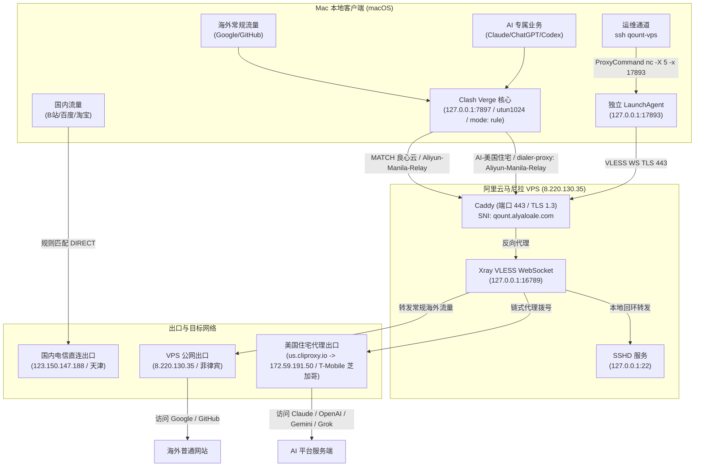

# 本机网络分流与 AI 防封控架构手册

> **状态**：active｜**权威**：L2 运维手册｜**最后更新**：2026-10-10
> **本文回答**：Mac 个人网络分流拓扑、VPS 443 TLS 隧道、美国住宅代理链式转发原理、防 Claude 封号环境对齐全套方法与故障排查。
> **TL;DR**：架构实现“国内直连、常规海外走自建 VPS、AI 流量经 VPS 链式路由至美国芝加哥住宅代理”。SSH 彻底解耦公网 22 改走 443 TLS WebSocket 独立隧道。系统时区已对齐住宅出口所在城市（America/Chicago），Chrome 已固化 WebRTC 防泄漏策略与语言偏好，终端已补齐环境注入。

---

## 1. 架构全景



---

## 2. 核心网络分流机制

整套方案实现了流量精细化隔离，兼顾访问速度、账号安全性与流量成本：

| 业务分类 | 命中规则 / 分组 | 传输链路 | 出口 IP 与归属 | 关键特性 |
| :--- | :--- | :--- | :--- | :--- |
| **国内直连** | `GEOIP,CN`<br>`DOMAIN-SUFFIX,cn` 等 | 本机直连网卡 | `123.150.147.188`<br>中国电信 | 延迟 70~150ms，零代理损耗，绝不消耗住宅流量 |
| **海外常规** | `MATCH,良心云`<br>(选定 `Aliyun-Manila-Relay`) | Mac ➔ VPS (443 TLS) ➔ 公网 | `8.220.130.35`<br>菲律宾马尼拉阿里云 | 完全脱离第三方机场依赖，带宽独享，不花住宅流量 |
| **AI 专属业务** | `AI-美国住宅`<br>(涵盖 Anthropic/OpenAI/Google AI/xAI) | Mac ➔ VPS (443 TLS) ➔ 住宅代理 ➔ 目标平台 | `172.59.191.50`<br>美国芝加哥 T-Mobile 家宽 | 纯正住宅 ISP，原生绕过机房 IP 403 质询拦截 |
| **SSH 运维** | `~/.ssh/config`<br>(Host `qount-vps`) | Mac ➔ 本地 17893 ➔ VPS 443 ➔ 本机 22 | 内网回环连接 | 避开公网 22 阻断，0.8 秒免密直连 |

---

## 3. SSH 22 端口历史故障复盘与 443 改造优势

### 3.1 为什么原生直连 22 端口会停滞？
在实际排查中，`ssh -vvv` 底层抓包定位了断连真相：
1. **TCP 三次握手成功**、**SSH 协议版本标识（明文字符串）交换成功**；
2. **在随后的第三步 `SSH2_MSG_KEXINIT`（密钥交换协商包）彻底失去响应**。

**停滞的深层原因**：
- **跨境 DPI 报文特征识别**：此前通过 `ssh -D 17893` 承载持续高熵网页代理流量，触发跨境国际出口网关 DPI 行为识别。TCP 握手及版本协商均为几十字节小包；而密钥交换协商包通常超过 1000~1500 字节，跨境网关对 `(本地:端口 <-> 海外:22)` 进行了长连接行为阻断，专门拦截丢弃大包。
- **公网 22 暴露遭受字典爆破风暴**：VPS 公网 22 端口遭受全网自动化字典爆破轰炸，触发了 `/etc/ssh/sshd_config.d/` 下的 `PerSourceMaxStartups 3` 保护，导致合法连接在 preauth 阶段被丢弃。

### 3.2 改造为 443 TLS WebSocket 的核心优势
- **伪装度高**：流量封装在标准 TLS 1.3 报文中，带有合法证书与 `qount.alyaloale.com` 域名，中间网络设备仅视为普通 HTTPS 浏览；
- **公网收敛**：SSH 端口不再暴露给公网爆破攻击，公网仅开放 Caddy (80/443)；
- **架构解耦**：本地运行独立轻量 LaunchAgent 守护进程（监听 `127.0.0.1:17893`），即便 Clash Verge 退出或重启，终端执行 `ssh qount-vps` 依然秒级畅通。

---

## 4. 防 Claude / Anthropic 封号全套硬核配置

Claude 的反作弊系统（基于 Cloudflare Turnstile、IP 欺诈库及自研风控）会全方位比对 IP、时区、WebRTC、语言与环境指纹。当前本机已完成如下加固：

### 4.1 本机系统时区对齐（已实施）
* **原理**：浏览器 JavaScript (`Intl.DateTimeFormat().resolvedOptions().timeZone` 与 `new Date().getTimezoneOffset()`) 会直接上报系统时区。如果出口 IP 位于芝加哥，而系统时区为 `Asia/Shanghai`（时差 13 小时），属于高危不一致特征。
* **已执行配置**：
  ```bash
  sudo systemsetup -settimezone America/Chicago
  ```
  已将系统时区直接对齐至住宅代理出口所在的 **芝加哥 (America/Chicago，CDT / UTC-5)**。

### 4.2 WebRTC 真实 IP 防泄漏（已实施）
* **原理**：即使开启系统代理，Chrome 默认的 WebRTC 协议仍可能通过 UDP STUN 探测绕过代理，向网站泄露中国公网 IP（`123.150.147.188`）。
* **已执行配置**：
  ```bash
  defaults write com.google.Chrome WebRtcIPHandlingPolicy -string "disable_non_proxied_udp"
  ```
  强制 Chrome 的 WebRTC 流量只能走代理，彻底封堵直连泄露通道。

### 4.3 浏览器语言环境偏好（已实施）
* **已执行配置**：
  修改 Chrome `Preferences` 中的 `intl` 设置为 `en-US,en,zh-CN,zh`。
  向服务端发送的 `Accept-Language` 请求头与前端 `navigator.languages` 中，**美式英语 (en-US)** 处于最高优先级。

### 4.4 终端与 CLI 开发工具环境注入（已实施）
* **已执行配置**：
  在 `~/.local/bin/claude-us` 与 `~/.codex/proxy-env.zsh` 中注入：
  ```bash
  export HTTP_PROXY="http://127.0.0.1:7897"
  export HTTPS_PROXY="http://127.0.0.1:7897"
  export TZ="America/Chicago"
  export LANG="en_US.UTF-8"
  ```
  终端运行 `cc` (Claude Code) 和 Codex 时，Node.js 运行时环境自动对齐美国中部时间与美式语言，且通过 Cloudflare 探测预检。

### 4.5 住宅会话稳定性（Sticky Session）
* 住宅代理使用固定会话 `sid-Rv3gvPAw-t-120`（120 分钟租期），保持出口 IP 稳定，避免网页每刷新一次就跳跃一次跨州 IP。

---

## 5. 核心配置文件分布索引

| 配置文件路径 | 所属服务 / 客户端 | 核心作用 |
| :--- | :--- | :--- |
| `~/.config/aliyun-manila-relay/ssh-client.json` | 独立 SSH 转发守护 | 本地 17893 端口轻量 Mihomo 配置（连接 VPS 443） |
| `~/Library/LaunchAgents/com.alyaloale.aliyun-manila-relay.plist` | macOS Launchd | 开机自启 17893 端口守护进程 |
| `~/.ssh/config` | OpenSSH 客户端 | 配置 `Host qount-vps` 走 `nc -X 5 -x 127.0.0.1:17893` |
| `~/.local/bin/claude-us` | Claude Code 包装脚本 | 注入美国时区与代理，预检出口归属地并启动 Claude |
| `~/.codex/proxy-env.zsh` | 终端 Codex 环境 | 导出 7897 代理变量与 `America/Chicago` 时区 |
| `.../clash-verge-rev/clash-verge.yaml` | Clash Verge 运行时 | 锁定 `mode: rule` 与 `mixed-port: 7897` |
| `.../clash-verge-rev/profiles.yaml` | Clash Verge 配置集 | 持久化记录 `良心云 -> Aliyun-Manila-Relay` 选中项 |
| `.../profiles/rn08w8hHqxDo.yaml` | Clash Verge 分流规则 | 规定 AI 域名与 Cloudflare 探测走住宅，VPS 节点直连 |
| `/etc/systemd/system/aliyun-relay.service` | VPS 端 systemd | 运行 Xray VLESS 服务，监听 `127.0.0.1:16789` |
| `/etc/caddy/Caddyfile` | VPS 端 Caddy | 443 端口反向代理 WebSocket 路径至 Xray |

---

## 6. 常用验证与运维排错指令

### 6.1 验证分流与出口归属
```bash
# 1. 验证国内直连出口（应返回中国本地电信 IP）
curl -s --connect-timeout 5 https://myip.ipip.net

# 2. 验证海外常规出口（应返回菲律宾马尼拉阿里云 IP: 8.220.130.35）
curl -s --connect-timeout 5 -x http://127.0.0.1:7897 https://ipinfo.io/json

# 3. 验证 AI 专属业务出口（应返回美国芝加哥 T-Mobile IP: 172.59.191.50，loc=US）
curl -s --connect-timeout 5 -x http://127.0.0.1:7897 https://www.cloudflare.com/cdn-cgi/trace | grep -E "ip|loc|colo"
```

### 6.2 验证开发工具与时区
```bash
# 验证系统当前时区与时间
date
readlink /etc/localtime

# 验证 Chrome WebRTC 防泄漏策略
defaults read com.google.Chrome WebRtcIPHandlingPolicy

# 验证 Claude Code 终端启动与预检
cc --version

# 验证 SSH 经 443 隧道直连 VPS
ssh qount-vps 'uptime'
```
