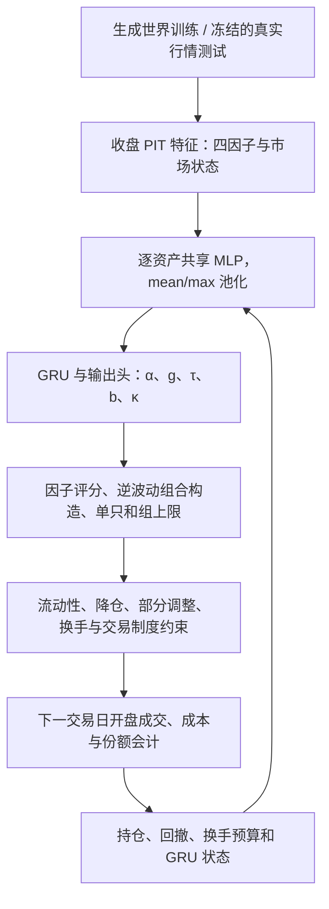

# P2 ETF Trader：当前架构、双端训练与历史实测

> **状态**：active research / exploratory completed｜**权威**：已核对代码与保存产物的研究证据；当前运行事实只看 [current.md](current.md)｜**更新时间**：2026-10-02
> **TL;DR**：3090 已按 owner 要求停训并回收，Stage B 未完成；4 个冻结 checkpoint 已在 WSL 真实历史行情上测试。相对固定评分器有增益，但剔除最好一年后 4 个模型均未满足 G5，不能声明正式 P3 通过。

`research_only=true / orders_authorized=false`。本轮 owner 要求查看双端训练、实现回测并在 WSL 实测；随后要求核查云端并更正错误文档。
研究问题是“现有 checkpoint 在相同真实行情、成本和可复现执行规则下，是否相对固定评分器与 60/40 有增益”。
最小验证为模型输入与训练/参考会计一致、冻结模型与数据后一次测试；停止本轮模型比较后不根据历史收益改参数重试。

## 阅读导航

- [当前架构与市场](#当前架构与市场)：资产范围、因子、网络输入输出、约束、训练方式与代码归属。
- [完成范围与证据缺口](#完成范围与证据缺口)：实现、训练、探索性测试和正式验收的区别。
- [云端停训与回收](#云端停训与回收)、[双端核查](#双端核查1639-的只读快照)：读取时点与已保存权重。
- [冻结与执行口径](#冻结与执行口径)、[真实历史结果](#真实历史结果2-成本)：真实测试范围和结论。
- [代码、产物与复现](#代码产物与复现)、[文档修正与归档](#文档修正与归档)：证据位置、复现入口和历史记录。
- [P3 分层研究及实施计划](etf-p3-research-plan-2026-10.md)：基于本页证据设计的下一代预测/风险/组合/执行路线，原 P2 结果保持原样。

本页继续作为 P2 实际架构与结果的证据主文档。新的 baseline 冻结登记、Stage A/中途 Stage B 配对诊断和 P3 重构均在上述计划中标明待实施；不能把设计推进写成训练或验收已完成。

## 当前架构与市场

核心是**固定、可解释的四因子评分器，加一个学习如何调配因子、仓位和交易节奏的交易员**。
网络每天输出评分与调仓参数，组合构造和硬约束决定实际目标持仓，执行引擎在下一交易日开盘尝试成交。
模型是每日 long/cash ETF 配置，风险资产权重非负、总仓位不超过 100%；没有杠杆、做空或订单授权。
“双端”指 WSL RTX 4060 与云端 RTX 3090 两个计算端，本轮两端实际训练和历史实测都属于 US 账户。

### 市场与账户

| 账户 | 风险资产宇宙 | 现金 | 设计与本轮证据范围 |
| --- | --- | --- | --- |
| US / USD | SPY、QQQ、IWM、EFA、EEM、IEF、TLT、GLD、DBC，共 9 只 | BIL | 覆盖美国与海外股票、债券、黄金和商品；本轮有训练和真实历史结果 |
| CN / CNY | 510300、510500、159915、510050、518880、511010、513100、513500，共 8 只 | MMF | 境内 ETF、黄金、债券和跨境 ETF；代码支持独立账户，本轮没有 CN 训练完成或历史实测证据 |

两个账户分别训练、分别计价，复用网络结构；没有跨账户统一优化或汇率对冲。
现金不参与资产排名，承接未使用仓位及约束削减的权重。Universe 和市场制度定义见
[universe.py](../src/qount/research/etf_trader/universe.py)。本线与被冻结的历史 A 股 ETF 研究线分开，不能据此恢复旧线。



### 四因子评分器

先验 `α = (6, 4, 4, 3) / 17`；因子顺序始终是 M、Trend、Value、Risk。
代码以截至决策日的历史计算因子，转换为截面分位，再把原始值做 756 日滚动标准化；不输入未来价格。
Liquidity 进入容量、准入和成本约束，不作为第五个评分因子。

| 因子 | 先验权重 | 当前实现 |
| --- | ---: | --- |
| M | 35.3% | 跳过最近 5 日的 21/63/126/252 日动量，除以 63 日波动后合成 |
| Trend | 23.5% | SMA200 距离、SMA50/200 斜率符号、过去 252 日高于 SMA200 比例；合成后用 trailing 252 日跨资产回归去除 M 的线性部分 |
| Value | 23.5% | 股票估值自身历史分位取反、债券收益率自身历史分位；黄金和商品中性。本轮缺 PIT 估值，**全部资产固定为中性，`value_enabled=false`** |
| Risk | 17.6% | 波动、回撤、下行波动相对自身历史分位取反；风险水平另由组合构造的逆波动权重处理 |

实现见 [scorer.py](../src/qount/research/etf_trader/scorer.py)。α 是评分系数，不能解释为持仓比例。
本轮 Value 名义权重即使较高，也没有估值择时证据：其截面常数项在评分 softmax 中消去；α 的归一化仍会改变其余因子的评分幅度。

### 网络输入与输出

| 输入 | 维度 | 组成 |
| --- | ---: | --- |
| 每只资产 | 12 | 4 个因子分位 + 4 个标准化原始值；当前权重、距 35% 单只上限的空间、流动性可交易标记、`log1p(0.05 × ADV / equity)` |
| 市场 | 6 | 高于 SMA200 的资产比例、63 日收益离散度、63 日平均两两相关、等权组合 63 日年化波动、其 21 日变化、首只股票与首只债券的 63 日相关；滚动标准化 |
| 账户 | 6 | `used/U`、`1-used/U`、回撤 dd、`D1-dd`、`D2-dd`、是否处于降仓状态 |

资产共享两层 Linear + SiLU 编码器 φ；mean 与 max 池化后拼接市场/账户状态，GRU 输入宽度为 `2 × d_phi + 12`。
没有按资产位置分配独立参数。GRU 输出接 8 维线性头，前 4 维调节因子先验，后 4 维产生交易参数。
实现见 [features.py](../src/qount/research/etf_trader/features.py)、
[policy.py](../src/qount/research/etf_trader/policy.py) 和 [train.py](../src/qount/research/etf_trader/train.py) 的 `policy_inputs()`。

| 输出 | 变换/边界 | 用途 |
| --- | --- | --- |
| α（4 个系数） | `softmax(log(prior) + tanh(delta))`，总和为 1 | 决定四因子组合分 |
| g | sigmoid，0–1 | 组合构造前的目标总仓位；约束后实际仓位可能更低 |
| τ | 对数尺度 sigmoid，0.03–1 | 分数转权重时的集中度温度；越小越集中 |
| b | 0–0.10 | 不交易带，权重差低于带宽时不主动调整 |
| κ | 0.05–1 | 超出不交易带的差额，本次调整多少 |

目标权重 `w_i ∝ exp(Σ α_k rank_ik / τ) / σ_i,63`，在合格资产上归一后乘 g。
单只 35%、同类组 50% 的超出部分直接转现金，不重新分配；US 同类组为 SPY/QQQ/IWM 和 IEF/TLT。
代码默认结构 phi32/h64/L1 为 29,256 参数，仅是默认值；本轮实测 WSL phi32/h32/L2 为 18,632 参数，3090 phi32/h16/L2 为 7,752 参数（按实际层维度计算）。
不能用默认结构替代 checkpoint 内实际结构。

### 硬约束与执行

| 层 | 当前规则与本轮口径 |
| --- | --- |
| 流动性 | ADV 是 trailing 20 日成交额；低于自身 trailing 252 日中位数的 30% 或价差高于其中位数 3 倍时只允许减仓；仓位容量按 3 日 × 5% ADV，单日成交额上限 5% ADV |
| 降仓与恢复 | D1=10% 回撤时 gross 上限 50%；D2=15% 时上限 20%；有独立的恢复条件，不因网络输出更高 g 而绕过 |
| 部分调仓 | `κ × sign(diff) × max(abs(diff)-b, 0)`；不同于忽略 b/κ 直接买入目标组合 |
| 换手 | trailing 252 日单边主动换手 U：US=4、CN=3；强制降仓单独记账，总换手诊断上限为 1.5U |
| 市场制度 | US 默认整股；CN 默认 100 份、0.001 tick、±10% 价格带和境内股票 ETF 的 T+1 掩码；CN 制度尚需 P0 审计 |
| 执行与会计 | t 收盘决策，t+1 开盘成交；未复权价计算份额、现金、整股和成交成本，复权收益支持总回报及分配现金会计 |
| 成本 | 佣金、规费、半价差与平方根冲击。本轮初始资金 USD 1,000,000；价差为静态估计，费率为研究默认，未按历史各期费率逐期审计；现金 BIL 收益不计交易费 |

约束见 [constraints.py](../src/qount/research/etf_trader/constraints.py)，成本见
[costs.py](../src/qount/research/etf_trader/costs.py)，参考会计见 [env.py](../src/qount/research/etf_trader/env.py)。
训练使用 [torch_env.py](../src/qount/research/etf_trader/torch_env.py) 的可微模式；本轮真实历史使用 numpy 份额会计。
Torch exact 模式与 numpy 一致性的测试，不能等同于可微训练模式每一项成交都完全相同。

### 训练方法与有效配置

训练直接对可微模拟器中的净收益反向传播，使用 **252 日截断 BPTT、Adam、梯度范数裁剪 1**，没有 PPO 的策略概率比、裁剪目标或 critic。
优化目标包含净 log 收益、因子权重偏离先验的 KL 惩罚、回撤/CVaR 约束的对偶项，以及接近换手预算的软惩罚；硬换手限制仍由环境执行。
每个 segment 用跨世界最差 5% 的回撤/收益尾均值更新对偶变量，日志 `p95_max_dd` 则是 episode 级 95% 分位诊断，两者口径有区别。

| 设置 | 本轮保存模型的有效值 |
| --- | --- |
| 世界与预算 | 每批 256 个结构族世界；每世界 10 年因子预热 + 8 年交易；Stage A 30 episodes，当前云端 Stage B 计划 100 episodes |
| 风险目标 | `dd_target=0.15`、`cvar_floor=-0.10`，`dual_lr=0.5` |
| 正则与换手软惩罚 | `lambda_kl=0.01`、`turnover_soft_start=0.9`、`lambda_turnover=1.0` |
| 搜索空间 | d_phi∈{16,32}、hidden∈{16,32,64,128}、layers∈{1,2}，共 16 个结构；设计学习率候选 {1e-4,3e-4,1e-3}，不代表全部已完成 |
| 已实测配置 | WSL phi32/h32/L2、lr=3e-4、2 seeds、30 episodes；云端 phi32/h16/L2、lr=1e-4、2 seeds、ep40 中途状态 |

以上配置来自 `results.json` 的模型 config 和回收 `checkpoint-validation.json`。
`TrainConfig` 的 600-episode 默认及 `train_optimized.py` 的 20% 回撤默认均不代表这些已保存模型；训练 15% 目标、降仓 D1/D2 与历史 G3 的 20% 诊断上限也不能混用。
KL/CVaR 的当前值在原设计中仍属待校准参数，不能因训练已运行而宣称正式校准或 owner 参数验收完成。

生成世界的路径为宏观状态 → 基本面/估值 → 定价 → 微观结构；结构族具备 numpy 与 C++ 后端，代码见
[generator/](../src/qount/research/etf_trader/generator/)。自助族与可解析子族代码存在，但完整两族泛化验收、独立验证遗憾值、1-SE 最小容量选择尚未核实完成。
本轮历史结果不能反向用于挑结构或修改生成器。

## 完成范围与证据缺口

| 工作 | 已有证据 | 尚未完成 / 不能推出的结论 |
| --- | --- | --- |
| P0 数据合同 | 本轮 Yahoo US 9 ETF + BIL 原始 JSON、规范 CSV、来源及 hash；无共同日期删减 | 替代口径；正式 Tiingo/PIT 估值/历史成本审计不完整，CN 面板未实测 |
| P1 模块与生成器 | 代码存在；本轮输入、numpy 会计和 Torch exact 相关验证共 20 项在 WSL 通过；过去生成器诊断已归档 | 本轮没有重跑 1,000 世界验收；旧报告部分项目待校准，不能汇总成两市场全部正式通过 |
| P2 训练与选模 | 云端 Stage A 32/32 个模型已保存；Stage B 5 个最新 ep60 权重已回收；WSL 状态仅有 16:39 快照 | 云端 Stage B 停于计划 100 episodes 之前；WSL 该快照未全部完成；无正式最终模型选择与两族验收证据 |
| 历史探索性实测 | 4 个冻结模型，1×/2×/3× 成本，完整净值、持仓、动作与 hash；G1–G4 满足、G5 均失败 | 已暴露窗口的弱保留集，不能声明正式 P3、独立 OOS 或稳健性通过；未完成 DSR/PBO、配对块自助置信区间 |
| P4 前瞻与生产 | 无本线新部署或交易授权 | 没有前瞻验收；研究结果不改变 VPS、服务、账户或订单权限 |

目前应将这条线理解为**实现可运行、部分训练完成、历史探索评估已完成但未通过全部门槛的研究模型**。
原设计的阶段目标见 [设计方案 §11](etf-imitation-policy-design-2026-09.md#11-实施阶段)，
2026-10-01 的实现与生成器记录见 [历史实施快照](archive/p2-history/snapshots/implementation-20261001.md)。

## 云端停训与回收

owner 于 2026-10-02 明确要求“停掉当前 3090 训练，回收保存重要结果和代码”。
先冻结云端训练调度、trainer、子进程、自动续跑和 P2 监控，取得稳定文件快照并完成备份/模型校验；
外置盘回读验证完成后终止关联进程。17:18 停止回执显示活跃目标进程为 0，GPU 利用率 0%、显存 1 MiB；
17:20 再次核查 GPU compute 进程为空。停止后的源文件 hash 与冻结快照无差异。

| Seed | 停训前最后完成 episode index | 回收的最新模型 |
| --- | ---: | --- |
| 20260930 | 64 | checkpoint_ep60.pt |
| 20260931 | 62 | checkpoint_ep60.pt |
| 20260932 | 65 | checkpoint_ep60.pt |
| 20260933 | 62 | checkpoint_ep60.pt |
| 20260934 | 63 | checkpoint_ep60.pt |

episode 从 0 编号。ep60 模型代表完成 61 个 episode 时的保存状态；后续训练记录保存在日志，内存中的最新权重未被持久化。
本次没有把不完整训练记成完成，也没有重新启动训练。现有 checkpoint 没有完整 optimizer/RNG 状态，不保证精确接续训练。

回收根：`E:\qount_data\qount\artifacts\etf_trader\cloud_recovery_20261002_1713`，WSL 路径为
`/mnt/e/qount_data/qount/artifacts/etf_trader/cloud_recovery_20261002_1713`。

- `p2_recovery_20261002_1713.tar.gz`：原始回收包 17,841,464 bytes（约 17.8 MB），SHA256 `9f81d58d94a54acfef76bb0d577177f6fa314a1f9196d46da77382ef51d0bc57`。
- `bundle/experiments/`：全部云端 P2 实验结果，包括当前 Stage A 32 个最终模型、Stage B 所有历史 checkpoint、最新 5 个 ep60 模型、配置、完整 history/train.log、监控和自动续跑日志。
- `bundle/code/`：云端实际 ETF 训练包（含生成器 C++ 源码/目标 JSON）、训练和容量搜索入口、相关测试、项目元数据及续跑/启动脚本。实际 `etf_trader_train.py` 与 Mac 入口存在差异，已保留云端版本用于重现。
- `bundle/evidence/`：冻结前/后的关联进程、源文件 SHA256、每个模型验证结果、最后训练进度、Python/torch/CUDA/包版本。云端 torch 为 2.7.0+cu128、CUDA 12.8，与本次 WSL 回测环境分开记录。
- `post-stop/`：停止回执、停止后 hash/GPU 审计和 manifest；`operation-script.py` 保存无凭据的操作脚本。
- `recovery-manifest.json`：整个回收目录 551 个文件的相对路径与 SHA256；附来源、执行方式、保留策略和研究守卫。

验证原包 542 项文件 hash 全部匹配；33 个最终模型（32 个当前 Stage A + 1 个历史 smoke）及 5 个最新 Stage B checkpoint 共 **38 个模型**均可安全加载，tensor 全部有限。
云端和外置盘上的原产物均保留。只导出研究产物、代码与非敏感环境元数据，没有保存 `.env`、认证配置或凭据。
Mac 仅保留 `state/research_runs/etf_trader_cloud_recovery_20261002/` 下的轻量 JSON 摘要；完整代码和模型在外置盘。

云实例仍处于开机状态，本次操作为停止训练及回收，未执行关机或删除。WSL 训练与 VPS 生产状态不在本次停止范围。
原历史实测使用的 ep40 模型及其不可变结果保持原有来源标记；本次未用 ep60 重新测试已经暴露的历史窗口。

## 双端核查（16:39 的只读快照）

- WSL RTX 4060：`experiments/p2_us_full_wsl_20261002_033008`，Stage A 16 个结构 × 2 seeds = 32 次运行；27 次有最终 `model.pt` 和 30-episode history。
  剩余三个 h128 运行最后记录为 episode 22（从 0 编号，即完成 23/30）。另两次未产生最终模型：phi16/h16/L2 seed20260930 日志停在 03:30 的 compile 回退提示，没有 episode；phi16/h32/L1 seed20260931 日志停在 04:57，记录 CUDA device-side assertion。未终止或重启任何训练。
- 云端 RTX 3090：`/root/autodl-tmp/experiments/p2_us_optimized_20261002_040315`，Stage A 32/32 次有最终模型。
  Stage B 当前 phi32/h16/L2、lr=1e-4 的 5 seeds 最后 episode 分别为 52、50、52、50、51（完成 51–53/100）；没有最终模型。
  最近 episode 169–184 秒，世界生成 100 秒以上；“缓存后 60 秒、17:00 完成”不再成立。按近期速度，当前 5 seeds 仍需约 2.3–2.5 小时；这不是整个 Stage B 的 ETA。
- 两端均为 US 账户研究模型。不是“美股与 A 股双账户训练已完成”；本轮也没有测试 CN 模型。
- 约 6% 的 `ann_log_return` 来自生成世界训练 episode。未核实独立验证遗憾值、1-SE 选择或第二生成族验收，不能据此选出最终模型或断言 h32/L1 最优。

## 冻结与执行口径

回测窗口为 **2015-01-02 收盘首次决策 → 2015-01-05 首次开盘成交 → 2026-10-01**，2,953 个收益日。
2009-01-02 起的 1,510 个共同历史 bar 仅用于因子预热，不偷扣测试窗口内 1,000 天。

预先声明的 4 个模型：WSL phi32/h32/L2（lr=3e-4）两个 30-episode 最终模型；云端 phi32/h16/L2（lr=1e-4）两个 ep40 中途 checkpoint。
云端文件是 episode index 40 保存的状态，不能当作 100-episode 最终模型。模型来源、SHA256、配置和源代码 hash 在推理之前写入 `contract.json`；保存模型副本。
两端模型结构、学习率与训练预算不同，结果不支持“3090/4060 硬件导致效果差异”的推论；未用历史收益筛选胜者。

- 全部 9 只 US ETF 加 BIL，来自 Yahoo 公共日线；4,464 个共同交易日，无日期删减。Mac 仅获取公开行情后同步外置盘，推理和会计均在 WSL CPU 执行，以保留训练 GPU 资源。
- 收盘复权价计算因子和总回报；开盘/收盘价格用于份额会计与成本，成交额为 volume × close 的 trailing 20 日均值。风险资产窗口无拆股；BIL 拆股只出现在现金复权收益代理中，不持有其份额。
- 在 t 收盘决策、t+1 开盘成交；复用 `env.simulate()` 的份额、分红现金、整股、流动性、换手和降仓规则。
- 输入是训练时相同的 12 维资产状态和 6 维账户状态；使用模型输出的 α/g/τ/b/κ，经既有组合构造函数形成目标权重。GRU 从零状态开始，不在预热期虚构交易。
- 无 PIT 估值来源：Value 全体中性，结果明确 `value_enabled=false`。现金使用 BIL adjusted-close 日收益作为代理，未计 BIL 买卖费用。
- 固定评分器共用风险约束、成本及换手预算。60/40 按 SPY 60%/IEF 40%、每 21 交易日调仓，保留相同成本与换手预算；为了表示真正的 60/40，不施加交易员的 35% 单只、50% 组上限或降仓开关。
- Sharpe 使用净算术日收益、零收益基准；另报告相对同期 BIL 的超额 Sharpe，避免混用旧文档凭空设定的 4.5% 无风险利率。BIL 零基准 Sharpe 不用于风险资产比较。

## 真实历史结果（2× 成本）

| 模型/基准 | CAGR | Sharpe（零基准） | Sharpe（扣 BIL） | 最大回撤 | 平均现金比例 |
| --- | ---: | ---: | ---: | ---: | ---: |
| WSL phi32/h32/L2 seed 20260930（30 episodes） | 6.52% | 0.776 | 0.551 | 14.49% | 9.94% |
| WSL phi32/h32/L2 seed 20260931（30 episodes） | 6.70% | 0.802 | 0.575 | 14.47% | 8.75% |
| 3090 phi32/h16/L2 seed 20260930（ep40） | 6.38% | 0.781 | 0.549 | 14.23% | 9.95% |
| 3090 phi32/h16/L2 seed 20260931（ep40） | 6.45% | 0.788 | 0.557 | 13.86% | 9.86% |
| 固定评分器 | 5.86% | 0.725 | 0.492 | 13.87% | 24.13% |
| SPY/IEF 60/40 | 8.75% | 0.862 | 0.675 | 21.18% | 0.07% |
| BIL 现金收益代理 | 1.96% | — | 0.000 | 0.21% | 100.00% |

4 个模型的 CAGR 高于固定评分器的 5.86%，Sharpe 高于其 0.725，回撤相差不到 3 个百分点。
相对 60/40 的 8.75% CAGR，模型收益较低，回撤从 21.18% 降至约 14%；全窗口满足 G1 所需的 Sharpe 容差与 30% 回撤改善。
平均现金只有 8.75%–9.95%，并非旧文档猜测的“60% 现金”。真实持仓、逐日交易成本和模型动作均有完整产物。

### 实际持仓、交易节奏与成本

下表简称 seed30/31 分别为 20260930/20260931；模型顺序与前表一致。数值直接摘自冻结产物 `results.json` 的 2× 成本结果，没有重新推理或选择胜者。

| 模型 | 平均 g | 平均 τ | 平均 b | 平均 κ | 年均主动/强制单边换手 | 最大滚动主动/总换手 | 累计成本 USD | 降仓天数 |
| --- | ---: | ---: | ---: | ---: | ---: | ---: | ---: | ---: |
| WSL seed30 | 0.986 | 0.266 | 0.035 | 0.318 | 0.628/0.091 | 1.070/1.217 | 5,828.19 | 423 |
| WSL seed31 | 0.985 | 0.310 | 0.041 | 0.257 | 0.380/0.069 | 0.891/0.902 | 3,544.21 | 318 |
| 3090 seed30 ep40 | 0.961 | 0.298 | 0.025 | 0.412 | 0.841/0.087 | 1.446/1.461 | 7,897.14 | 386 |
| 3090 seed31 ep40 | 0.972 | 0.295 | 0.027 | 0.405 | 0.759/0.090 | 1.371/1.371 | 7,145.24 | 414 |

主动与强制换手按 252 个交易日年化，最大滚动值用于 G4，不能以全窗口平均代替。
平均 g 是网络的期望仓位；实际现金还受单只/组上限、降仓、不交易带和执行规则影响。上表是整条路径的观测，不是证明哪项约束导致收益差异的消融实验。

| 平均评分系数 α | M | Trend | Value（本轮中性） | Risk |
| --- | ---: | ---: | ---: | ---: |
| WSL seed30 | 0.255 | 0.213 | 0.376 | 0.156 |
| WSL seed31 | 0.240 | 0.221 | 0.377 | 0.162 |
| 3090 seed30 ep40 | 0.279 | 0.218 | 0.340 | 0.162 |
| 3090 seed31 ep40 | 0.262 | 0.220 | 0.362 | 0.156 |

这些是生成世界训练出的评分系数在真实窗口上的平均输出，不能解释为实证识别了 Value 溢价；本轮所有资产的 Value 同分。

| 平均持仓占权益 | WSL seed30 | WSL seed31 | 3090 seed30 ep40 | 3090 seed31 ep40 |
| --- | ---: | ---: | ---: | ---: |
| SPY | 12.72% | 12.30% | 12.52% | 12.49% |
| QQQ | 10.24% | 9.73% | 9.89% | 9.90% |
| IWM | 7.44% | 7.19% | 7.30% | 7.30% |
| EFA | 9.78% | 9.89% | 9.64% | 9.63% |
| EEM | 7.70% | 7.54% | 7.36% | 7.46% |
| IEF | 17.55% | 18.89% | 18.32% | 18.32% |
| TLT | 7.64% | 8.12% | 7.87% | 7.94% |
| GLD | 10.03% | 10.43% | 10.07% | 10.02% |
| DBC | 6.96% | 7.15% | 7.08% | 7.07% |
| 现金 | 9.94% | 8.75% | 9.95% | 9.86% |

持仓是在模拟执行与会计后观察到的路径平均，四因子 α 则是评分系数；两者没有一一对应关系。不得把 Value 的名义 α 当成估值资产的资金占比。

### 年度净收益（2× 成本）

| 年份 | WSL seed30 | WSL seed31 | 3090 seed30 ep40 | 3090 seed31 ep40 | 固定评分器 | 60/40 |
| --- | ---: | ---: | ---: | ---: | ---: | ---: |
| 2015 | -4.47% | -4.22% | -4.82% | -4.85% | -4.39% | 1.70% |
| 2016 | 2.37% | 6.57% | 2.84% | 2.82% | 0.11% | 7.77% |
| 2017 | 18.21% | 17.63% | 17.68% | 17.72% | 16.30% | 13.73% |
| 2018 | -5.06% | -5.23% | -4.88% | -4.95% | -2.16% | -2.06% |
| 2019 | 15.07% | 14.62% | 14.35% | 14.56% | 11.35% | 21.71% |
| 2020 | 3.84% | 3.33% | 5.83% | 5.31% | 2.24% | 16.39% |
| 2021 | 12.23% | 10.49% | 12.47% | 12.31% | 14.71% | 15.09% |
| 2022 | -10.22% | -10.63% | -10.33% | -10.02% | -6.42% | -16.64% |
| 2023 | 11.90% | 12.22% | 12.12% | 12.17% | 7.55% | 16.79% |
| 2024 | 11.37% | 11.46% | 10.63% | 10.76% | 10.84% | 14.27% |
| 2025 | 18.38% | 18.96% | 16.80% | 17.28% | 14.48% | 14.11% |
| 2026（截至 10-01） | 7.53% | 7.96% | 6.53% | 6.90% | 7.33% | 5.80% |

2026 仅 188 个收益日，表中为期间累计净收益，未年化。剔除年度诊断从收益序列中去掉对应年度后重新计算 Sharpe/回撤，未重跑或重新训练模型。

### 成本敏感性（CAGR）

| 模型 | 1× | 2× | 3× |
| --- | ---: | ---: | ---: |
| WSL phi32/h32/L2 seed 20260930（30 episodes） | 6.54% | 6.52% | 6.50% |
| WSL phi32/h32/L2 seed 20260931（30 episodes） | 6.73% | 6.70% | 6.69% |
| 3090 phi32/h16/L2 seed 20260930（ep40） | 6.34% | 6.38% | 6.35% |
| 3090 phi32/h16/L2 seed 20260931（ep40） | 6.47% | 6.45% | 6.42% |

换手较低，成本增加影响较小。成本影响不必严格单调：约束、整股成交、降仓和 GRU 输入会随净权益改变整条路径；没有固定同一交易路径只扣额外费用。

### 探索性门槛诊断

| 门槛 | 本轮计算规则（2× 成本） | 4 个模型结果 |
| --- | --- | --- |
| G1 | Sharpe ≥ 60/40 − 0.10，且最大回撤 ≤ 60/40 × 0.70 | 全部满足 |
| G2 | Sharpe ≥ 固定评分器，且最大回撤 ≤ 固定评分器 + 0.03 | 全部满足 |
| G3 | 最大回撤 ≤ 20% | 全部满足 |
| G4 | 最大滚动主动换手 ≤ U，最大滚动总换手 ≤ 1.5U；US U=4 | 全部满足 |
| G5 | 选出模型收益最高的完整年份（≥240 收益日），模型与 60/40 同时剔除该年，仍需满足 G1 | 全部失败 |

4 个模型均满足全窗口 G1、G2、G3 和 G4；**4 个模型均未满足 G5**。
WSL 两个模型剔除最好完整年份 2025 后，Sharpe 降为 0.670/0.692，而同期剔除后的 60/40 为 0.826，未达到基准减 0.10。
云端两个模型剔除最好完整年份 2017 后为 0.653/0.660，基准为 0.794，同样未达到容差；回撤条件仍满足。
因此即使按本轮替代口径诊断，也不能声称稳健性通过。

这是已经被先前研究看过的**弱保留集探索性实测**，不是正式 P3：最终模型选择、两族验收、P0 Tiingo/估值审计、DSR/PBO 和配对块自助置信区间尚未完成。
本轮记录 4 个模型的历史数据暴露，不冒称只占一次账户试验、不自行宣称全局 trial 已到 153。同窗口未来再次测最终模型不能称新的独立 OOS。
不得依据这次结果放宽风控或修改生成器再重新宣称样本外通过；生产权限仍为 false。

## 代码、产物与复现

实现位于 `src/qount/research/etf_trader/historical_data.py` 和 `historical_backtest.py`；脚本是薄入口。
既有 `etf_trader_backtest{,_full,_real,_nopandas}.py` 保留路径并转到同一个实现，消除旧占位和重复错误。
`batch_backtest_full.sh`/`batch_backtest_p2.sh` 接受显式重复 `--checkpoint`，一次冻结整个比较集。
旧 `--warmup` 参数不再使用；`--start` 是真实评估起点，预热历史来自完整数据面板。

WSL 环境已实际验证：`/usr/bin/python3`、torch 2.5.1+cu124、numpy 2.5.0；通过下面的 `PYTHONPATH` 加载，不需要 pandas、不重装训练环境。

```bash
cd /home/alyaloale/Code/qount
export PYTHONPATH=src:/home/alyaloale/venv_upper/lib/python3.12/site-packages
/usr/bin/python3 scripts/research/etf_trader_backtest.py \
  --checkpoint experiments/p2_us_full_wsl_20261002_033008/stage_a/phi32_h32_L2_lr3e-04/seed20260930/model.pt \
  --checkpoint experiments/p2_us_full_wsl_20261002_033008/stage_a/phi32_h32_L2_lr3e-04/seed20260931/model.pt \
  --checkpoint /mnt/e/qount_data/qount/artifacts/etf_trader/checkpoints/cloud_ep40_20261002/qount-cloud-seed20260930-ep40.pt \
  --checkpoint /mnt/e/qount_data/qount/artifacts/etf_trader/checkpoints/cloud_ep40_20261002/qount-cloud-seed20260931-ep40.pt \
  --data-root /mnt/e/qount_data/qount/datasets/etf_trader/qount-p2-history-2009-v2-20261002 \
  --start 2015-01-01 --end 2026-10-01 \
  --out /mnt/e/qount_data/qount/artifacts/etf_trader/NEW_DIRECTORY
```

复现命令要求新输出目录，不能覆盖原证据；没有执行额外历史选模。

- 主产物：`/mnt/e/qount_data/qount/artifacts/etf_trader/historical_20261002_v1`，39 个文件及 SHA256 manifest；包括冻结合同、checkpoint 副本、完整逐日净值/持仓/成本/换手 CSV、逐日模型动作和 1×/2×/3× 汇总。
- 来源与环境：`/mnt/e/qount_data/qount/artifacts/etf_trader/historical_20261002_v1_provenance`，14 个代码文件逐项匹配冻结 hash，附环境版本；`training_status_20261002_1639` 保存双端只读状态和 manifest。
- 数据：`/mnt/e/qount_data/qount/datasets/etf_trader/qount-p2-history-2009-v2-20261002`，10 只资产的源 JSON、CSV 和来源 manifest。
- Mac 仅保留轻量摘要：`state/research_runs/etf_trader_historical_20261002/{results,contract,manifest,wsl-training-status,cloud-training-status}.json`。
- 验证：WSL `test_etf_trader_historical`、`test_etf_trader_env`、`test_etf_trader_torch` **20 项通过**；新增测试逐日比较训练输入和实际适配器动作，覆盖下一期开盘成本、checkpoint 加载、全资产/复权字段和缺文件拒绝。
  Mac 相应数据/参考引擎 12 项运行，其中 1 项因未安装 torch 跳过。原产物 39 项和数据源 JSON/CSV 20 项 hash 回读全部匹配。
  `repository_hygiene.py check`、`git diff --check`、新增/修改 Python 的 compileall 和两个批量 shell 的 `bash -n` 均通过；未运行全仓回归。

## 文档修正与归档

当前运行事实和 owner 决定仅写入 [current.md](current.md)；[README-P2](README-P2.md)、CLAUDE 与全仓文档入口只作导航。
本页集中说明已核对的架构、有效配置、结果、缺口和回收证据；[原设计](etf-imitation-policy-design-2026-09.md) 保留正式验收协议，历史实施进度已拆出。

本轮 owner 明确授权文档整理归档后，先在 [archive manifest](archive/manifest.md) 逐项批准，再移动 18 份旧文档；另将设计 §11.1 拆为 2026-10-01 历史快照。
15 份错误收益/“最终报告”等现存撤回说明放入 `corrections-20261002/`；14:12 进度、旧 RECENT_UPDATES 和通用云环境建议进入 `snapshots/`。
既有 64 份历史记录保留原路径并标记 historical / non-restorable；其中 29 份的明文认证字面值已清除，私有认证配置未修改。
完整分类与路径/hash 审计见 [P2 历史索引](archive/p2-history/README.md) 和 [本轮归档审计](archive/p2-history/archive-audit-20261002.md)。

旧“PPO”、最终最佳模型、60% 现金猜测、约束造成低收益的断言、放宽后收益预测、17:00 必然训练完成和只缺 pandas 的判断均不能作为现有证据。
最新保存的 ep60 是停训回收产物；表中云端收益来自预先冻结的 ep40，没有补测 ep60 或改变原测试集。

本轮仅整理文档、核对已有 JSON 和代码，没有更改模型、训练参数、风控、生产权限或远端服务。
文档验证结果在 [归档审计](archive/p2-history/archive-audit-20261002.md#验证记录) 记录；前文 WSL 20 项模型相关测试属于此前实测批次，本轮没有冒称重新运行。
