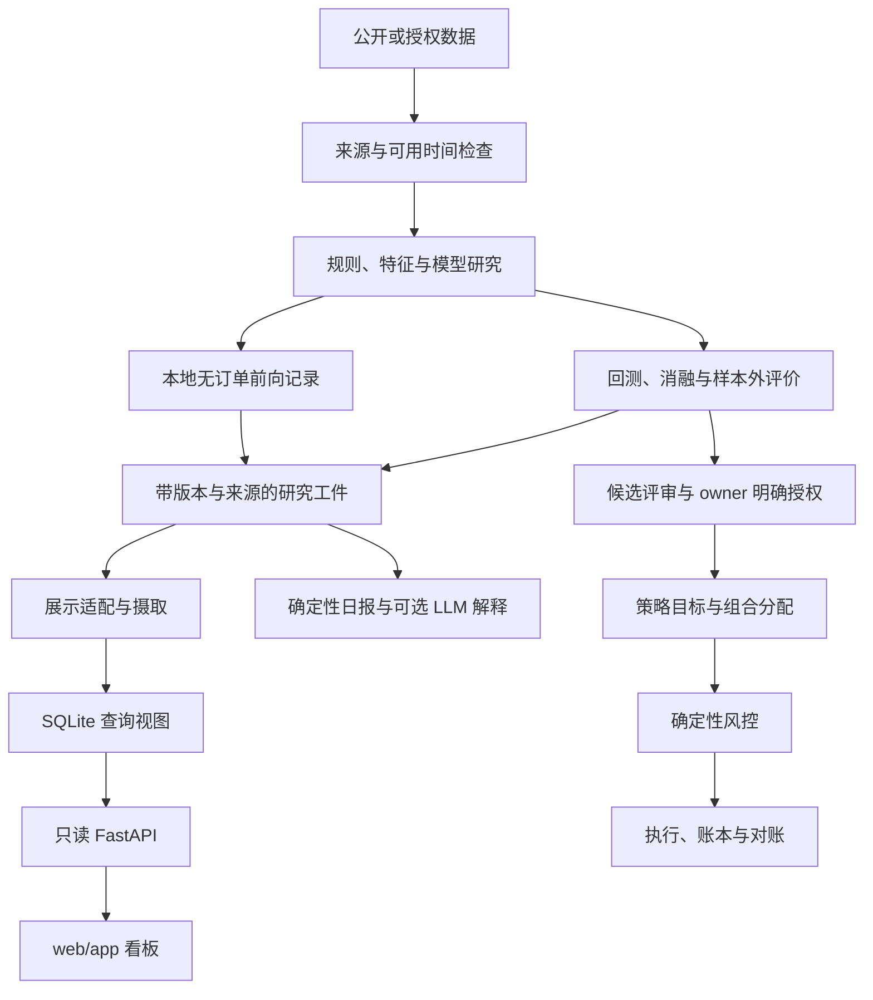

# QOUNT 个人资产管理交易系统架构设计

> **状态**：active｜**权威**：架构主设计；遵循 [AGENTS.md](../AGENTS.md) 与 [项目规则](project-rules.md)｜**最后更新**：2026-10-16
> **本文回答**：研究、助手展示与生产执行如何分工，现有模块如何连接，何时值得扩展架构。
> **TL;DR**：研究循环围绕净收益、回撤与可信证据；只读助手消费有来源的工件；真实交易经独立风控、执行与授权路径。

2026-10-16本地整理：账户观察独立于策略交易池，研究查询与前向模拟分开，新增共享回测组件与分线结果复用；四个主页面为资产、实盘、记录、研究。实际结构与剩余限制见[个人系统结构](personal-system-consolidation-plan.md)。以下通用控制面是既有能力，不是每条离线研究的必经流程；旧部署描述以current为准。

## 1. 目标、范围与证据状态

架构覆盖个人资产分析、策略研究、组合配置、风险管理与授权交易执行，服务于长期实盘风险调整后财富增长。ETF 均线择时研究是一条普通研究线；首页资产分析目前只统计已接入的 Binance 账户。先让一个研究问题获得可重复证据，再为复用、性能或执行可靠性增加结构；不以模块数、门禁数或迁移阶段替代研究进展。

本文描述当前仓库可见实现和设计边界。[current.md](current.md)集中维护 owner 决定、部署登记与冻结状态；源码存在不证明已部署，历史部署也不证明今天健康。2026-10-12 本轮仅做本地源码与文档核对，未远端巡检。

| 层面 | 可核对的实现／登记 | 不能由此推定的能力 |
| --- | --- | --- |
| ETF 均线择时研究 | `research/personal_trading_assistant.py` 的规则状态机、数据检查与确定性日报；current 记录 S1/S2、S3-A/B/C 交付 | S3-D 五日工程连续性、真实 ETF 账户资格或长期盈利 |
| 展示后端与前端 | `api/`、`web/app/`；current 记录初版 FastAPI 服务部署 | 工作区后续修复已经同步到 VPS |
| 本地后续修复 | 缺源处理、动态新鲜度、持仓／流水表、CTA-R 适配与 Tiingo 缓存等在工作区可见 | 完整线上流水验收、48 小时配额观察或全部数据边界已闭合 |
| 既有运行产物 | Dual-Engine、CTA-R 侧车、公开采集、只读账户与通知的登记见 current | paper 曲线等于真实账户，或旧交易链可以恢复 |
| 交易控制面 | `contracts/portfolio/risk/execution/ledger/governance/venue` 等现有代码 | 新策略、当前 arm 或实盘订单授权 |

旧约 1,500 行设计与迁移明细保存在 [历史架构](archive/system-architecture-design-pre-2026-10-12.md)。其中 MiniTrend Base、静态 Dashboard、旧成熟度等级和各阶段记录按原时点读取。

## 2. 三条数据流



研究循环可以单独运行，不要求先接完整生产账本。API 摄取与日报生成不触发交易；图中的候选到执行是受授权约束的后续路径，不能从看板状态或某项指标达标自动进入。

## 3. 模块与依赖

| 职责 | 当前代码入口 | 边界 |
| --- | --- | --- |
| 公共数据与计算 | `research_data/`，各线数据模块 | 处理来源、时钟、公司行动、指标与统计；不含订单授权 |
| 策略和模型研究 | `research/`、`mini_trend/`、`small_account/` | 传统规则、Transformer、RL、配置与混合方法按任务实验；线路状态查 current |
| ETF 均线择时研究 | `research/personal_trading_assistant.py`、`scripts/research/run_personal_assistant_daily.py` | 普通研究线，回测与每日状态复用规则；报告数据资格、信号、风险与未知项 |
| 既有 paper | `dual_engine/`、独立 `research/cta_r_*` | 维护各自模拟会计、费用与来源，不继承其他线的证据身份 |
| Binance 资产分析 | `operations/account_assets.py`、`scripts/operations/refresh_dashboard_account_observation.py`、`api/routes/account.py` | 官方钱包汇总、合约浮盈亏与真实观测历史；独立旁路文件，API 不接触凭据或采集交易所 |
| 查询与展示 | `api/adapters/`、`api/ingest.py`、`api/db.py`、`api/routes/`、`web/app/` | 读工件形成查询视图，不训练模型或向交易所发送订单 |
| 通用控制面 | `contracts/`、`persistence/`、`governance/`、`portfolio/`、`risk/`、`execution/`、`ledger/`、`venue/` | 有版本的目标、风控、执行和对账；调用受运行模式与授权限制 |
| 运行与解释 | `operations/`、`reporting/`、`notifications/`、`intelligence/`、`alpha_agents/` | 健康、发布、确定性报告和解释；投递／服务变更按既有授权 |
| 历史兼容 | `legacy/`、`scripts/archive/` | 留存证据与必要兼容，不自动恢复冻结线 |

入口脚本保持薄层，复杂或复用逻辑进入已有包。生产控制面不导入研究脚本或可选训练依赖；查询适配器可以读取研究工件，但没有执行该研究的权限。共享时钟、成本和会计计算优先复用；需要独立核验时使用独立实现并说明核验范围。

这是一张职责地图，不要求按图搬迁全部旧模块。具体源码职责与兼容路径见 [代码组织](reference/code-organization.md)和[仓库地图](reference/repository-map.md)。

## 4. 数据与实验路径

按用途保留原始来源、规范化输入、时点资格与特征之间的关系。最小实验只需足以复现的输入、配置／代码版本、输出和结论；形成候选时补齐其所需的不可变快照与验证证据，沿用已有格式。

核心时钟是 `信息可用 → 策略决策 → 订单提交 → 可能成交`。收盘确认的数据只能用于随后可交易时点；财报、成分、复权、标签与预处理不能引入未来信息。当前名单与历史组合各自需要适用的数据，不因历史全库缺口阻止无关的小实验。

成本模型纳入适用的佣金、税费、价差、滑点、冲击、成交单位、受阻成交、结算与融资成本。近似值标为假设，候选再根据执行证据细化。价格指数、含分红代理、原价现金账本、模拟 NAV 和实盘权益保持清楚身份，不能重复计息／分红或相加。

实验输出至少能说明假设、时间范围、标的与规模、基准、成本、净收益、MDD、样本属性和限制；优先比较 CAGR、Calmar、跨期稳定性与资源成本。训练、验证、测试按时间分离；模型调参、奖励设计、参数敏感性和种子复验按问题选择。已消费样本继续用于研究时保留 discovery 身份，原失败不覆盖。具体见 [验证边界](holdout.md)。

## 5. 只读助手与看板

### 5.1 当前查询链

```text
各线工件／快照 + config/paper-lines.json
  → api/adapters：转换为 PaperLine / AccountSnapshot 等展示结构
  → api/ingest.py：读取登记并摄取
  → api/db.py：SQLite 查询视图与摄取记录
  → /paper/*、/account、/account/live、/research/registry、/health
  → web/app：原生 JS + ECharts
```

API 数据库本地默认 `state/qount.db`，VPS 部署登记使用 `/var/lib/qount/api/qount.db`。它是派生查询存储，原研究工件和运行账本仍保有各自证据职责。`/account` 与 `/account/live` 均读取真实账户只读快照，不从模拟余额推算。历史研究使用 `/research/*`，前向模拟使用 `/paper/*`。

本地实现已包含 `paper_positions`／`paper_trades` 与相应查询；来源明确的模拟调仓和快照差异推断须保留标识。首次观测不推断历史成交，权重变化不等于交易所实际成交。缺完整流水时明确覆盖范围，不声称重建了全部交易。

启动时仅在研究线表为空时自动摄取；周期摄取是否运行、采用哪个来源与部署版本应按 current 和运行证据核对。源码中有适配器不能证明线上数据会自动更新。`/market/klines` 已有接口代码，其线上启用范围仍按部署记录处理。

### 5.2 展示契约

- 每条结果携带来源、数据时点、证据身份和错误状态。文件存在不等于内容有效，来源损坏不得吞异常后返回预置业绩。
- 缺数据时展示 `MISSING`／未知与原因；缺基准时保留空值，不画伪造的恒定净值线。未知金额不能展示为已证实的零余额。
- 数据时点、生成／摄取时间和当前查询时间分别处理；重新发布不能把旧数据变新。阈值根据来源频率与交易日历解释，不能为通过检查而放宽。
- 收益与风险数字由后端可追溯输入计算，前端负责显示。历史回放、前向、模拟和实盘显式区分。
- 页面保持只读，不能设置 arm、交易权限、live 参数或风控豁免。LLM 或界面故障不改变交易权威。

以上是实现要求，不是本轮对所有适配器的完整认证。本地修复范围与未验收项见 current 及 [模拟盘优化计划](paper-lines-optimization-plan-2026-10.md)。

### 5.3 新旧展示共存

`web/site/`、`reporting/` 与旧 publisher 仍供现有快照与运行链使用；`web/app/` 是新展示入口。旧 publisher、账户 observer 与摄取职责不能因为前端切换而自行停用。服务切换、数据迁移与回退细节分别见 [前后端设计](frontend-backend-rewrite-design-2026-10.md)和[部署手册](vps-deployment-runbook-2026-10.md)。

## 6. 模型研究与运行时 LLM

| 能力 | 允许产物 | 限制 |
| --- | --- | --- |
| 研究 Agent | 假设、代码、实验、诊断与可证伪改进 | 在授权预算内执行；不得覆盖冻结状态或把推测写成已验证结果 |
| Transformer／RL／集成模型 | 预测、模拟权重、策略动作与离线风险预算 | 可研究不同架构与损失；上线须独立验证、版本冻结和生产授权 |
| 运行时日报／情报 LLM | 对已有数据和确定性结果的解释、研究建议 | 不直接写订单、真钱权重、live 配置、arm 或风控覆盖 |

模型输出不是交易许可。最终风控与执行检查保持确定性；训练环境、API、前端和 LLM 不接收交易凭据。确定性日报与可选文本解释分开，解释不可用时仍能读取已生成的事实和错误。

## 7. 生产候选的控制路径

现有通用对象形成以下路径；是否接入某策略由该候选的证据与 owner 明确授权决定：

```text
MarketSnapshot → StrategyIntent → PortfolioTarget → RiskDecision → OrderPlan
  → 执行适配器 → RuntimeLedger → reconciliation → 结果归因与只读展示
```

- 数据层冻结实际可用输入；策略表达目标；组合层分配资金；风控检查账户事实、暴露与约束；执行层管理计划到成交的变化；账本解释仓位和资金。
- `InstrumentId` 区分同一 underlying 的现货、股票、代币化产品与合约；产品资格、做空、杠杆和结算不能从 ticker 或 BUY/SELL 名称推定。
- 订单关联决策、版本、风险检查和确定性 client ID。超时属于 UNKNOWN，先查询和对账，不能盲目发送替代单；重启、部分成交和保护单要有恢复路径。
- 资金与仓位从可验证的成交、费用、分红／funding、现金流和估值重建。未知残差、未知账户状态或未解决订单阻止风险增加。
- 当前有效风控参数、资金上限、策略准入、readiness 与 arm 按相应运行合同校验；旧 Base 的 100 USDT、gross、资产数及观察天数不变成所有研究的参数。
- 真实资金、订单权限、交易服务部署和 HALT 恢复遵守 owner 明确授权。旧授权过期、单次授权消费或冻结决定不能由代码推断为解除。

离线仿真、virtual allocator 和 paper 测试可按研究任务直接运行，不要求先完成生产准入。涉及真实执行的详细恢复、对账与认证设计见 [控制面演进参考](trading-system-evolution-plan.md)；历史设计只提供背景。

## 8. 主机、存储与资源

| 节点 | 责任 | 约束 |
| --- | --- | --- |
| Mac `/Users/alyaloale/Code/qount` | 主代码仓、Git、设计、文档、轻量实验与验证 | 不长期保存海量数据或承担生产执行；私有配置 `0600` |
| Windows `E:\qount_data` | 历史数据、大规模输入、完整不可变工件 | 不存凭据或虚拟环境；活跃数据库与高频锁按存储手册放置 |
| WSL `/home/alyaloale/Code/qount` | CPU/GPU 训练、特征与深度回测 | 不存凭据，不作为实盘当前事实源；任务遵守范围与预算 |
| VPS `/root/qount` | 既有采集、paper、看板、只读观测与通知 | 不存大规模研究库，不因研究或文档调整变更服务权限 |

只同步必要非密文件，优先复用数据缓存与检查点；长任务有日志、预算、终止条件与恢复说明。云计算暂停和一次性任务授权按 current 保持。Tiingo 共享预算见 [项目规则](project-rules.md#6-数据主机与凭据)。连接、挂载、运行状态与备份操作见 [主机手册](operations/host-runbooks.md)和[存储拓扑](storage-topology.md)。

## 9. 验证与演进

探索期验证假设、维度、时钟、成本和关键输出；研究候选补可复现、合理基准、样本外和适用的消融；生产候选验证执行限制、故障恢复、风控和部署。每项检查应防止具体错误，按 [项目规则](project-rules.md#5-按影响范围验证)选范围。

复杂度只在证据表明存在瓶颈时增加：例如重复计算影响实验效率再做缓存／批处理，CPU 成为瓶颈再用 GPU，查询需求超出现有存储再评估迁移。无需为小实验先建立微服务、完整晋级平台或所有生产接口；也不预先否定 RL、在线推理或新的配置方法的离线研究价值。

交付必须区分已规划、已实现、已运行、已验证和已交付。测试通过支持代码正确性，回测支持限定条件下的研究结论，真实交易证据才支持相应实盘表现。架构改进应落实为更可信的实验、更低的资源成本或更可靠的执行，而不是更多流程。
